# 🤖 JARVIS OS — Local-First Multi-Agent Cognitive Platform & Study OS

<p align="center">
  
  
  
  
  
  
  
  
</p>

> **JARVIS OS** (`ai-company-orchestrator`) is an independent, local-first multi-agent cognitive operating system and desktop orchestration workspace combining **deterministic software engineering automation**, **host-level Security Sentinel EDR**, a **bi-directional Obsidian Knowledge Engine**, and a **7-Phase Epistemic Academic Study Engine** running on local **Ollama (`qwen3.5:9b`)**.

---

## 🧭 Navigation Table

| Area | Link | Description |
|---|---|---|
| 🖼️ **Visual Showcase** | [Spatial Board HUD](#-spatial-board-hud--visual-showcase) | Interactive screenshots of Study, Coding, Obsidian & Sentinel boards |
| 🎓 **Study Engine (2–7)** | [Academic Study Engine](#-academic-study-engine-phases-27) | Local `qwen3.5:9b` document intelligence, SM-2 recall, PDF/DOCX & chat tools |
| 🏛️ **Architecture** | [`ARCHITECTURE.md`](./ARCHITECTURE.md) | Deep technical specification & architectural invariants |
| 📊 **Blueprints** | [`docs/diagrams/`](./docs/diagrams/) | 10 standalone vector SVG system blueprints |
| 📐 **JSON Schemas** | [`schemas/README.md`](./schemas/README.md) | 11 canonical Draft-07 contracts for missions, tools, WS & security |
| 🛡️ **Security Policy** | [`SECURITY.md`](./SECURITY.md) | Sentinel watchdog, approval gates & containment boundaries |
| 🗺️ **Project Map** | [`docs/PROJECT_MAP.md`](./docs/PROJECT_MAP.md) | Directory, module & dependency map |
| ⚖️ **ADRs** | [`docs/decisions/`](./docs/decisions/) | Architecture Decision Records (`ADR-001` to `ADR-006`) |
| 🚀 **Roadmap** | [Roadmap & Next Additions](#-roadmap--next-additions) | Planned features, Phase 8+ milestones & upcoming engineering work |
| 🤝 **Contributing** | [`CONTRIBUTING.md`](./CONTRIBUTING.md) | Contribution standards, code style & PR checklist |
| 📜 **Changelog** | [`CHANGELOG.md`](./CHANGELOG.md) | Historical release and feature log |

---

## 🌟 Overview & Engineering Philosophy

Large Language Models are stochastic and unreliable when given unconstrained filesystem or terminal access. **JARVIS OS** treats AI models as **bounded reasoning units running inside deterministic, verifiable software harnesses**:

- **Typed Wire & Data Contracts**: Canonical Draft-07 JSON schemas ([`schemas/`](./schemas/)) and strict WebSocket contract assertions ([`websocket_schema.py`](./websocket_schema.py)) prevent protocol drift between Python and TypeScript.
- **Epistemic Rigor & Source Provenance**: Study and knowledge subsystems separate verified facts from model synthesis (`SOURCE_FACT`, `MODEL_INFERENCE`, `NOT_FOUND`, `UNVERIFIED`) instead of presenting ungrounded generations as citations.
- **AST-Level Code Manipulation**: `Coding Agent 2.0` targets exact `tree-sitter` syntax nodes and repository symbol graphs rather than brittle full-file rewrites.
- **Host EDR + Human-in-the-Loop Gates**: Real-time Security Sentinel telemetry and Just-In-Time approval modals protect host files, processes, and external capabilities.
- **Local-First AI Privacy**: The complete academic pipeline (Study Engine Phases 2–7 and Obsidian Knowledge Engine) operates offline through local **Ollama (`qwen3.5:9b`)** without cloud inference or cloud fallbacks.

---

## 🖥️ Spatial Board HUD & Visual Showcase

JARVIS OS centers around an interactive **Hologram Core Orb** that docks into a unified **4-Domain Spatial Board HUD** (`Estudos`, `Projetos & Código`, `Obsidian Vault`, `Sentinel`), complemented by a slide-out **Chat & Central Console Drawer (`Ctrl+J`)**, **Full Study Workspace Overlay**, and live voice control.

<table>
  <tr>
    <td width="50%">
      <strong>Study Spatial Board (<code>Estudos</code>)</strong><br />
      Structured paper reader, grounded <code>qwen3.5:9b</code> synthesis, section citations, Cornell notes &amp; interactive quiz/flashcards.<br /><br />
      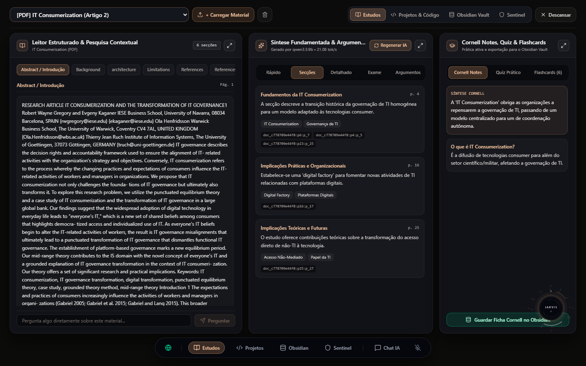
    </td>
    <td width="50%">
      <strong>Projects &amp; Coding Agent 2.0 (<code>Projetos &amp; Código</code>)</strong><br />
      Embedded Monaco code editor, live sandbox preview, and assisted AST diff planning/apply/rollback.<br /><br />
      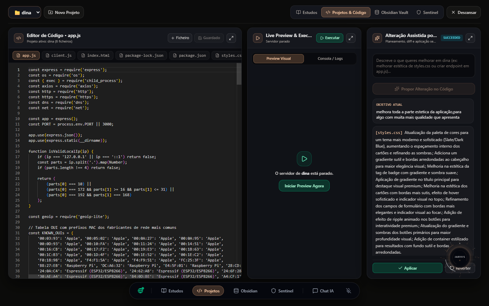
    </td>
  </tr>
  <tr>
    <td width="50%">
      <strong>Obsidian Knowledge Vault (<code>Obsidian Vault</code>)</strong><br />
      261 indexed Markdown notes with YAML provenance, Maps of Content (MOCs), wikilinks &amp; quality audit queue.<br /><br />
      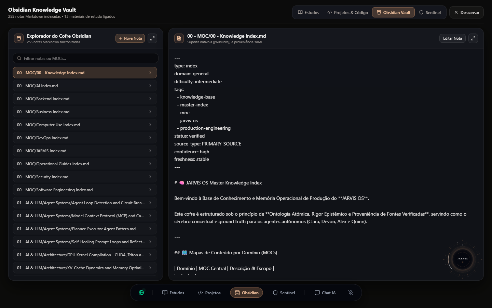
    </td>
    <td width="50%">
      <strong>Security Sentinel (<code>Sentinel</code>)</strong><br />
      Host EDR watchdog telemetry, baseline drift event stream, mandatory human approval queue &amp; rollback controls.<br /><br />
      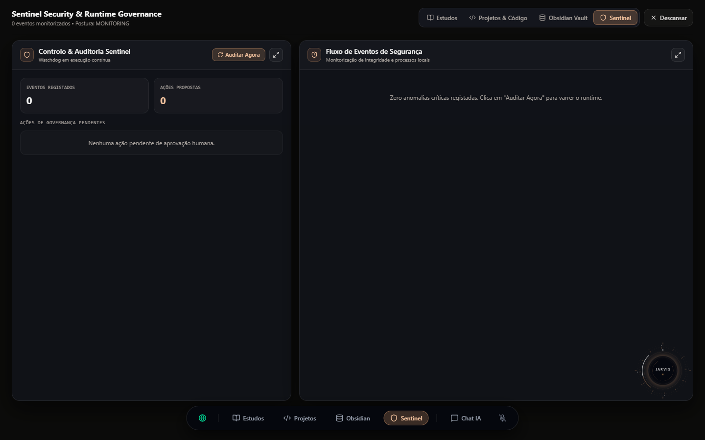
    </td>
  </tr>
</table>

<details>
<summary><strong>Preview: Native HiDPI PDF Reader &amp; Contextual Academic Assistant</strong></summary>
<br />
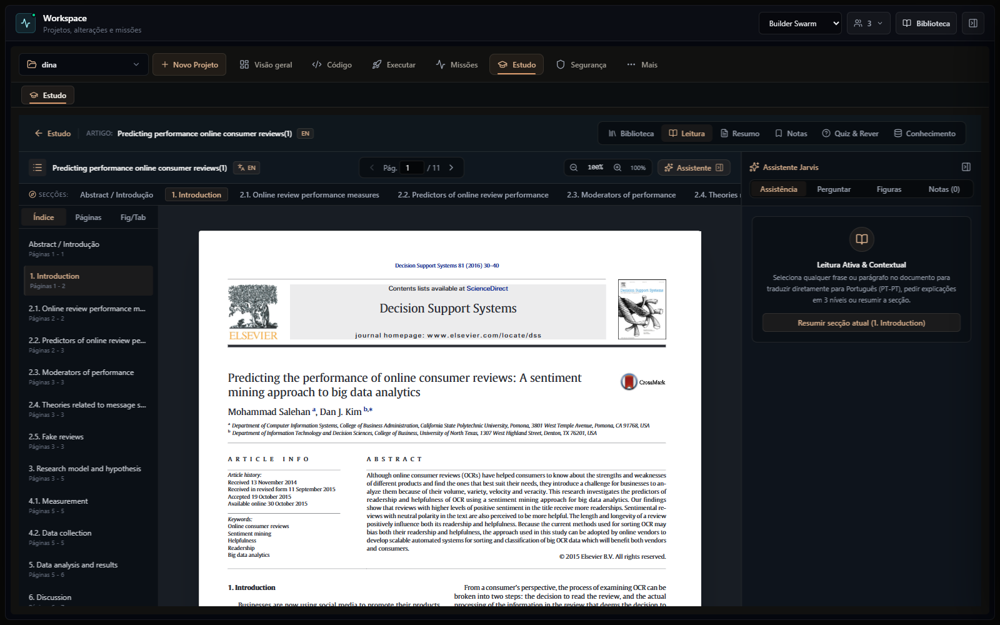
</details>

---

## 🚦 Engineering Status & Maturity Matrix

To maintain factual transparency, all platform subsystems are categorized by current implementation and verification status:

| Subsystem | State | Current Implementation & Verification Scope |
|---|---|---|
| **Spatial Board HUD & Workspace UI** | `IMPLEMENTED & VERIFIED` | Electron 31 + React 19 + TypeScript 6 + Vite 8 HUD, `ChatStudyResultCard` deep links & Playwright E2E verified (`tsc -b`, `vite build`, headless Chromium). |
| **Academic Study Engine (Phases 2–7)** | `IMPLEMENTED & VERIFIED` | Document AST extraction, hierarchical reasoning, editorial planner, PDF/DOCX composer, SM-2/Active Recall modes & JARVIS chat/agent orchestration on local `qwen3.5:9b`. |
| **Multi-Agent Swarm & Chat Bridge** | `IMPLEMENTED & VERIFIED` | `Clara`, `Alex`, `Devon`, `Quinn` personas, WorkPackage DAG scheduling, intent resolver (`STUDY_OPERATION` vs coding/missions) & WS schema parity. |
| **Coding Agent 2.0 Engine** | `VALIDATED IN TRIALS` | `tree-sitter` AST symbol replacement, TypeScript `@/*` alias resolution, failure memory & checkpoint rollback across 4 empirical suites. |
| **Model Harness & Profile Router** | `IMPLEMENTED & VERIFIED` | Multi-provider harness (`Ollama qwen3.5:9b`, OpenRouter Free, Gemini, Claude, OpenAI) with 7-stage schema validation & bounded repair loops. |
| **Security Sentinel (EDR) & HITL** | `VALIDATED IN TRIALS` | Windows host collectors (processes, TCP/UDP sockets, Task Scheduler, FS), baseline drift scoring, HITL permission gateway & one-click rollback. |
| **Obsidian Vault & Epistemic Graph** | `IMPLEMENTED & VERIFIED` | 261 Markdown notes, 0-orphan graph diagnostics, background `qwen3.5:9b` quality/enrichment worker, strict snapshots & rollback. |
| **Real Browser DevTools QA** | `VALIDATED IN TRIALS` | Playwright / CDP visual inspection, DOM tree capture, console error trapping & HTTP/WS trace auditing. |
| **Continuous Self-Improvement (ECC)** | `EXPERIMENTAL` | SQLite compounding rules repository learning constraints from user corrections across sessions. |
| **Multi-Repo Enterprise Autonomy** | `PLANNED` | Cross-repository dependency orchestration & autonomous multi-repo release pipelines ([Roadmap](#-roadmap--next-additions)). |

---

## 🏛️ System Architecture

JARVIS OS decouples interactive desktop interfaces, real-time duplex WebSocket transport, multi-agent orchestration, local study/knowledge services, sandboxed code execution, and host security monitoring:

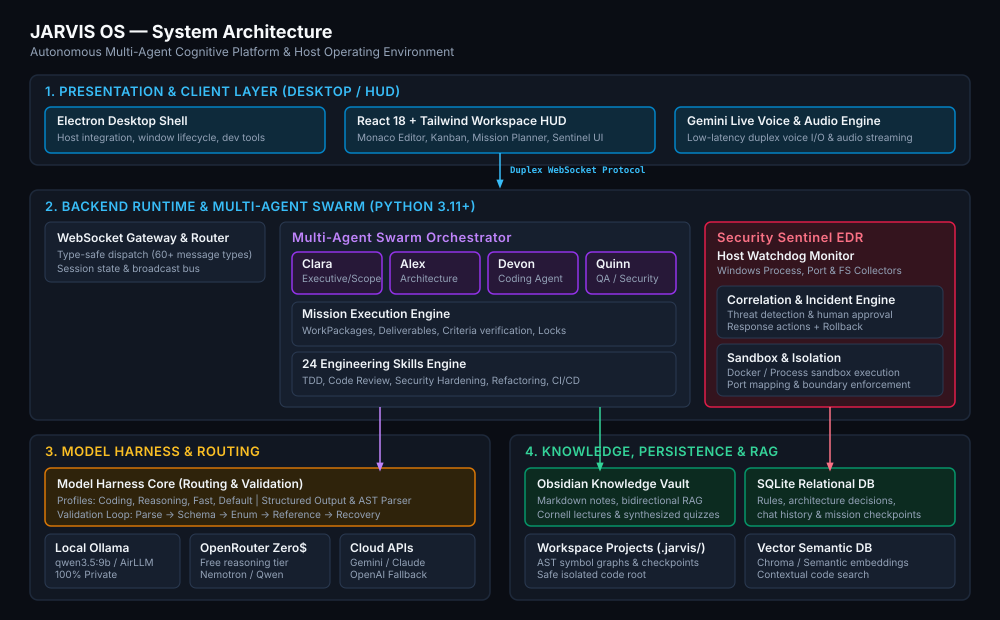

---

## 🎓 Academic Study Engine (Phases 2–7)

Unlike generic wrapper chatbots over PDFs, JARVIS OS implements a **7-Phase Epistemic Study Engine** ([`services/`](./services/)) executed strictly on local **Ollama (`qwen3.5:9b`)**:

```
Source File (PDF / PPTX / DOCX / MD / Audio / Video)
  └──> [Phase 2: Document Intelligence]   ──> AcademicDocumentAST (sections, tables, equations, bounding boxes, page provenance)
  └──> [Phase 3: Academic Reasoning]      ──> AcademicReasoningDossier (hierarchical map-reduce + epistemic tagging)
  └──> [Phase 4: Editorial Intelligence]  ──> EditorialStudyPlan (1:1 validated pedagogical blueprint)
  └──> [Phase 5: Document Generation]     ──> StudyDocumentIR -> Verified PDF / DOCX (zero silent truncation + atomic checkpoints)
  └──> [Phase 6: Adaptive Learning]       ──> SM-2 Flashcards · Cornell Notes · Assessments · Active Recall · Mixed Daily Review
  └──> [Phase 7: JARVIS Integration]      ──> Conversational Orchestration · 12 Scoped Agent Tools · Deep-Linked Chat Cards
```

- **Strict Epistemic Grounding**: Claims are explicitly typed as `SOURCE_FACT`, `MODEL_INFERENCE`, `NOT_FOUND`, or `UNVERIFIED` inside [`services/academic_reasoning_engine.py`](./services/academic_reasoning_engine.py), [`services/study_document_generation/`](./services/study_document_generation/), and [`services/study_integration/explainer.py`](./services/study_integration/explainer.py). Unverified statements cannot be promoted automatically to `SOURCE_FACT`.
- **Adaptive Pedagogy & Mixed Sessions ([`services/study_modes/`](./services/study_modes/))**: Implements SM-2 spaced repetition flashcards, structured Cornell notes, adaptive assessments, source-grounded **Active Recall** evaluation, weak-topic analytics, and mixed typed **Daily Review** sessions (`flashcard` + `active_recall`).
- **Conversational Study Orchestration ([`services/study_integration/`](./services/study_integration/) & [`agents/study_tools.py`](./agents/study_tools.py))**:
  - Multi-turn context persistence per chat session (`StudyContextManager`) with strict cross-document isolation and ambiguous-document clarification (`AMBIGUOUS` / `NOT_FOUND`).
  - Deduplicated background execution with cooperative cancellation (`study_cancel_operation`) and post-restart recovery (`INTERRUPTED` state in `StudyOperationManager`).
  - 12 typed, bounded agent tools (`study_list_documents`, `study_explain_topic`, `study_analyse_document`, `study_generate_study_document`, `study_generate_flashcards`, `study_generate_cornell_notes`, `study_create_assessment`, `study_start_active_recall`, `study_start_daily_review`, `study_get_learning_progress`, `study_resume_session`, `study_get_document_status`).
  - Structured [`ChatStudyResultCard`](./frontend/src/features/chat/ChatStudyResultCard.tsx) cards inside chat displaying epistemic badges, citations, live operation progress, cancellation controls, and one-click deep links into [`StudyContainer`](./frontend/src/features/study/StudyContainer.tsx).
- **Multimodal Reader & Course Collections**: Synchronized folder monitoring ([`services/folder_sync_service.py`](./services/folder_sync_service.py)), cross-document course Q&A with citations, video timestamp synchronization ([`services/video_intelligence_service.py`](./services/video_intelligence_service.py)), and native HiDPI `pdfjs-dist` reading.

---

## 👥 Multi-Agent Swarm & Orchestration

Complex engineering and analytical directives flow through specialized agent personas governed by WorkPackage DAGs, debate consensus, and action validation:

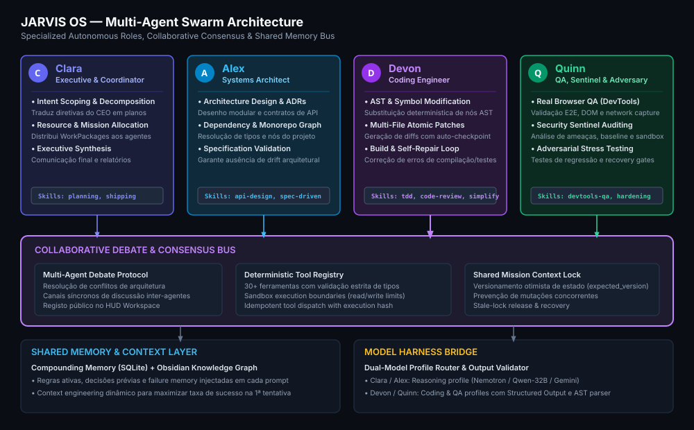

- **Clara (`Executive / Coordinator`)**: Mission scoping, WorkPackage DAG decomposition, and executive synthesis.
- **Alex (`Systems Architect` / `product_manager`)**: System boundaries, API/ADR authoring, and scoped access to `study_*` orchestration tools.
- **Devon (`Coding Engineer`)**: `tree-sitter` AST edits, multi-file atomic patching, and compiler self-repair loops.
- **Quinn (`QA, Sentinel & Adversary`)**: Playwright DevTools verification, Security Sentinel audits, and delivery quality gates.

---

## 💻 Coding Agent 2.0 Pipeline

```
Prompt ──> Specification ──> Artifact Inference ──> Repository Graph
  ──> AST Symbol Graph ──> Coding Session Plan ──> Atomic Patch Engine
  ──> Build Pipeline (tsc / py_compile) ──> Browser DevTools QA ──> Self-Repair Loop
```

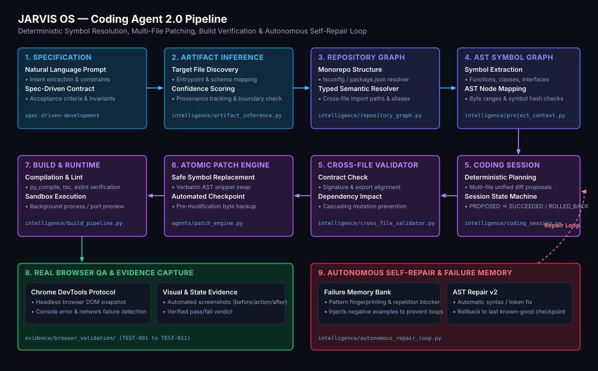

- **AST Symbol Replacement**: Modifies target functions/classes cleanly via `tree-sitter` instead of brittle diff heuristics.
- **Typed Semantic Resolution**: Resolves TypeScript `@/*` aliases and Python imports across workspaces.
- **Snapshot Checkpointing & Rollback**: Captures pre-patch byte state for instant recovery if compilation or QA gates fail.

---

## 🔄 Model Harness & Multi-Provider Routing

```
Request ──> Context Builder ──> Profile Router ──> Provider Execution
  ──> 7-Stage Validation Loop ──> Deterministic Recovery ──> Telemetry Recording
```

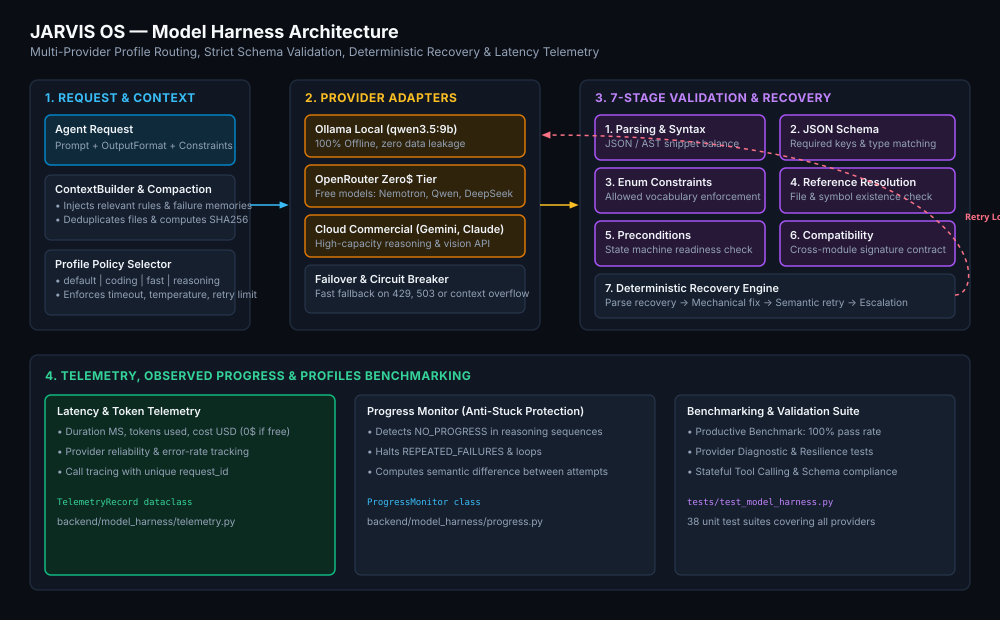

- **Profiles**: `default`, `coding`, `fast`, `reasoning` ([`backend/model_harness/`](./backend/model_harness/)).
- **Providers**: Local **Ollama (`qwen3.5:9b`)** (mandatory for Study & Obsidian workers), plus configurable OpenRouter Free Tier, Google Gemini, Anthropic Claude, and OpenAI for general/coding profiles.
- **7-Stage Schema Validation**: `parsing` &rarr; `schema` &rarr; `enums` &rarr; `references` &rarr; `preconditions` &rarr; `compatibility` &rarr; `acceptance_criteria`.

---

## 🛡️ Security Sentinel EDR & Permission Gateway

```
Windows Host ──> Process/Port/FS Collectors ──> Baseline Drift Analysis
  ──> Temporal Correlation ──> Incident Scoring ──> Human Approval Gate
  ──> Containment Action (Kill/Quarantine) ──> Post-State Verification ──> One-Click Rollback
```

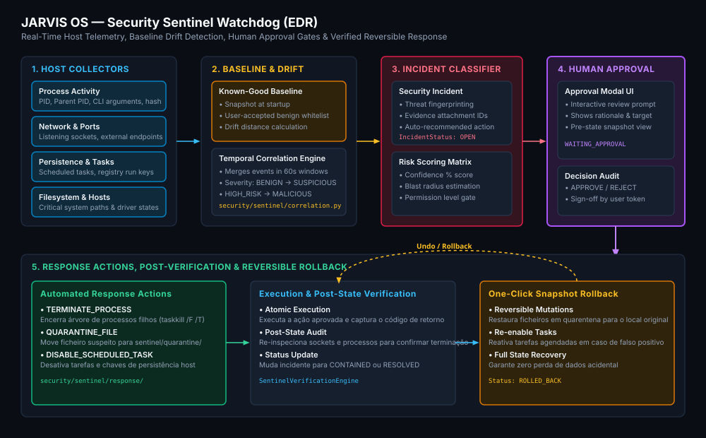

- **Continuous Host Collectors ([`security/`](./security/))**: Observes Windows process trees, listening TCP/UDP ports, scheduled tasks, and filesystem mutations.
- **Just-In-Time Human Approval**: High-risk actions (`TERMINATE_PROCESS`, `QUARANTINE_FILE`, `DISABLE_SCHEDULED_TASK`, and external dependency installations) block on explicit operator consent via UI approval modals.
- **Reversible Containment ([`sentinel/`](./sentinel/))**: Quarantined artifacts and task mutations support one-click restoration.

---

## 📚 Obsidian Knowledge Vault & Epistemic Graph

```
Obsidian Markdown Vault (261 notes) ──> Bi-Directional Wikilink & Epistemic Graph
  ──> Quality Audit & qwen3.5:9b Enrichment Queue ──> Snapshot + Rollback Safety
  ──> SQLite Compounding Rules & Memory ──> Grounded Mission & Study Context
```

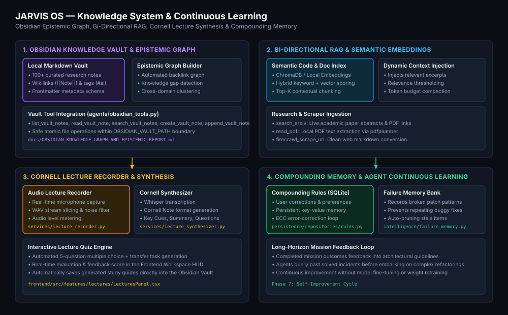

- **Atomic Markdown Vault ([`obsidian_vault/`](./obsidian_vault/))**: 261 structured notes anchored by domain MOCs (`obsidian_vault/00 - MOC/`) with 0-orphan graph reconciliation ([`services/obsidian_graph_engine.py`](./services/obsidian_graph_engine.py)).
- **Autonomous Enrichment Worker**: Local `qwen3.5:9b` audits note quality and proposes structured enrichments backed by strict pre-edit snapshots.

---

## ⚖️ 4-Tier Economic Evidence Taxonomy

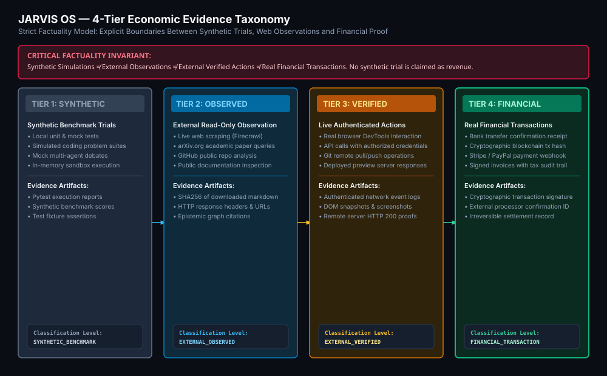

| Tier | Category | Operational Definition | Verification Proof |
|---|---|---|---|
| **Tier 1** | `SYNTHETIC_BENCHMARK` | Simulated coding suites and unit trials | Exit codes & pytest assertion logs |
| **Tier 2** | `EXTERNAL_OBSERVED` | Read-only external data extraction | SHA256 hashes & HTTP metadata |
| **Tier 3** | `EXTERNAL_VERIFIED` | Authenticated API calls & browser traces | Network traces & DevTools DOM captures |
| **Tier 4** | `FINANCIAL_TRANSACTION` | Actual monetary settlement | Cryptographic signatures & receipts |

> [!IMPORTANT]
> **No synthetic benchmark or local simulation is ever reported as real-world financial revenue.**

---

## 🗺️ Roadmap & Next Additions

Active planned milestones for upcoming releases across Study OS, Multi-Agent Engineering, Sentinel EDR, and Desktop Packaging:

### 1. Study Engine — Phase 8+ (Cross-Course Mastery & Knowledge Transfer)
- 🎯 **Study Engine &rarr; Obsidian Bi-Directional Sync**: Export verified `SOURCE_FACT` flashcards, Cornell Notes, and weak-topic diagnostic reports with backlinks directly into `obsidian_vault/00 - MOC/`.
- 🎯 **Citation-to-PDF Bounding-Box Jumping**: Click citations inside chat [`ChatStudyResultCard`](./frontend/src/features/chat/ChatStudyResultCard.tsx) cards to scroll and highlight the exact source bounding box inside the native `pdfjs-dist` reader.
- 🔬 **Multi-Document Syllabus & Exam Roadmaps**: Cross-course prerequisite graphs uniting multiple lectures, papers, and slides into unified adaptive exam schedules.
- 🔬 **Offline Voice-to-Voice Active Recall Loop**: Hands-free local Whisper + local TTS drill mode for conversational oral exam preparation.

### 2. Autonomous Engineering & Model Scheduling
- 🛠️ **Multi-Repository Dependency Swarm (`Self-Driving Enterprise`)**: Coordinated WorkPackage planning, interface contract diffs, and PR readiness verification across multiple local repositories.
- 🔬 **Hardware-Aware Local Model Orchestration**: Dynamic VRAM/context budgeting and tiered local Ollama scheduling across reasoning (`qwen3.5:9b`) and fast coding models.
- 🔬 **GitHub Actions CI Matrix**: Automated non-LLM deterministic quality gates (documentation integrity, Draft-07 schema checks, WebSocket schema contract parity, and Vite production build checks) on every PR.

### 3. Security Sentinel & Isolated Runtimes
- 🔬 **Cross-Platform EDR Collectors**: Abstracted Linux/macOS host process, socket, and filesystem telemetry adapters alongside Windows collectors.
- 🔬 **Containerized Per-Mission Quotas**: Enforced CPU, memory, and network egress caps for sandboxed project runs with cryptographic audit digests.

### 4. Desktop Packaging & Telemetry HUD
- 🛠️ **Standalone Installers & First-Run Wizard**: Electron Builder packages (`.exe`, `.AppImage`, `.dmg`) with automatic Ollama model detection (`qwen3.5:9b`) and environment health diagnostics.
- 🔬 **Spatial Board Flight Recorder**: Visual timeline inspector inside the Spatial Board to replay agent tool calls, checkpoint diffs, and epistemic verification traces.

---

## 📈 Benchmarks & Empirical Reports

| Report Document | Focus Area | Scope |
|---|---|---|
| [`STUDY_GOLDEN_PATH_REPORT.md`](./docs/STUDY_GOLDEN_PATH_REPORT.md) | Study Engine | End-to-end study ingestion, grounding & synthesis forensic validation |
| [`STUDY_PDF_FINAL_FORENSIC_REPORT.md`](./docs/STUDY_PDF_FINAL_FORENSIC_REPORT.md) | Study PDF Composer | HiDPI PDF rendering, text layer & composition audit |
| [`VIDEO_STUDY_EXPERIENCE_REPORT.md`](./docs/VIDEO_STUDY_EXPERIENCE_REPORT.md) | Multimodal Study | Video lecture ingestion & reading experience verification |
| [`OBSIDIAN_KNOWLEDGE_GRAPH_AND_EPISTEMIC_REPORT.md`](./docs/OBSIDIAN_KNOWLEDGE_GRAPH_AND_EPISTEMIC_REPORT.md) | Knowledge Graph | Bi-directional wikilink topology & epistemic graph verification |
| [`JARVIS_CODING_AGENT_2_REPORT.md`](./docs/JARVIS_CODING_AGENT_2_REPORT.md) | Coding Agent 2.0 | AST symbol parser & deterministic patch benchmark suite |
| [`JARVIS_CODING_AGENT_2_4_TYPED_SEMANTICS_REPORT.md`](./docs/JARVIS_CODING_AGENT_2_4_TYPED_SEMANTICS_REPORT.md) | Typed Semantics | Cross-file TypeScript `@/*` alias & import graph resolution |
| [`SENTINEL_S5_DETECTION_QUALITY_REPORT.md`](./docs/SENTINEL_S5_DETECTION_QUALITY_REPORT.md) | Sentinel Detection | EDR incident scoring and anomalous host spawn detection |
| [`JARVIS_REALTIME_BROWSER_VALIDATION_REPORT.md`](./docs/JARVIS_REALTIME_BROWSER_VALIDATION_REPORT.md) | Autonomous QA | Chrome DevTools DOM, console & network verification |
| [`JARVIS_PHASE7_SELF_IMPROVEMENT_REPORT.md`](./docs/JARVIS_PHASE7_SELF_IMPROVEMENT_REPORT.md) | Self-Improvement | Error-correction compounding memory loops |
| [`JARVIS_PHASE10_REAL_WORLD_VALUE_REPORT.md`](./docs/JARVIS_PHASE10_REAL_WORLD_VALUE_REPORT.md) | Value Validation | Controlled execution across empirical value tasks |

---

## 📁 Repository Structure

```
ai-company-orchestrator/
├── agents/                        # Swarm personas (Clara, Alex, Devon, Quinn), orchestrator & study tools
├── backend/                       # FastAPI/WS runtime, Model Harness, ChatMissionBridge, permission gateway
├── config/                        # Runtime settings & model configuration
├── diagnostics/                   # Environment health and telemetry scripts
├── docs/                          # Architectural specs, ADRs (decisions/), 10 SVG diagrams & forensic reports
├── evidence/                      # Tracked QA screenshots & trace artifacts (spatial_board/, study/, sentinel/)
├── frontend/                      # React 19 + TypeScript 6 + Vite 8 + Tailwind 4 + Monaco + PDF.js HUD
│   └── src/features/
│       ├── board/                 # SpatialBoard 4-domain interactive canvas
│       ├── chat/                  # ChatPanel + ChatStudyResultCard structured cards
│       ├── study/                 # Unified StudyContainer (Library, Reader, Cornell, Flashcards, Recall, Hub)
│       └── workspace/             # HologramCore & WorkspaceViewer
├── intelligence/                  # Coding Agent 2.0 (AST graph, semantic resolver, autonomous self-repair loop)
├── obsidian_vault/                # 261 atomic Markdown notes & Maps of Content (00 - MOC/)
├── persistence/                   # SQLite repositories & checkpoint stores
├── schemas/                       # 11 canonical Draft-07 JSON Schemas
├── security/                      # Security Sentinel EDR collectors & runtime safety classifier
├── sentinel/                      # Sentinel quarantine store & response audit history
├── services/                      # Domain engines
│   ├── study_document_generation/ # Phase 5 academic layout, PDF pagination & QA engine
│   ├── study_modes/               # Phase 6 SM-2 flashcards, Cornell, quizzes, active recall & sessions
│   ├── study_integration/         # Phase 7 coordinator, context manager, async op manager & router
│   └── *.py                       # Document Intelligence, Reasoning, Editorial, Folder Sync, Obsidian Graph
├── tests/                         # 356 pytest test modules (3,341 collected tests)
└── workspace/                     # Isolated sandbox projects
```

---

## 🚀 Getting Started

### 1. Prerequisites
- **OS**: Windows 10/11 recommended for full Windows Security Sentinel collectors (core Study Engine & backend also run cross-platform on Python 3.11+).
- **Python**: 3.11+
- **Node.js**: v20+ with `npm`
- **Ollama**: Required for offline Study Engine (`qwen3.5:9b`) and local Obsidian quality workers.

```powershell
# Pull the default local reasoning/study model
ollama pull qwen3.5:9b
ollama serve
```

### 2. Backend & Playwright Setup
```powershell
python -m venv venv
.\venv\Scripts\python.exe -m pip install --upgrade pip
.\venv\Scripts\python.exe -m pip install -r requirements.txt
.\venv\Scripts\python.exe -m playwright install chromium

Copy-Item .env.example .env
```

### 3. Frontend & Electron Desktop HUD Setup
```powershell
npm install
npm install --prefix frontend
```

### 4. Running JARVIS OS
```powershell
# Launch full Desktop Application (Electron 31 HUD + Vite Dev + Python Backend)
npm start

# Or launch Vite Dev + Electron in concurrent dev mode
npm run dev

# Or run the standalone Python WebSocket/API backend server
.\venv\Scripts\python.exe server.py
```

---

## 🧪 Testing & Verification

Run targeted domain suites or documentation checks anytime:

```powershell
# Study Engine Phases 2–7 full verification suite
.\venv\Scripts\python.exe -m pytest `
  tests/test_document_intelligence_phase2.py `
  tests/test_academic_reasoning_phase3.py `
  tests/test_editorial_intelligence_phase4.py `
  tests/test_document_generation_phase5.py `
  tests/test_study_modes_phase6.py `
  tests/test_study_jarvis_integration_phase7.py -v

# Documentation, SVG blueprints, ADRs & relative link integrity
.\venv\Scripts\python.exe -m pytest tests/test_documentation_integrity.py -v

# Core WebSocket contracts, chat routing & safety classifiers
.\venv\Scripts\python.exe -m pytest `
  tests/test_chat_mission_bridge.py `
  tests/test_websocket_dispatcher_contract.py `
  tests/test_safety_classifier_regression.py `
  tests/test_runtime_security.py -q

# Security Sentinel EDR & Coding Agent 2.0
.\venv\Scripts\python.exe -m pytest tests/test_sentinel.py tests/test_coding_agent_2_benchmark.py -q

# Frontend TypeScript check & production bundle (Vite 8)
npm run build --prefix frontend

# Complete pytest suite discovery / execution (356 modules / 3,341 collected tests)
.\venv\Scripts\python.exe -m pytest tests/ -q
```

---

## 🔒 Security

For vulnerability disclosures, Sentinel EDR architecture details, and sandbox trust boundaries, consult [`SECURITY.md`](./SECURITY.md).

---

## 📜 License

Developed as an independent research and engineering platform on **Autonomous Multi-Agent Cognitive Systems, Epistemic Study Tooling & Deterministic Software Engineering**. Distributed under the **MIT License**. Engineering skills inspired by [Addy Osmani (`agent-skills`)](https://github.com/addyosmani/agent-skills).
