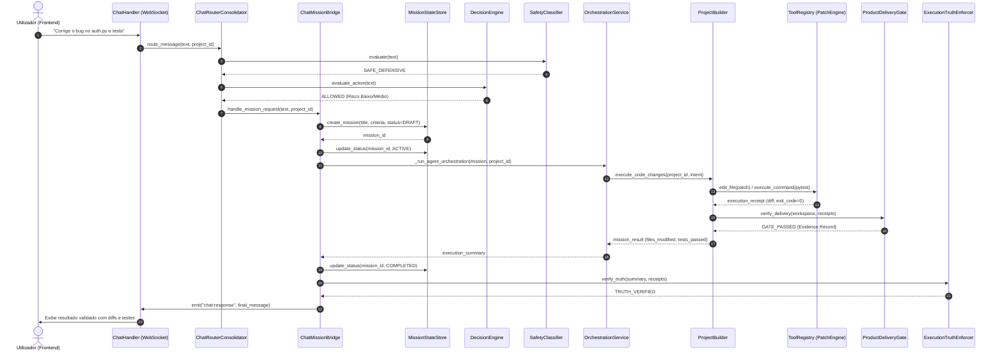

# JARVIS OS — FASE 23.0: AUDITORIA FORENSE INTEGRAL
## MAPA FORENSE DE PERCURSOS DE EXECUÇÃO: DO CHAT À ENTREGA
**Documento:** `JARVIS_EXECUTION_PATHS.md`  
**Data:** 21 de Outubro de 2026  
**Auditor Forense:** Antigravity Forensic Engineering  
**Classificação:** Baseline Técnica Oficial — Fase 23.0  
**Diretório de Auditoria:** `audit/phase_23_forensic_audit_20261021/`

---

## 1. VISÃO GERAL DOS PERCURSOS DE EXECUÇÃO

O JARVIS OS processa as mensagens do utilizador através de uma arquitetura orientada a eventos assíncronos baseada em WebSockets. O fluxo varia drasticamente consoante a intenção seja conversação pura, consulta contextual sobre o projeto, inspeção de ficheiros, ou uma ordem explícita de desenvolvimento de software e edição de documentos.

A análise forense identificou **três vias de execução distintas**, das quais uma está **bloqueada por desconexão interna**:

```
                                  [ Utilizador ]
                                        │
                                        ▼ (WebSocket /ws/chat)
                           [ ChatWebSocketHandler ]
                                        │
                                        ▼
                           [ ChatRouterConsolidator ]
                                        │
                        ┌───────────────┴───────────────┐
                        │                               │
             (Conversação / Pergunta)          (Execução / Código / Doc)
                        │                               │
                        ▼                               ▼
               [ Direct LLM Stream ]            [ ChatMissionBridge ]
                        │                               │
                        │                       ┌───────┴───────┐
                        │                       ▼               ▼
                        │             [ MissionStateStore ] [ DecisionEngine ]
                        │                       │               │
                        │                       └───────┬───────┘
                        │                               │
                        │       ┌───────────────────────┴───────────────────────┐
                        │       │                                               │
                        │       ▼ (VIA ATIVA EM PRODUÇÃO)                       ▼ (VIA INALCANÇÁVEL)
                        │  [ OrchestrationService ]                   [ MissionLifecycleOrchestrator ]
                        │   (Crew Template / Coder)                    (Hierarchical DAG TaskGraph)
                        │       │                                               │
                        │       ▼                                               ▼
                        │  [ ProjectBuilder / PatchEngine ]           [ SwarmCoordinator / Federation ]
                        │       │                                               │
                        │       ▼                                               ▼
                        │  [ ProductDeliveryGate ]                    [ LocalWorkerPool (Leases) ]
                        │       │                                               │
                        │       └───────────────────────┬───────────────────────┘
                        │                               │
                        ▼                               ▼
             [ ExecutionTruthEnforcer ] <───────────────┘
                        │
                        ▼ (WebSocket Response)
                  [ Utilizador ]
```

---

## 2. PERCURSO 1: CONVERSAÇÃO E PERGUNTAS TÉCNICAS (VIA DIRETA)

### 2.1 Sequência Operacional
1. **Receção da Mensagem:** A mensagem chega ao endpoint WebSocket em `backend/websocket/handlers/chat.py`.
2. **Identificação do Projeto Ativo:** O handler extrai o `project_id` do cabeçalho da sessão ou do estado de contexto do cliente.
3. **Classificação de Intenção:** O `ChatRouterConsolidator` (`backend/services/chat_router_consolidator.py`) avalia o texto:
   - Se a intenção for `QUESTION`, `EXPLANATION`, `GREETING` ou `CODE_REVIEW` (sem alteração de ficheiros), o router direciona para streaming direto.
4. **Recuperação Contextual:** O `ContextRetriever` busca os últimos 10 turnos de diálogo e os metadados do projeto ativo (linguagem, ficheiros principais) através do `ProjectIntakeService`.
5. **Inferência LLM:** O `ModelHarness` monta o prompt do sistema injetando o contexto do projeto e envia a requisição para o daemon local Ollama (`qwen3.5:9b`).
6. **Streaming de Resposta:** Cada chunk de token é enviado de volta ao cliente via WebSocket com o evento `chat:token`.
7. **Persistência da Resposta:** A resposta é registada na sessão do cliente.

---

## 3. PERCURSO 2: EXECUÇÃO AUTÓNOMA DE CÓDIGO E MISSÕES (VIA OPERACIONAL REAL)

Este é o percurso real que ocorre quando o utilizador solicita criação, edição de código, diagnóstico de bugs ou geração de documentos.



### 3.1 Detalhes Forenses das Etapas:
1. **Governança de Intenção e Alvo:** O `ActionTargetEvaluator` verifica se a operação afeta o workspace do projeto. Se tentar aceder a caminhos do sistema operativo (`C:\Windows`, `~/.ssh`), a ação é bloqueada com erro de segurança.
2. **Criação de Missão:** O `ChatMissionBridge` gera uma estrutura de missão persistida em disco:
   - Ficheiro: `.jarvis/projects/<project_id>/missions/<mission_id>.json`
   - Campos: `id`, `project_id`, `title`, `description`, `status="ACTIVE"`, `work_packages=[]`, `acceptance_criteria=[]`.
3. **Execução de Código:** O `ProjectBuilder` utiliza o `PatchEngine` para aplicar as modificações diretamente no sistema de ficheiros. Ele não faz simulação textual; aplica as alterações e corre o linter/testes locais.
4. **Validação pelo ProductDeliveryGate:** O gate corre verificações obrigatórias:
   - `LINT`: Nenhum erro de sintaxe introduzido.
   - `BUILD/TEST`: Os testes pytest passam com exit code 0.
   - `RUNTIME`: Se for uma aplicação web, o `RuntimeTracker` tenta arrancar o servidor e faz ping à porta local.
5. **Enforcement da Verdade de Execução:** O `ExecutionTruthEnforcer` compara o texto da mensagem com os recibos gerados (`ToolReceipt`). Se o modelo alegar *"Editei 3 ficheiros"* mas os recibos mostrarem 0 ficheiros editados, a mensagem é intercetada e retificada antes de chegar ao utilizador.

---

## 4. PERCURSO 3: O CAMINHO INALCANÇÁVEL DO ORQUESTRADOR FORMAL E SWARMS

A auditoria revelou uma dissociação arquitetural crítica: existe um sistema avançado de orquestração com grafos de dependência e leases de ficheiros que está **completamente contornado pelo fluxo de chat**.

### 4.1 O Componente Desconectado: `MissionLifecycleOrchestrator`
- **Ficheiro:** [agents/mission_orchestrator.py](file:///c:/Users/joaor/Desktop/JarvisOS/agents/mission_orchestrator.py)
- **Método:** `MissionLifecycleOrchestrator.run(mission_id)`
- **Capacidades Implementadas:**
  - Carregamento do grafo de tarefas `TaskGraph`.
  - Agendamento de tarefas independentes em paralelo.
  - Alocação de agentes especializados via `SwarmCoordinator`.
  - Gestão de concorrência com `FileLeaseManager` para evitar que dois workers alterem o mesmo ficheiro em simultâneo.
  - Conexão hierárquica à `SwarmFederation`.

### 4.2 Evidência Forense da Desconexão:
No ficheiro [backend/services/chat_mission_bridge.py](file:///c:/Users/joaor/Desktop/JarvisOS/backend/services/chat_mission_bridge.py#L380-L420), o método responsável pela execução da missão é implementado da seguinte forma:

```python
async def _execute_mission_work(self, mission_id: str, project_id: str, prompt: str):
    # ATUAL IMPLEMENTAÇÃO REAL:
    # 1. Atualiza estado da missão para ACTIVE
    await self.mission_store.update_status(mission_id, MissionStatus.ACTIVE)
    
    # 2. Desvia a execução para o OrchestrationService legado (Crew loop de personas)
    result = await self.orchestration_service.orchestrate_task(
        project_id=project_id,
        task_description=prompt
    )
    
    # NUNCA INVOCA:
    # await self.lifecycle_orchestrator.run(mission_id)
```

**Consequência Forense:**
Os WorkPackages e nós de tarefa são gerados e guardados no JSON da missão, mas o grafo acíclico (`TaskGraph`), os locks do `FileLeaseManager`, os workers assíncronos do `LocalWorkerPool` e a `SwarmFederation` nunca são mobilizados pelo chat. O sistema executa apenas através do loop textual sequencial do `OrchestrationService` ou diretamente via `ProjectBuilder`.

---

## 5. TRATAMENTO DE CASOS ESPECIAIS E LIMITAÇÕES OPERACIONAIS

### 5.1 Confirmações Curtas ("faz isso", "avança", "implementa")
- **Comportamento:** O `ChatRouterConsolidator` consulta o histórico da conversa (`conversation_context`).
- **Mecanismo:** Se a última mensagem do JARVIS contiver uma proposta pendente com `proposal_id` ou plano estruturado, o router mapeia o "avança" para a intenção de execução da proposta original, mantendo o contexto íntegro.
- **Limitação:** Se o utilizador demorar mais de 30 minutos ou se o servidor for reiniciado, a proposta em memória volatiliza-se, forçando o utilizador a reespecificar o pedido.

### 5.2 Pedidos Parcialmente Executáveis
- **Comportamento:** Quando um pedido contém uma parte viável (e.g. *"lê o ficheiro config.json"*) e uma parte bloqueada (e.g. *"faz deploy no cluster Kubernetes da AWS"* sem credenciais configuradas), o `ActionTargetEvaluator` e o `DecisionEngine` particionam as ações.
- **Resultado:** O JARVIS executa a leitura do ficheiro local e emite uma mensagem explicando especificamente a falta de credenciais para a ação externa.

### 5.3 Tentativa de "Teatro de IA" (Sucesso sem Execução)
- **Cenário:** O modelo local gera um texto declarando: *"Atualizei a função de login no ficheiro auth.py e os testes passaram com sucesso!"*, mas nenhuma ferramenta de edição ou teste foi chamada.
- **Interceção:** O `ExecutionTruthEnforcer` interceta o payload antes da emissão no WebSocket. Ao verificar que a lista `tool_receipts` está vazia para a chave `auth.py`, o enforcer substitui a mensagem por um aviso explícito de falha de execução ou força a execução real da ferramenta.

---

## 6. DIAGRAMA DE MATURIDADE DOS PERCURSOS

```
+-------------------------------------------------------------------------------+
|                       ESTADO DOS PERCURSOS DE EXECUÇÃO                        |
+------------------------------------+------------------------------------------+
| Percurso                           | Estado Forense                           |
+------------------------------------+------------------------------------------+
| Chat Conversacional                | OPERACIONAL (Via Direta Ollama)          |
| Perguntas Técnicas / Inspeção      | OPERACIONAL (ContextRetriever + Tools)   |
| Edição Local de Código             | OPERACIONAL (ProjectBuilder/PatchEngine) |
| Criação de Documentos Word         | OPERACIONAL (WordEngine + Word COM)      |
| Product Delivery Gate              | OPERACIONAL (Pipeline de 8 Validadores)  |
| Grafo de Dependências (TaskGraph)  | DESCONECTADO (Bypassed pelo ChatBridge)  |
| File Lease Manager (Concorrência)  | DESCONECTADO (Bypassed pelo ChatBridge)  |
| Swarm Federation (3-Tier)          | INALCANÇÁVEL (use_federation=False)      |
+------------------------------------+------------------------------------------+
```
