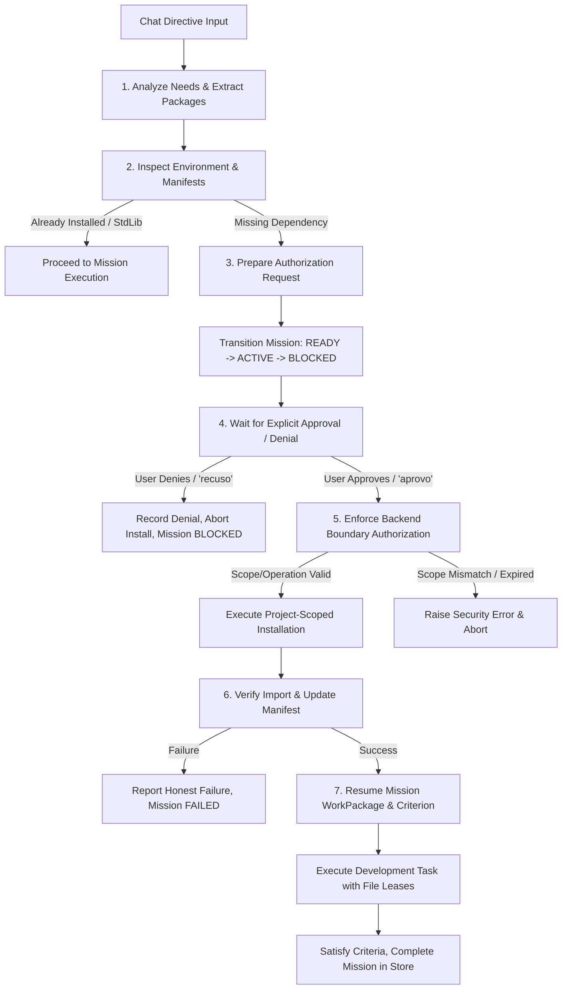

# JARVIS OS — AUTHORIZATION AND DEPENDENCY FLOW
**Phase 24 Technical Architecture Document**  
**Date:** 2026-10-21  
**Status:** IMPLEMENTED AND VERIFIED  

---

## 1. OVERVIEW

A recurring failure mode in autonomous developer agents is either:
1. **Overblocking/Refusal:** Failing to complete an assisted-development task because an uninstalled package is needed; or
2. **Uncontrolled Modification:** Silently installing packages globally, running unapproved package managers, or elevating privileges without human oversight.

Phase 24 implements the **7-Step Dependency Authorization Lifecycle**, establishing a strict boundary between planning, approval, and side-effect execution.

---

## 2. THE 7-STEP DEPENDENCY AUTHORIZATION LIFECYCLE

### Step 1: Analyze
- **Mechanism:** `ProjectDependencyManager.extract_requested_packages(prompt)`.
- **Logic:** Parses natural language directives for package installation intentions (`adiciona o pacote X`, `npm install Y`, `com a biblioteca Z`).
- **Precision:** Skips common coding terminology (`docstring`, `função`, `script`, `endpoint`, `interface`) and standard library modules (`sqlite3`, `json`, `os`, `pathlib`, `math`, `asyncio`).
- **Output:** Exact candidate package names.

### Step 2: Inspect
- **Mechanism:** `ProjectDependencyManager.inspect_environment(project_root)`.
- **Environment Detection:**
  - Identifies project language (`python`, `javascript`, `typescript`).
  - Detects package manager (`pip`, `npm`).
  - Locates manifest files (`requirements.txt`, `pyproject.toml`, `package.json`).
  - Checks for virtual environments (`.venv`, `venv`, `env`) inside the project or within workspace roots.
- **Verification:** Runs isolated import probes (`[python, -c, "import pkg"]` or `node_modules` existence checks) against the identified project runtime rather than the host system Python.

### Step 3: Prepare an Authorization Request
- **Mechanism:** `ProjectDependencyManager.prepare_authorization_request(...)`.
- **Transparency Invariant:** Before requesting permission, JARVIS generates a structured explanation containing:
  - Exact package name and version constraint.
  - Concrete reason why it is needed for the requested feature.
  - Target project and workspace path.
  - Execution environment path (e.g., project virtualenv).
  - Package manager and command to be run (`pip install pandas`).
  - Manifest file that will be updated (`requirements.txt`).
  - Security implications (project-scoped, unprivileged userland execution).
- **Gateway Registration:** Request is created in `PermissionGatewayService` with a 300-second TTL and status `WAITING_FOR_USER`.

### Step 4: Wait for Explicit Approval
- **Mechanism:** Mission is placed in state `BLOCKED` in `MissionStateStore`.
- **Enforcement:**
  - No installation command is executed.
  - Silence, ambiguous text, or generic instructions are NOT treated as approval.
  - User can approve via conversational text (`"aprovo"`, `"autorizo"`, `"sim"`) or programmatic API (`handle_dependency_decision(req_id, "approve")`).
  - If user denies (`"recuso"`, `"não"`), the authorization request is marked `DENIED`, the mission remains `BLOCKED`, and the user is honestly informed of the consequence without any environment side effects.

### Step 5: Execute Only the Approved Operation
- **Mechanism:** `ProjectDependencyManager.execute_authorized_installation(...)`.
- **Backend Boundary Enforcement:**
  - Re-verifies approval status in `PermissionGatewayService`.
  - Verifies TTL has not expired.
  - **Scope Isolation:** Rejects cross-project approval reuse (`CrossProjectApprovalError`). An approval for `project-alpha` cannot be executed in `project-beta`.
  - **Operation Isolation:** Rejects privilege or operation escalation (`PermissionBlockedByPolicyError`). An approval for `install_package:pandas` cannot be converted to `SHELL_EXEC` or arbitrary process execution.
- **Execution Target:** The installation command is executed with `cwd=project_root` pointing directly to the project's virtualenv Python executable (`venv/Scripts/python.exe`). Global system environments are never mutated.

### Step 6: Verify
- **Mechanism:** Post-install verification and manifest synchronization.
- **Verification Invariant:**
  - Inspects process exit code (`exit_code == 0`).
  - Verifies that the package is physically importable in the target environment.
  - Appends the package specification to `requirements.txt` or `package.json`.
  - If installation fails (e.g. wheel compilation error, invalid package index, network timeout), JARVIS reports the failure honestly (`status: FAILED`), records the exact stderr output, and does NOT claim the package is available.

### Step 7: Resume the Original Task
- **Mechanism:** Automatic mission resumption in `ChatMissionBridge`.
- **State Transition:**
  - Transitions mission from `BLOCKED` back to `ACTIVE`.
  - Work package is placed in `IN_PROGRESS`.
  - Execution proceeds to `_execute_mission_work` protected by atomic `FileLeaseManager` file locks.
  - On successful completion, execution evidence is attached, acceptance criteria are marked `SATISFIED`, the work package is marked `COMPLETED`, and the mission transitions to `COMPLETED`.

---

## 3. SECURITY BOUNDARIES & GUARANTEES

| Security Risk | Prevention Mechanism in Phase 24 |
| :--- | :--- |
| **Silent Global Pollution** | Installation executes exclusively via project virtual environment binaries (`project/.venv/Scripts/python.exe`). Global root execution is prohibited. |
| **Cross-Project Approval Reuse** | `enforce_backend_authorization` checks `req.project_id == target_project`. Reuses raise `CrossProjectApprovalError`. |
| **Operation Escalation** | `enforce_backend_authorization` checks `req.requested_operation == target_operation`. Reuses raise `PermissionBlockedByPolicyError`. |
| **Replay / Stale Approvals** | Time-To-Live (300 seconds default) enforced at backend boundary immediately before subprocess invocation. |
| **Client/UI Bypass** | Checks occur in the Python backend service, independent of WebSocket or frontend button state. |
| **False Completion Claims** | `ExecutionTruthEnforcer` and post-install import probes enforce that only verified, exit-code-0 installations update mission state. |
