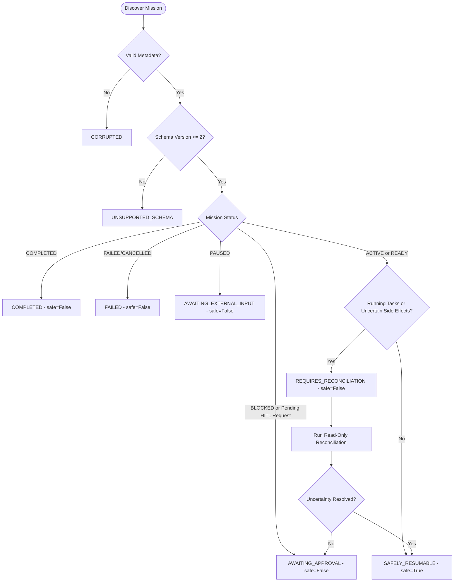

# JARVIS OS — CHECKPOINT AND RECOVERY DESIGN
**Phase 25: Durable Mission State, Checkpoint Recovery & Persistence Reliability**  
**Document ID:** CRD-P25-001  
**Author:** DeepMind Antigravity (Advanced Agentic Coding)  

---

## 1. Architectural Overview

The Phase 25 Durable Checkpoint and Recovery Architecture provides crash resiliency, deterministic state reconstruction, and idempotent post-mortem reconciliation for all long-running JARVIS missions.

```
+---------------------------------------------------------------------------------+
|                                 JARVIS OS RUNTIME                               |
+---------------------------------------------------------------------------------+
                                      |
                       (Application Restart / Crash)
                                      |
                                      v
+---------------------------------------------------------------------------------+
|                            MISSION RECOVERY ENGINE                              |
|   1. Discovery of all project missions in metadata root                         |
|   2. Single-Recovery Ownership Lock (.recovery.lock with PID liveness check)   |
|   3. Forensic Assessment & Classification (SAFELY_RESUMABLE, AWAITING_APPROVAL) |
|   4. Read-Only Side-Effect Reconciliation (Venv Inspection, Lease Re-acquire)   |
|   5. Evidence Audit (Demote fraudulent criteria lacking evidence to PENDING)    |
|   6. Monotonic Checkpoint Commit (Sequence N+1 with audit event trail)          |
+---------------------------------------------------------------------------------+
          |                                                   |
          v                                                   v
+-------------------------------+                   +-------------------------------+
|  PERSISTENCE BACKEND          |                   |  SECURITY & AUTHORIZATION     |
|  - Hybrid (SQLite + JSON)     |                   |  - PermissionGatewayService   |
|  - Sharded Filesystem JSON    |                   |  - ProjectDependencyManager   |
|  - SHA-256 Checksum Validator |                   |  - FileLeaseManager           |
+-------------------------------+                   +-------------------------------+
```

---

## 2. Checkpoint Data Structure & Schema Evolution

### 2.1 Schema Version 2 Contract (`Checkpoint`)

```python
@dataclass
class Checkpoint:
    checkpoint_id: str                          # Unique identifier (e.g., cp_0001_a9f82d)
    sequence: int                               # Strictly monotonic sequence number (1, 2, 3...)
    mission_id: str                             # Target mission identifier
    project_id: str                             # Scoped project identifier
    mission_status: str                         # Canonical status (READY, ACTIVE, BLOCKED, etc.)
    current_stage: str = "UNDERSTANDING"        # Pipeline stage (PLANNING, EXECUTING, VERIFYING)
    project_path: str = ""                      # Path to project directory
    task_graph_data: dict[str, Any]             # Serialized DAG nodes, edges, dependencies
    completed_task_ids: list[str]               # Work packages confirmed COMPLETED
    pending_task_ids: list[str]                 # Work packages awaiting execution
    running_task_ids: list[str]                 # Tasks actively running when checkpoint was saved
    failed_task_ids: list[str]                  # Tasks failed or in dead-letter queue
    blocked_task_ids: list[str]                 # Tasks blocked on dependencies or permissions
    evidence_refs: list[str]                    # Identifiers of verified attached evidence records
    approval_requests: list[dict[str, Any]]     # Active HITL permission requests bound to mission
    outputs: dict[str, Any]                     # Intermediate execution artifacts / outputs
    created_at: str                             # UTC ISO-8601 timestamp
    schema_version: int = 2                     # Active schema specification version
    checksum: str = ""                          # Hex-encoded SHA-256 checksum of payload
```

### 2.2 Schema Evolution & Backward Compatibility

- **Schema v1 Support:** Checkpoints generated under Phase 24 or legacy systems lack `approval_requests`, `work_packages`, and cryptographic checksums. The loader automatically populates defaults (`approval_requests = []`, `work_packages = []`, `schema_version = 1`) without crashing.
- **Unsupported Version Quarantine (v99+):** When a checkpoint has `schema_version > 2`, the engine classifies the mission as `RecoveryClassification.UNSUPPORTED_SCHEMA`, marks `safe_to_resume = False`, and halts automatic recovery to protect future schema formats from being clobbered by older binaries.

---

## 3. Checkpoint Integrity & Defensive File Operations

### 3.1 Cryptographic Integrity (SHA-256 Checksums)

Every checkpoint dictionary includes a computed checksum of its canonical JSON representation (excluding the checksum field itself):

$$\text{Checksum} = \text{SHA-256}\left(\text{canonical\_json}(\text{checkpoint}\setminus\{\text{"checksum"}\})\right)$$

When `Checkpoint.from_dict(d, verify_checksum=True)` is called, any modification, bitrot, or truncation raises a `ValueError("Checkpoint checksum mismatch")`, protecting against silent corruption.

### 3.2 Atomic Replacement Mechanism

Checkpoints and mission entities are **never** written directly to their target paths. Writes follow an atomic two-phase write pattern:
1. Data is serialized into a hidden sibling temporary file:
   `.checkpoint_0001.json.tmp.<uuid>`
2. The file descriptor is explicitly flushed and synced to disk:
   `handle.flush()` followed by `os.fsync(handle.fileno())`
3. The temporary file replaces the target via POSIX atomic rename / Windows atomic replacement:
   `os.replace(temporary, target_path)`
4. A `finally` block ensures any dangling temporary files are unlinked if an unhandled error occurs.

### 3.3 Checkpoint Corruption Self-Healing

If the application crashes during OS-level file allocation, causing a file to contain truncated or malformed JSON:
1. `load_checkpoint` catches `json.JSONDecodeError` or `OSError`.
2. The malformed file is immediately quarantined by renaming it to:
   `checkpoint_0002.json.corrupt.<timestamp>`
3. The engine logs the quarantine event and automatically rolls back to the previous valid sequence (`checkpoint_0001.json`), preventing poison-pill restart loops.

---

## 4. Single-Recovery Ownership Lock

To eliminate race conditions between multiple background workers, CLI commands, or restarted daemon processes, the engine implements strict single-ownership recovery locks:

### 4.1 Lock Protocol (`.recovery.lock`)
1. Before performing any assessment or mutation, the engine attempts to acquire `.recovery.lock` inside the mission's directory.
2. The lock file contains:
   ```json
   {
     "recovery_id": "rec_09f1a8c3d2",
     "pid": 28412,
     "project_id": "my_project",
     "mission_id": "miss_001",
     "acquired_at": "2026-10-22T20:30:00Z"
   }
   ```
3. If an existing lock exists:
   - The engine checks process liveness of `owner_pid`.
   - On Windows, it handles elevated and system processes (such as Windows System PID 4) by verifying `OpenProcess` return values and checking `GetLastError() == 5` (`ERROR_ACCESS_DENIED`), correctly recognizing alive processes.
   - If the process is dead (stale lock from previous hard kill), the lock is automatically reclaimed.
   - If the process is alive and distinct, it raises `RecoveryLockError`, barring concurrent execution.

---

## 5. Startup Recovery Classification Engine

Upon application startup, the engine scans all projects and classifies missions into discrete states:



---

## 6. Idempotent Reconciliation Pipeline

The reconciliation procedure is strictly read-only and idempotent:

1. **Project Directory Integrity:** Validates that `project_path` exists on disk.
2. **File Lease Re-acquisition:** 
   - Never trusts old in-memory leases (which die with process termination).
   - Scans all in-progress work packages for target files.
   - Re-acquires leases with holder ID `mission:<mission_id>:<wp_id>` using `FileLeaseManager`.
   - Leaves user edits intact without overwriting.
3. **Dependency Reconciliation:**
   - Inspects project environment via `ProjectDependencyManager.inspect_environment`.
   - Checks if packages (e.g. `colorama`) were already installed before the interruption.
   - If installed, marks the work package `COMPLETED` and attaches verified evidence.
   - Removes task from `uncertain_operations` without re-running `pip install`.
4. **Acceptance Criteria Verification:**
   - Scans all criteria marked `MET` or `SATISFIED`.
   - Verifies that referenced evidence IDs exist on disk.
   - If evidence is missing, immediately reverts criterion status to `PENDING`.
5. **Fresh Checkpoint Commit:**
   - Commits a new monotonic checkpoint sequence recording reconciliation details.
