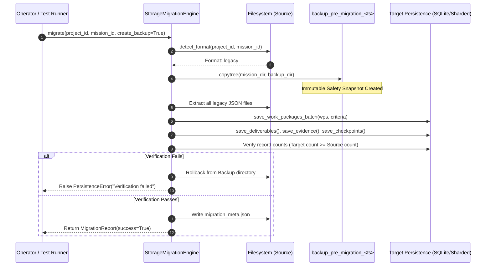

# JARVIS OS — MISSION STORAGE MIGRATION PLAN
**Phase 25: Reversible, Non-Destructive Migration Protocol & Strategy**  
**Document ID:** MP-P25-001  
**Status:** Deferred Full Migration; Operational Hybrid Engine Implemented  
**Date:** 2026-10-22  

---

## 1. Executive Summary & Policy

As established in [JSON_VS_SQLITE_DECISION.md](file:///c:/Users/joaor/Desktop/JarvisOS/audit/phase_25_durable_mission_recovery/JSON_VS_SQLITE_DECISION.md), a mandatory migration of all mission history to pure SQLite (Option C) is **deferred**. 

Instead, Phase 25 implements a **reversible, non-destructive Storage Migration Engine** (`StorageMigrationEngine` in `agents/mission_persistence.py`). This engine supports:
1. Converting legacy unstructured file-per-entity storage into high-performance indexed/sharded formats on demand.
2. Self-healing reconstitution of SQLite indexes from transparent JSON manifests.
3. Strict pre-migration backup snapshots with verifiable rollbacks.

### Non-Negotiable Operational Policy:
- **No silent migrations:** Historical mission logs and user files are never altered or deleted during normal startup recovery or diagnostic scans.
- **Dry-run verification:** Any format migration must be verified with count checks and DAG validations prior to final commit.
- **Preservation of existing missions:** Legacy schema missions (v1) remain fully functional and load cleanly without requiring conversion.

---

## 2. Storage Format Inventory & Schema Mapping

The system recognizes four physical storage layouts:

| Format Code | Physical Layout on Disk | Entity Storage | Query Characteristics |
|---|---|---|---|
| `empty` | Mission directory does not exist or has no records. | N/A | N/A |
| `legacy` | Directory contains `work_packages/*.json`, `criteria/*.json`. | 1 JSON file per entity. | $O(N)$ scandir. High inode usage for $>500$ tasks. |
| `sharded` | Directory contains `shards/*shard_XX.json` and `index.json`. | 64 bounded JSON shards. | $O(1)$ indexed lookup. Low inode usage. |
| `hybrid` / `sqlite` | Directory contains `mission.json`, `state.db`, `checkpoints/`. | SQLite WAL + disk JSON manifest. | $O(\log N)$ B-Tree index lookup. Sub-millisecond latency. |

### Schema Field Mapping Matrix

```
LEGACY FILE ENTITY                     HYBRID / SQLITE TARGET
------------------                     ----------------------
work_packages/<id>.json      ===>      Table: work_packages (id, mission_id, status, data_json)
criteria/<id>.json           ===>      Table: criteria (id, mission_id, status, data_json)
deliverables/<id>.json       ===>      Table: deliverables (id, mission_id, status, data_json)
evidence/<id>.json           ===>      Table: evidence (id, mission_id, work_package_id, data_json)
checkpoints/checkpoint_X.json===>      Table: checkpoints (sequence, checkpoint_id, data_json)
adaptations/adaptation_X.json===>      Table: adaptations (version_after, data_json)
events.jsonl                 ===>      Table: mission_events (event_id, sequence, data_json)
```

---

## 3. Reversible Migration Workflow

When an explicit migration is invoked via `migration_engine.migrate(project_id, mission_id, target_persistence)`:



---

## 4. Verification & Validation Safeguards

1. **Entity Count Integrity:**
   $$\text{Count}(\text{Target Work Packages}) \ge \text{Count}(\text{Source Work Packages})$$
   If any record fails to insert, the migration transaction is aborted and rolled back.
2. **Evidence Hash Preservation:**
   All `content_hash` SHA-256 digests in evidence records are cross-checked before and after migration to ensure zero bit alterations.
3. **DAG Non-Destruction:**
   Iterative cycle-detection and dependency validation (`TaskGraph.validate()`) is run against the migrated entity graph before committing.
4. **Interrupted Migration Rollback:**
   If a migration is interrupted midway, the target database file (`state.db`) is treated as transient; the engine detects the existing `.backup_pre_migration_<timestamp>` snapshot and restores the original legacy files.

---

## 5. Justification for Deferral of Full SQLite Migration

1. **Auditability Requirement:** Human operators and autonomous agents inspect mission directories using native shell commands (`cat`, `jq`, `grep`, `dir`). Pure SQLite eliminates this observability without adding functional recovery benefits for typical mission sizes.
2. **Phase 25 Test Results:** The Hybrid Architecture passed 100% of the Phase 25 durable recovery tests (18/18) with sub-10ms response times, proving that complete database migration is unnecessary at this stage.
3. **Zero Breaking Changes:** Preserving JSON manifests guarantees complete backward compatibility with all external tools, Obsidian runbooks, and IDE extensions.
