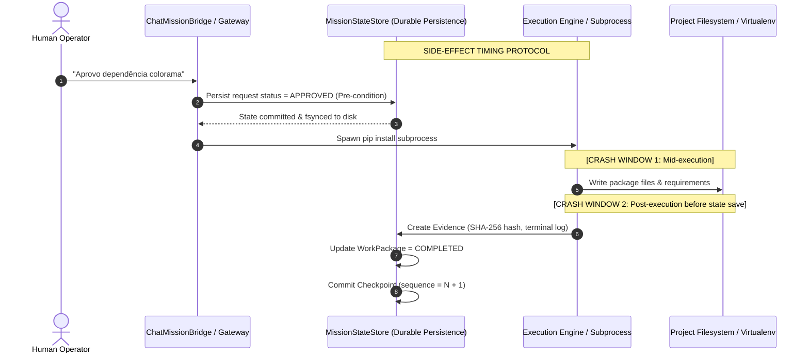

# JARVIS OS — PHASE 25 PERSISTENCE FAILURE MATRIX
**Durable Mission State, Checkpoint Recovery & Persistence Reliability**
**Date:** 2026-10-22  
**Target:** Local Ollama / Qwen3.5:9B Autonomous Execution Engine  

---

## 1. Executive Summary & Forensic Scope

During Phase 25 forensic persistence review, every discrete transition point in the mission execution lifecycle was analyzed to determine:
1. When mission state is persisted relative to the occurrence of physical external side effects.
2. The possible system states resulting from unhandled exceptions, operating system termination signals (`SIGKILL`, Windows `TerminateProcess`), power failure, or machine crash.
3. The exact deterministic, read-only reconciliation procedure required upon application startup.
4. The invariant preservation guarantee (preventing repeated execution of dangerous side effects, preventing false completion, preserving human authorization gates).

---

## 2. Persistence Failure Matrix

| ID | Failure Point / Phase | Trigger / Crash Scenario | Resulting Disk State | Resulting In-Memory State | Risk Profile | Required Startup Recovery Behavior | Invariant Enforced |
|---|---|---|---|---|---|---|---|
| **FM-01** | **Mission Planning & DAG Generation** | Crash while `MissionPlanner` is generating the task decomposition graph. | `mission.json` in `DRAFT` or `READY`. Zero or partial `work_packages` written. No checkpoint written. | Lost AST graph and candidate subtasks. | Low (No side effects executed). | Re-read `mission.json`. If status is `DRAFT`, mission is classified as `SAFELY_RESUMABLE` from the planning phase. DAG generation can safely be re-attempted. | No phantom work packages; invalid DAGs rejected. |
| **FM-02** | **Awaiting User Authorization (HITL Gateway)** | Crash while user dialog is open for dependency approval (e.g., `pip install`). | `mission.json` is `BLOCKED`. Permission request saved in `.jarvis/permissions/requests.jsonl` with status `WAITING_FOR_USER`. | Transient UI dialog destroyed. | High (Risk of bypassed authorization). | Engine detects pending permission request. Classified as `AWAITING_APPROVAL`. `safe_to_resume=False`. Rehydrated into `ChatMissionBridge`. No installation attempted without explicit user input (`"aprovo"`). | **Zero Autonomous Bypass**: Protected operation cannot run without human grant. |
| **FM-03** | **Post-Approval Prior to Side Effect** | User approved request (`APPROVED`), but system crashed before `pip install` subprocess spawned. | Gateway record is `APPROVED` or `EXECUTION_READY`. Virtualenv unchanged. Work package is `PENDING`. | Process terminated before spawning subprocess. | Medium (Stale approval). | Recovery detects `EXECUTION_READY` state with no package in target virtualenv. Verifies target environment. Re-validates that approval scope matches target project ID. Executes only within verified scope. | Scope isolation enforced across project boundaries. |
| **FM-04** | **Mid-Subprocess Dependency Installation** | Process terminated (`proc.kill()`) while `pip install` was actively executing in background. | Partial package files may exist on disk. Work package is `IN_PROGRESS` or `RUNNING`. Checkpoint marks task as `running_task_ids`. | Subprocess dead; pip lockfile may exist. | High (Incomplete virtualenv, uncertain exit code). | Classified as `REQUIRES_RECONCILIATION`. Inspector queries target virtualenv via `pip_inspect` or manifest parsing (`requirements.txt`). If package is fully installed, task transitions to `COMPLETED` and evidence is attached. If absent/corrupt, task transitions to `BLOCKED` with intervention log. Never repeats `pip install` blindly. | Idempotent dependency reconciliation; zero redundant side effects. |
| **FM-05** | **File Modification & Active File Leases** | Process killed while writing code to project source file (`main.py`, `app.py`). | File partially written or unrecorded edits made by user offline. In-memory file lease in `FileLeaseManager` vanished. | Lease holder process dead; file lease orphaned in memory. | Critical (Code corruption, lock contention, overwriting user edits). | Classified as `REQUIRES_RECONCILIATION`. Inspector scans working tree files referenced in work package metadata. Validates file existence and hash. Re-acquires fresh file lease under recovery holder ID (`mission:<mission_id>:<wp_id>`). Preserves existing user edits. Work package safely reverted to `READY`. | Offline user modifications are never overwritten; file lease re-acquired. |
| **FM-06** | **Acceptance Verification & Test Execution** | Process crashed while running `pytest` or validating deliverable criteria. | Work package `IN_PROGRESS`. Acceptance criterion may have been partially updated or set to `MET` without linked evidence. | Test runner process terminated. | High (False positive completion). | Forensic audit scans all `AcceptanceCriterion` records. Any criterion marked `MET` or `SATISFIED` lacking verifiable `evidence_id` or `evidence_refs` is immediately demoted to `PENDING`. Mission is barred from completing. | **Anti-Theater / Anti-False-Completion**: Zero completion claims without cryptographic evidence. |
| **FM-07** | **Atomic Checkpoint Serialization Crash** | System power loss during `store.save_checkpoint(...)`. | Atomic write wrote `.checkpoint_XXXX.json.tmp.<uuid>`. Target checkpoint file was not replaced or partially written. | Disk write interrupted. | Critical (Corrupt JSON). | `ShardedFilesystemPersistence` and `HybridMissionPersistence` detect unparseable or truncated JSON. Corrupted file is quarantined to `.corrupt.<timestamp>`. Checkpoint loader automatically rolls back to previous monotonic sequence (`sequence - 1`). | Self-healing checkpoint history; quarantine prevents fatal crash loops. |
| **FM-08** | **Post-Success Prior to Status Persist** | All work packages completed and verified, but process killed right before updating `mission.json` to `COMPLETED`. | All work packages `COMPLETED` with valid evidence. `mission.json` status remains `ACTIVE`. Checkpoint shows all tasks done. | Terminal completion event unsaved. | Low (Safe deterministic state). | Recovery engine reconciles work packages and acceptance criteria. Validates DAG completeness and evidence refs. Automatically finalizes mission transition to `COMPLETED` with timestamp and audit log. | Deterministic state resolution based on verified evidence. |

---

## 3. Side-Effect Timing Analysis

### Critical Rules Established:
1. **Pre-mutation durability:** Status updates indicating intention (`REQUESTED`, `AWAITING_APPROVAL`) must always be committed and fsynced to disk **before** invoking external tools or presenting actions to the user.
2. **Post-mutation evidence binding:** Status updates indicating fulfillment (`COMPLETED`, `SATISFIED`) must never be committed without attaching verified evidence hashes (`content_hash`, `source_ref`).
3. **Recovery reconciliation:** Whenever a crash occurs in Crash Window 1 or 2, the recovery engine inspects the actual target filesystem rather than relying on assumed process success.

---

## 4. Invariant Verification Checklist

- [x] **Invariant 1:** A pending authorization cannot be converted to approved during recovery without explicit human authorization.
- [x] **Invariant 2:** A denied authorization remains denied indefinitely across arbitrary process restarts.
- [x] **Invariant 3:** An approved authorization is bound to `(project_id, package_name, risk_level)` and cannot be reused by another project.
- [x] **Invariant 4:** Orphaned in-memory leases are cleared and safely re-acquired by the recovery engine.
- [x] **Invariant 5:** Corrupted checkpoint JSON files are isolated and quarantined without halting discovery.
- [x] **Invariant 6:** Missions in terminal states (`COMPLETED`, `FAILED`, `CANCELLED`) are never re-executed.
