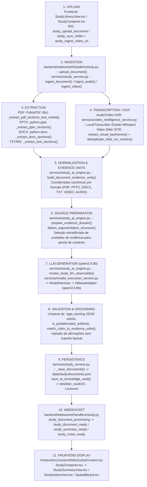

# JARVIS OS — Study Engine Forensic Audit (`STUDY_ENGINE_FORENSIC_AUDIT.md`)

**Data da Auditoria:** 2026-11-04  
**Modelo Obrigatório:** Local Ollama — `qwen3.5:9b` (sem substituição de modelo, sem APIs pagas, sem fallback silencioso para cloud)

---

## 1. Diagrama do Fluxo Real do Subsistema de Estudos

---

## 2. Mapeamento Detalhado Etapa a Etapa

| Etapa | Ficheiro e Função Responsáveis | Dados Recebidos | Dados Produzidos | Dependências | Possíveis Falhas | Fallback Utilizado | Evidência de Execução |
|---|---|---|---|---|---|---|---|
| **1. UPLOAD** | `frontend/src/features/study/StudyLibraryView.tsx`, `backend/websocket/handlers/study.py::upload_document` | `filename`, `content_base64`, `subject`, `source_type`, `request_id` | Bytes descodificados + evento `study_document_processing (UPLOADED)` | WebSocket ativo (`WebSocketContext.tsx`) | Base64 corrompido, ficheiro vazio | Emissão imediata de `study_document_failed` com erro explícito | Eventos WS `study_document_processing` + testes `test_01` a `test_06` |
| **2. INGESTION** | `services/study_service.py::ingest_document`, `ingest_audio`, `ingest_video` | Bytes ou caminho em disco, metadados de curso/coleção | Hash SHA-256 (`source_hash`), `document_id` determinístico, despacho por `source_type` | Sistema de ficheiros (`data/study/`) | Ficheiro inexistente ou extensão inválida | Exceção explícita `ValueError` / `FileNotFoundError` | `test_01` a `test_07` em `tests/test_study_engine_forensic_qa.py` |
| **3. EXTRACTION** | `services/study_service.py::_extract_pdf_sections_and_media`, `_extract_pptx_sections`, `_extract_docx_sections`, `_extract_text_sections` | Bytes / path do documento | Lista de `StudySection` com `StudyParagraph` e `StudyMedia` | `PyMuPDF (fitz)`, `python-pptx`, `python-docx` | PDF digitalizado sem camada de texto, ficheiro truncado | Fallback para extração de texto bruto com aviso explícito | `test_01` (TXT), `test_02` (PDF), `test_03` (PPTX), `test_04` (DOCX) |
| **4. TRANSCRIPTION / OCR** | `services/video_intelligence_service.py::LocalTranscriber`, `extract_visual_keyframes`, `services/study_service.py::transcribe_audio_real` | Ficheiro `.mp3/.wav/.mp4/.mkv` | `raw_transcript`, `List[TranscriptSegment]`, `List[VideoKeyframe]`, estados `TRANSCRIPTION_*` e `OCR_*` | `faster-whisper`, `ffmpeg`, `pytesseract`/`cv2` | Áudio silencioso (`rms < 1e-4`), ausência de pista de voz, falha de ASR | Registo de `NO_SPEECH_DETECTED` / `TRANSCRIPTION_FAILED` e `audio_analysis_incomplete=True` (nunca inventa transcrição) | `test_05`, `test_06`, `test_07` |
| **5. NORMALIZATION** | `services/study_ai_engine.py::build_document_evidence_units` | `document_id`, `source_type`, `text`, `sections`, `metadata` | Lista normalizada de unidades de evidência com `evidence_id` e coordenadas canónicas | Extração concluída | Documento sem texto nem transcrição | Lista vazia `[]` -> força modo `UNAVAILABLE` | `test_01` a `test_06`, `test_11` |
| **6. SOURCE PREPARATION** | `services/study_ai_engine.py::prepare_evidence_dossier`, `detect_argumentative_structure` | `title`, `subject`, `source_type`, `evidence_units` | Dossier estruturado com `[evidence_id]` + diagnóstico `is_argumentative` | `build_document_evidence_units` | Excesso de páginas/segmentos para a janela de contexto | Amostragem estratificada determinística (início, meio, fim e secções densas) até ao limite de caracteres | `test_13`, `test_17` |
| **7. LLM GENERATION** | `services/study_ai_engine.py::invoke_study_llm_observable` -> `ModelExecutionService.execute("study_synthesis")` | `operation`, `system_prompt`, `user_prompt`, `document_id` | JSON estruturado + `StudyLLMTelemetry` (`provider="ollama"`, `model="qwen3.5:9b"`, `ttft_ms`, `total_ms`, `tokens_per_sec`, `attempts`) | Servidor local Ollama (`http://localhost:11434`) com `qwen3.5:9b` | Ollama desligado, timeout, cancelamento pelo utilizador | Registo em `generation_telemetry.status` (`MODEL_UNAVAILABLE`, `CANCELLED`, `PARSE_FAILED`) e transição honesta para `EXTRACTIVE_GROUNDED` | `test_08`, `test_09`, `test_20`, `test_21` |
| **8. VALIDATION** | `services/study_ai_engine.py::strip_think_tags`, `_extract_json_object`, `match_claim_to_evidence_units`, `is_prefabricated_artifact` | Resposta bruta do modelo + `evidence_units` | Artefactos validados com `source_refs` verificados e `grounding_ratio` | `evidence_units` | Presença de `<think>`, JSON malformado, afirmações sem suporte factual | Limpeza de `<think>`, rejeição de claims com `UNCONFIRMED` (`match_claim_evidence_ids` devolve `[]`), marcação `PARTIAL` ou `EXTRACTIVE_GROUNDED` | `test_09`, `test_10`, `test_11` |
| **9. PERSISTENCE** | `services/study_service.py::_save_documents`, `save_to_knowledge_vault` | `StudyDocument` validado | `data/study/documents.json` atualizado atomicamente; ficheiro `.md` no Obsidian com arquivo `.archive/` | Lock `_documents_lock` | Concorrência de escrita ou colisão de ficheiro no Obsidian | Escrita protegida por lock; criação automática de `.archive/<nome>_<timestamp>.md` antes de sobrescrever | `test_22`, `test_23` |
| **10. WEBSOCKET** | `backend/websocket/handlers/study.py` | Mensagens `study_*` com `request_id` | Eventos `study_document_ready`, `study_summary_ready`, `study_notes_ready`, `study_generation_cancelled` | `ConnectionManager` | Pedido concorrente ou cancelamento a meio | Propagação integral de `request_id` e suporte a `study_cancel_generation` | `test_24` |
| **11. FRONTEND DISPLAY** | `frontend/src/context/WebSocketContext.tsx`, `StudySummaryView.tsx`, `StudyNotesView.tsx`, `SpatialBoard.tsx` | Eventos WS + `StudyDocument` | Interface com badges `LLM_GROUNDED (qwen3.5:9b)` vs `EXTRACTIVE_GROUNDED`, telemetria, `source_refs` e aviso de limitação argumentativa | Estado React sincronizado por `document_id` | Troca rápida de documento durante geração | Verificação de `selectedDoc.document_id` + botão de cancelamento em tempo real | `test_25` + `npm --prefix frontend run build` |

---

## 3. Respostas às 6 Questões Forenses Obrigatórias

1. **Todos os serviços utilizam efetivamente o `study_ai_engine`?**
   - **Antes da auditoria:** Não. `services/lecture_synthesizer.py` possuía um gerador Cornell autónomo puramente heurístico e `services/study_service.py` tinha geradores de quizzes que completavam perguntas em falta com templates genéricos.
   - **Após a correção:** Sim. `StudyService`, `CornellNoteSynthesizer` (`lecture_synthesizer.py`) e `VideoIntelligenceService` delegam a geração, normalização de evidências e telemetria ao `services/study_ai_engine.py`.

2. **Existem caminhos antigos que ainda geram conteúdo autonomamente?**
   - **Resolvido:** Os blocos legados em `services/study_service.py` (perguntas genéricas de quiz) e em `services/lecture_synthesizer.py` foram refatorados para usar `generate_grounded_cornell_notes`, `build_document_evidence_units` e `match_claim_evidence_ids`.

3. **Os resultados são guardados antes da validação?**
   - **Não.** A persistência em `self._save_documents()` ocorre apenas após `generate_complete_study_bundle()` concluir o parsing JSON, remover blocos `<think>`, validar `is_prefabricated_artifact()` e associar `source_refs` verificados às unidades de evidência.

4. **Os resultados antigos podem ser apresentados por engano?**
   - **Resolvido:** `StudyService._refresh_document_study_bundle()` invalida imediatamente artefactos anteriores em memória antes de persistir o novo bundle, incrementa `regeneration_count` e atualiza `extraction_version = "3.0-forensic-grounded"`. No frontend, `WebSocketContext.tsx` filtra mensagens por `document_id` e `request_id`.

5. **O frontend consegue distinguir uma falha de geração de um resultado válido?**
   - **Sim.** `StudySummaryView.tsx` e `StudyNotesView.tsx` distinguem visualmente 4 estados (`LLM_GROUNDED`, `PARTIAL`, `EXTRACTIVE_GROUNDED`, `UNAVAILABLE`), exibem o motivo de indisponibilidade do modelo quando aplicável e listam `unavailable_generative_features`.

6. **Os documentos são associados inequivocamente aos respetivos resumos?**
   - **Sim.** Cada `StudyDocument` armazena `document_id`, `source_hash` (SHA-256), `evidence_units` prefixados por `document_id` (ex.: `doc_123:p1:par1`) e `cornell_notes.document_id == doc.document_id`.

