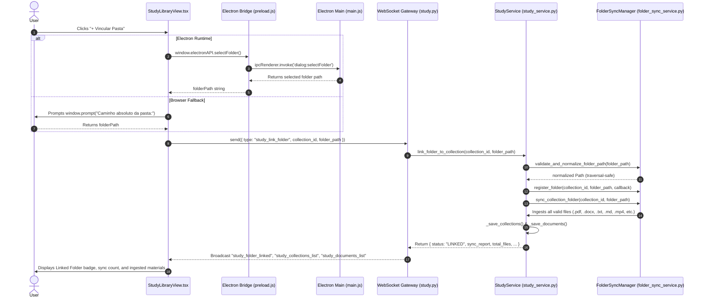
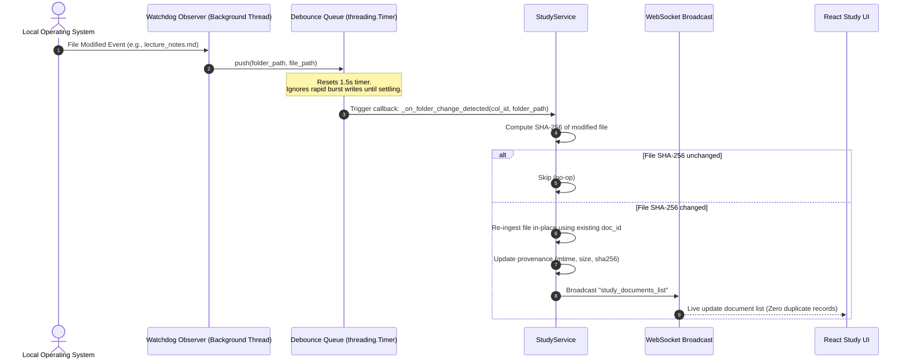
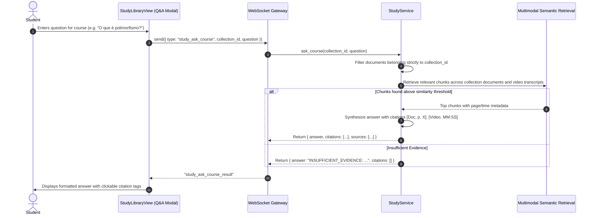

# ARCHITECTURE AND DATA FLOW — STUDY AREA FOLDER SYNCHRONIZATION
## Technical Specifications & Architecture Blueprint

**Module:** JARVIS OS Study Area Evolution  
**Date:** 2026-10-21  

---

### 1. High-Level System Architecture

The Study folder synchronization system bridges the desktop filesystem, the Python backend service layer, the WebSocket gateway, and the React frontend.

```
+-----------------------------------------------------------------------------------------+
|                                    REACT FRONTEND                                       |
|  [StudyLibraryView] <---> [WebSocketContext] <---> [Electron Bridge (window.electronAPI)]|
+------------------------------------+-----------------------------------+----------------+
                                     |                                   |
                         WebSocket   |                       Native IPC  |
                       (JSON Event)  |                      (Select Dir) |
                                     v                                   v
+------------------------------------+---------------+       +-----------+----------------+
|                   PYTHON BACKEND GATEWAY           |       |      ELECTRON MAIN PROCESS |
|     backend/websocket/handlers/study.py            |       |     electron/main.js       |
|     backend/websocket/contracts.py                 |       |  (dialog.showOpenDialog)   |
+------------------------------------+---------------+       +----------------------------+
                                     |
                                     v
+------------------------------------+----------------------------------------------------+
|                                 SERVICES LAYER                                          |
|                                                                                         |
|   +------------------------------------+      +-------------------------------------+   |
|   |         StudyService               | <--> |          FolderSyncManager          |   |
|   |   (collections, documents, RAG)    |      | (watchdog, debouncing, scan, hash)  |   |
|   +-----------------+------------------+      +------------------+------------------+   |
|                     |                                            |                      |
|                     v                                            v                      |
|   +-----------------+------------------+      +------------------+------------------+   |
|   |       Multimodal Ingestion         |      |       Filesystem Watcher            |   |
|   |  PyMuPDF / python-docx / Whisper   |      |  Thread-safe recursive Observer     |   |
|   +------------------------------------+      +-------------------------------------+   |
+-----------------------------------------------------------------------------------------+
```

---

### 2. Sequence Diagrams

#### Diagram 1: User Links Folder via Native Electron Dialog



#### Diagram 2: Background Change Detection & In-Place Re-ingestion



#### Diagram 3: Course-Scoped Contextual Q&A



---

### 3. Electron IPC Bridge Specification

In `electron/preload.js`:
```javascript
contextBridge.exposeInMainWorld('electronAPI', {
  selectFolder: () => ipcRenderer.invoke('dialog:selectFolder'),
  openPath: (targetPath) => ipcRenderer.invoke('shell:openPath', targetPath),
});
```

In `electron/main.js`:
```javascript
ipcMain.handle('dialog:selectFolder', async () => {
  const result = await dialog.showOpenDialog({
    properties: ['openDirectory', 'createDirectory']
  });
  if (result.canceled || !result.filePaths.length) return null;
  return result.filePaths[0];
});

ipcMain.handle('shell:openPath', async (event, targetPath) => {
  if (!targetPath) return { error: 'Invalid path' };
  return await shell.openPath(targetPath);
});
```

---

### 4. WebSocket Contracts

| Client Message | Parameters | Server Response | Action |
|:---|:---|:---|:---|
| `study_create_collection` | `name`, `subject`, `document_ids?`, `request_id?` | `study_collection_created`, `study_collections_list` | Creates a new discipline / course |
| `study_link_folder` | `collection_id`, `folder_path`, `recursive?`, `sync_enabled?` | `study_folder_linked`, `study_documents_list`, `study_collections_list` | Binds folder, registers watcher, runs initial sync |
| `study_unlink_folder` | `collection_id`, `folder_path`, `remove_materials?` | `study_folder_unlinked`, `study_documents_list`, `study_collections_list` | Unlinks folder without disk deletion |
| `study_sync_folder` | `collection_id`, `folder_path?` | `study_folder_synced`, `study_documents_list`, `study_collections_list` | Manually triggers full synchronization |
| `study_ask_course` | `collection_id`, `question`, `request_id?` | `study_ask_course_result` | Course-scoped RAG query with citations |
| `study_get_course_details` | `collection_id`, `request_id?` | `study_course_details` | Returns course stats, folder links, and materials |
| `study_retry_document` | `document_id`, `request_id?` | `study_document_retried` | Retries ingestion for failed or pending file |
