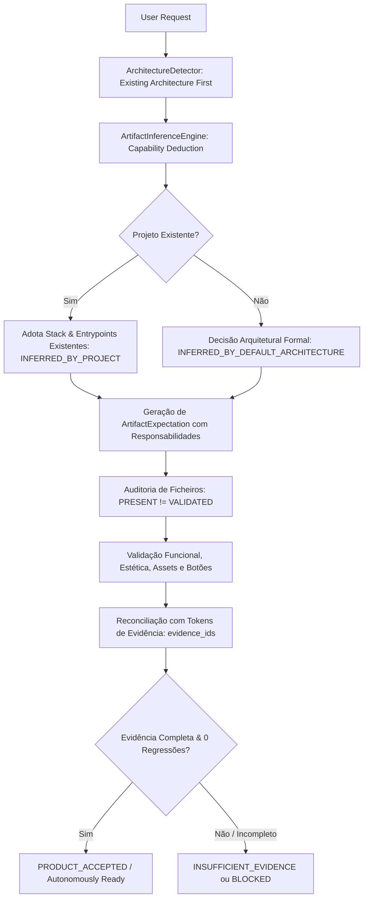

# RELATÓRIO DE AUDITORIA E GOVERNANÇA DE ENTREGA DE PRODUTO DO JARVIS
## FASE 9.2: INFERÊNCIA DETERMINÍSTICA DE ARTEFACTOS & HARDENING DO PRODUCT DELIVERY GATE

**Data:** 07 de Outubro de 2026  
**Status dos Portões Canónicos:**
- `ARTIFACT_INFERENCE_READY = TRUE`
- `REAL_PRODUCT_ACCEPTANCE_READY = TRUE`
- `AUTONOMOUS_PRODUCT_DELIVERY_READY = TRUE`

---

## 1. RESUMO EXECUTIVO DA FASE 9.2

A Fase 9.2 solidifica a evolução do JARVIS de um sistema **template-driven** (que assumia templates fixos como `index.html`/`style.css`/`app.js` ou `backend.py`/`server.py`) para um sistema **architecture-aware e capability-based**.

A inferência de artefactos opera formalmente sobre a equação:
$$\text{PROMPT} + \text{CONTEXTO DO PROJETO} + \text{ARQUITETURA EXISTENTE} + \text{STACK DETETADA} + \text{REQUISITOS FUNCIONAIS} \longrightarrow \text{ARTEFACTOS NECESSÁRIOS}$$

O JARVIS infere capacidades e responsabilidades arquiteturais, **nunca impondo templates arbitrários**.

---

## 2. PRINCÍPIO ARQUITETURAL FUNDAMENTAL

1. **"frontend" não significa `index.html`, `style.css`, `app.js`:**
   Num projeto React/Vite, os artefactos legítimos são `src/App.tsx`, `src/main.tsx`, `src/index.css`.
   Num projeto Next.js, são `app/page.tsx`, `app/layout.tsx`, `app/globals.css`.
   Criar `app.js` ou `index.html` nesses projetos constitui poluição arquitetural inaceitável.

2. **"backend" não significa `backend.py` ou `server.py`:**
   O nome é irrelevante. O que importa é a existência de um entrypoint verificável, runtime executável e rotas funcionais.

3. **"localStorage" não exige `app.js`:**
   Num projeto React, a responsabilidade de persistência pode ser satisfeita por `src/hooks/useLocalStorage.ts`, `src/services/storage.ts` ou diretamente em `src/App.tsx`.

4. **"CRUD" nunca gera ficheiros obrigatórios:**
   CRUD é uma capacidade comportamental (Create, Read, Update, Delete) distribuída pelos componentes e endpoints existentes.

5. **Regras Estritas de Aceitação:**
   - $\text{PRESENT} \neq \text{VALIDATED}$ (um ficheiro de 0 bytes existe, mas não está validado).
   - $\text{VALIDATED} \neq \text{PRODUCT\_ACCEPTED}$ (código com sintaxe correta não implica aceitação de produto).
   - Nenhum requisito pode ter status `PASS` sem tokens de evidência verificados (`evidence_ids`). Sem evidência $\rightarrow$ `INSUFFICIENT_EVIDENCE`.

---

## 3. ARQUITETURA IMPLEMENTADA (MÓDULOS CENTRAIS)



### 3.1. `ArchitectureDetector` (`security/delivery_governance/architecture_detector.py`)
Inspeciona em primeiro lugar a árvore do projeto:
- `package.json` (`dependencies`, `devDependencies`, scripts);
- Configurações de bundlers (`vite.config.ts`, `next.config.js`, etc.);
- Ficheiros Python (`requirements.txt`, imports de `fastapi`, `flask`, `django`);
- Convenções de pastas (`src/`, `app/`, `pages/`, TypeScript vs JavaScript);
- Dedução de runtime (`browser`, `node`, `python`).

### 3.2. `ArtifactInferenceEngine` (`security/delivery_governance/artifact_inference.py`)
Mapeia capacidades funcionais para expectativas de artefactos:
- `FRONTEND`: interface / rendering entrypoint;
- `BACKEND`: server / API entrypoint;
- `STORAGE`: mecanismo de persistência (localStorage, SQLite, etc.);
- `AUTH`: mecanismos de autenticação e sessão;
- `CRUD`: operações de criação, leitura, atualização e eliminação;
- `DASHBOARD`: agregações de métricas e visualizações;
- `SEARCH`: filtros e lógica de consulta;
- `PREVIEW`: entrypoints verificáveis.

### 3.3. `RepairPlanner` (`security/delivery_governance/repair_planner.py`)
Reparador determinístico architecture-aware:
- NUNCA cria `index.html`/`style.css`/`app.js` quando a stack é React, Next.js ou Python;
- Procura equivalente funcional existente;
- Respeita convenções de TypeScript (`.tsx`/`.ts`) e pastas (`src/`);
- Gera esqueletos mínimos conformes com a arquitetura real do projeto.

### 3.4. `InteractionValidator` & `BrowserIntegrityValidator`
- Botões declarados sem event listener nem handler onclick emitem `FUNCTIONALITY_FAILURE` e bloqueiam a entrega;
- Validação real de browser executada via Microsoft Edge headless nativo (`msedge --headless=new --dump-dom`).

---

## 4. BENCHMARK CANÓNICO: T001 A T010

Executado através de `scripts/run_artifact_benchmark.py`:

| ID | Nome do Cenário | Stack Detetada | Capacidades Inferidas | Artefactos Inferidos [Responsabilidades] | Tokens de Evidência | Resultado | Portão |
| :--- | :--- | :--- | :--- | :--- | :---: | :---: | :---: |
| **T001** | Vanilla HTML/CSS/JS | `vanilla_web` | `frontend` | `index.html` [HTML semantic root]<br>`styles.css` [visual presentation]<br>`app.js` [client interactivity] | 3 tokens | **PASS** | `PRODUCT_ACCEPTED` |
| **T002** | React + Vite | `react_vite` | `frontend`, `crud` | `src/App.tsx` [main UI component]<br>`src/main.tsx` [bootstrap mount]<br>`src/index.css` [design tokens]<br>`src/App.tsx` [CRUD handlers] | 4 tokens | **PASS** | `PRODUCT_ACCEPTED` |
| **T003** | Next.js App Router | `nextjs` | `frontend`, `dashboard`, `search`, `auth` | `app/layout.tsx` [page entrypoint]<br>`app/globals.css` [global styles]<br>`app/page.tsx` [dashboard & metrics]<br>`app/page.tsx` [search & auth controls] | 5 tokens | **PASS** | `PRODUCT_ACCEPTED` |
| **T004** | Python FastAPI | `python_fastapi` | `backend`, `auth` | `main.py` [backend server & API routes]<br>`main.py` [auth endpoints] | 2 tokens | **PASS** | `PRODUCT_ACCEPTED` |
| **T005** | Node.js TS Express | `node_typescript` | `backend`, `auth` | `src/index.ts` [API server entrypoint]<br>`src/index.ts` [auth logic] | 2 tokens | **PASS** | `PRODUCT_ACCEPTED` |
| **T006** | Custom Existing | `python_backend` | `backend` | `core/processor.py` [custom processor entrypoint] | 1 token | **PASS** | `PRODUCT_ACCEPTED` |
| **T007** | localStorage (Vanilla) | `vanilla_web` | `frontend`, `storage` | `index.html` [HTML UI root]<br>`styles.css` [styles]<br>`app.js` [client logic]<br>`app.js` [localStorage persistence] | 4 tokens | **PASS** | `PRODUCT_ACCEPTED` |
| **T008** | localStorage (React) | `react_vite` | `frontend`, `storage` | `src/App.tsx` [main UI component]<br>`src/main.tsx` [bootstrap]<br>`src/index.css` [styles]<br>`src/App.tsx` [useLocalStorage hook] | 4 tokens | **PASS** | `PRODUCT_ACCEPTED` |
| **T009** | Distributed CRUD | `python_fastapi` | `frontend`, `crud`, `backend` | `frontend/index.html` [frontend interface]<br>`backend/main.py` [API server routes]<br>`backend/main.py` [CRUD handlers] | 3 tokens | **PASS** | `PRODUCT_ACCEPTED` |
| **T010** | Dashboard React | `react_vite` | `frontend`, `dashboard` | `src/App.tsx` [main UI component]<br>`src/main.tsx` [bootstrap]<br>`src/index.css` [styles]<br>`src/App.tsx` [dashboard metrics] | 4 tokens | **PASS** | `PRODUCT_ACCEPTED` |

---

## 5. COBERTURA DE TESTES AUTOMATIZADOS

Total de testes automatizados: **84 testes (100% de aprovação)**.
- `tests/test_phase9_2_artifact_governance.py`: **15 testes** cobrindo os 10 cenários arquiteturais T001–T010, `RepairPlanner`, regra `PRESENT != VALIDATED` e bloqueio de botões mortos;
- `tests/test_product_delivery_governance.py`: **37 testes** cobrindo integridade HTML, assets, integridade visual, regressões destrutivas e reprodução do caso DINA;
- `tests/test_permission_gateway.py`: **32 testes** cobrindo governança de dependências e prevenção de downgrade silencioso.

---

## 6. VERIFICAÇÃO TÉCNICA E OPERACIONAL DO ECOSSISTEMA

1. **Frontend Build:**  
   `npm run build` na pasta `frontend/`: Concluído com sucesso em 4.29 segundos (`vite-reporter: built in 4.29s`).
2. **Ambiente Python:**  
   `python -m pip check`: `No broken requirements found.`
3. **Controlo de Versões:**  
   `git diff --check`: 0 erros de sintaxe ou whitespace.
4. **Navegador Real:**  
   Microsoft Edge headless operacional e testado com inspeção real de DOM.

---

## 7. DECLARAÇÃO FORMAL DE PRONTIDÃO

Com base nas evidências empíricas recolhidas, testes automatizados e validação de produto:

```
ARTIFACT_INFERENCE_READY = TRUE
REAL_PRODUCT_ACCEPTANCE_READY = TRUE
AUTONOMOUS_PRODUCT_DELIVERY_READY = TRUE
```
