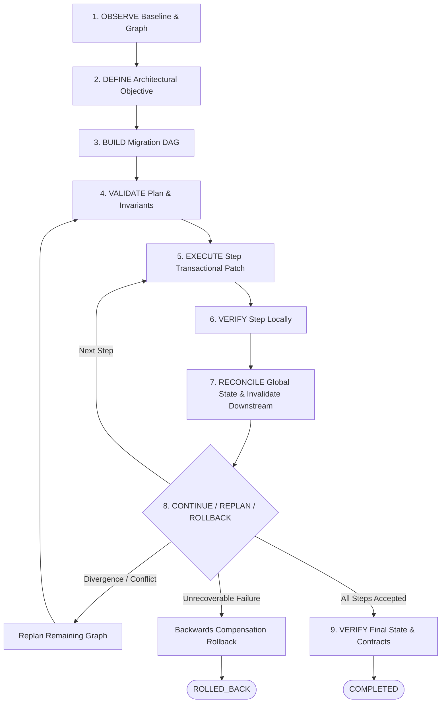

# JARVIS OS — PHASE 73 ARCHITECTURAL DESIGN
**Autonomous Macro-Refactoring Engine: Cross-System Transformations & Recoverable Architectural Evolution**  
**Design Document ID:** ARCH-P73-001  
**Date:** 2026-10-22  
**Target:** Local Autonomous Engineering Core  
**Author:** DeepMind Antigravity (Advanced Agentic Coding)  

---

## 1. Architectural Strategy & Design Principles

The Macro-Refactoring Engine provides a governed, transactional, and recoverable mechanism for executing cross-system refactorings that span multiple architectural boundaries (>15 nodes, touching producers, consumers, contracts, and persistence layers).

### Core Invariants:
1. `PATCH_APPLIED != STEP_VERIFIED != STEP_ACCEPTED != MIGRATION_COMPLETED != RELEASE_READY`
2. **Intermediate Safety:** Every intermediate state between steps must remain strictly buildable, verifiable, and operable (e.g. through compatibility shims and dual-path execution).
3. **Dependency-Aware Evidence Invalidation:** Mutations to shared interfaces or contracts in step $S_i$ automatically invalidate all downstream verification evidence previously recorded for steps $S_j$ dependent on $S_i$.
4. **Multi-Step Recoverability:** Failures at step $S_k$ trigger controlled recovery: retry $\rightarrow$ repair $\rightarrow$ replan $\rightarrow$ backwards compensation rollback ($S_k \rightarrow S_{k-1} \rightarrow \dots \rightarrow S_1$).
5. **Zero False Completion:** A migration is never marked `COMPLETED` unless all global invariants, contracts, and test suites are verifiably satisfied with non-stale evidence.

---

## 2. Global Migration Domain Model

```
+----------------------------------------------------------------------------------------------------+
|                                         MacroMigration                                             |
|  - migration_id: str                                                                               |
|  - objective: str                                                                                  |
|  - project_id: str                                                                                 |
|  - status: MigrationState                                                                          |
|  - blast_radius_nodes: int                                                                         |
|  - steps: dict[str, MigrationStep]                                                                 |
|  - execution_order: list[str] (Topologically sorted)                                              |
|  - evidence_ledger: list[EvidenceRecord]                                                           |
|  - invalidations: list[InvalidationRecord]                                                         |
|  - checkpoints: list[MigrationCheckpoint]                                                          |
|  - target_invariants: list[str]                                                                    |
|  - current_step_index: int                                                                         |
|  - provenance_hash: str                                                                            |
+----------------------------------------------------------------------------------------------------+
                                                  |
                                                  | 1 : N
                                                  v
+----------------------------------------------------------------------------------------------------+
|                                         MigrationStep                                              |
|  - step_id: str                                                                                    |
|  - step_type: MigrationStepType (PREPARATION, COMPATIBILITY, CONSUMER_MIGRATION, DUAL_PATH,        |
|                                  CUTOVER, CLEANUP, VERIFICATION)                                   |
|  - title: str                                                                                      |
|  - affected_files: list[str]                                                                       |
|  - affected_symbols: list[str]                                                                     |
|  - dependencies: list[str] (Predecessor step IDs)                                                  |
|  - state: StepState (PENDING, READY, EXECUTING, APPLIED, LOCALLY_VERIFIED, ACCEPTED,                |
|                      INVALIDATED, FAILED, ROLLED_BACK)                                             |
|  - preconditions: list[str]                                                                        |
|  - postconditions: list[str]                                                                       |
|  - verification_gates: list[str]                                                                   |
|  - compensation_action: str                                                                        |
|  - evidence_refs: list[str]                                                                        |
|  - error: Optional[str]                                                                            |
+----------------------------------------------------------------------------------------------------+
```

### Enumerated Lifecycle States:
- **`MigrationState`**:
  `INITIALIZED`, `PLANNING`, `PLANNED`, `EXECUTING`, `VERIFYING`, `COMPLETED`, `COMPLETED_WITH_ACCEPTED_RISK`, `PARTIALLY_COMPLETED`, `BLOCKED`, `ROLLING_BACK`, `ROLLED_BACK`, `HUMAN_REVIEW_REQUIRED`, `INSUFFICIENT_EVIDENCE`.
- **`StepState`**:
  `PENDING`, `READY`, `EXECUTING`, `APPLIED`, `LOCALLY_VERIFIED`, `ACCEPTED`, `INVALIDATED`, `FAILED`, `ROLLED_BACK`, `SKIPPED`.
- **`MigrationStepType`**:
  `PREPARATION`, `COMPATIBILITY_LAYER`, `CONSUMER_MIGRATION`, `DUAL_PATH`, `CUTOVER`, `OBSERVATION`, `CLEANUP`, `ROLLBACK_COMPENSATION`.

---

## 3. The 9-Stage Macro-Refactoring Workflow



---

## 4. Evidence Invalidation Engine (`InvalidationTracker`)

When a migration step modifies a component, interface, or shared contract:
1. The engine calculates the **forward reachability graph** of affected files and symbols using the SCC/dependency graph.
2. Any previously accepted step in the downstream path has its `evidence_refs` marked as `valid = False` with `invalidation_reason = "Upstream mutation in step X"`.
3. The step state transitions from `ACCEPTED` $\rightarrow$ `INVALIDATED`.
4. Downstream steps cannot transition to final completion until their verification gates are re-executed against the new baseline.

---

## 5. Multi-Step Backwards Compensation & Rollback

A single step failure must not leave orphaned transitional shims. The compensation algorithm executes:

$$\text{CompensationPath}(S_k) = \text{ReverseTopologicalOrder}(\{S_1, \dots, S_k\} \cap \text{ACCEPTED})$$

1. Each accepted step's `compensation_action` is retrieved (or preflight snapshot from Phase 65's `SnapshotEngine`).
2. Rollback transactions are executed in reverse order ($S_k \rightarrow S_{k-1} \rightarrow \dots \rightarrow S_1$).
3. Post-rollback SHA-256 baseline hashes are verified against the pre-migration baseline.
4. If compensation succeeds, the migration status transitions to `ROLLED_BACK`.

---

## 6. Subsystem Package Architecture (1:1 Parity)

The engine is structured as decoupled modules with 1:1 parity between `backend/agents/macro_refactoring/` and `agents/macro_refactoring/`:

```
backend/agents/macro_refactoring/ & agents/macro_refactoring/
├── __init__.py           # Public exports of canonical symbols
├── models.py             # Typed dataclasses, enums, states, contracts
├── graph.py              # Directed Acyclic Graph (DAG) for migration steps
├── invalidation.py       # Dependency-aware evidence invalidation engine
├── planner.py            # Decomposes >15 node refactorings into verifiable steps
├── step_executor.py      # Executes steps via Phase 65 transactions & Phase 66 claims
├── verification.py       # Invariant & contract verification engine
├── recovery.py           # Checkpointing, resumption, and compensation rollback
├── governance.py         # Autonomous execution limits and human review escalation
├── bridge.py             # Central 9-stage orchestrator
├── index.py              # High-level facade functions
├── cache.py              # In-memory evaluation cache
├── persistence.py        # Durable SQLite/JSON persistence for migration state
├── security.py           # Hardening against unauthorized mutations and path escapes
└── telemetry.py          # Operational metrics and timing counters
```

---

## 7. Integration Hooks with Existing Phases

1. **Phase 69 Integration:**
   In `backend/agents/quality_debt_remediation/architecture.py`, `DebtArchitectureEvaluator` is updated:
   - When `blast_radius_nodes > 15`, rather than emitting an absolute hard-block `permitted = False`, it checks if the refactoring can be decomposed by `MacroRefactoringPlanner`.
   - If decomposed into verifiable stages with blast radius $\le 15$ nodes per stage, it delegates execution to `MacroRefactoringBridge`.
2. **Phase 65 Integration:**
   `MacroStepExecutor` invokes `SelfModificationEngine.execute_transactional_patch()` for each step patch, guaranteeing atomic preflight snapshots and rollback per step.
3. **Phase 66 Integration:**
   `MacroStepExecutor` acquires file leases via `claims.py` before modifying resources, releasing them upon step completion or rollback.
4. **Phase 70 Integration:**
   `MacroRefactoringBridge` explicitly asserts:
   `migration.status == MigrationState.COMPLETED` does **not** set `release_gate.decision = APPROVED`. Release readiness remains an independent gate.
