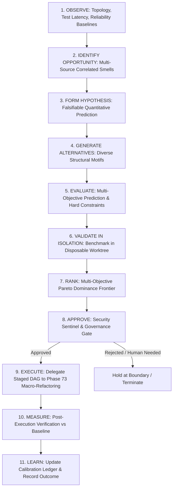

# Architecture & Integration Design — Phase 74: Autonomous Architectural Evolution & Optimization

**Author**: Antigravity Assistant (Google DeepMind)  
**Date**: 2026-10-22  
**Target Subsystem**: `backend/agents/architectural_optimization/` & `agents/architectural_optimization/`  
**Status**: APPROVED FOR IMPLEMENTATION  

---

## 1. Architectural Mission & Principles

Phase 74 establishes the closed-loop intelligence that answers:
- **What** architectural components should be evolved?
- **Why** should they be improved (grounded in measurable evidence)?
- **Which** architectural alternative is Pareto-optimal?
- **Did** the executed change demonstrably achieve its target objective relative to a reproducible baseline?

### Core Systemic Principles
1. $\text{PATCH\_APPLIED} \neq \text{TESTS\_PASS} \neq \text{OPTIMIZATION\_ACHIEVED}$.
   A change is not an optimization simply because it passes tests and completes cleanly; it is an optimization only if its target property demonstrably improves relative to baseline.
2. $\text{PREDICTED\_OUTCOME} \neq \text{MEASURED\_OUTCOME}$.
   Predictions are hypotheses; only isolated empirical benchmarks provide facts.
3. $\text{MULTI\_OBJECTIVE\_PARETO} \neq \text{SINGLE\_SCALAR\_ARBITRATION}$.
   Trade-offs between latency, coupling, memory, and complexity are preserved via Pareto dominance rather than collapsed into an arbitrary single score.
4. **Hard Constraints Trump Weighted Scores**.
   No high performance score can compensate for broken security policies, public contract violations, or unacceptable regression risk.
5. **Zero Main Workspace Pollution**.
   Experimental benchmarking of competing alternatives must execute strictly in isolated, disposable worktrees.

---

## 2. The 11-Stage Closed-Loop Lifecycle



### Description of Stages
1. **OBSERVE**: Collects structural graph data (Phase 64), test execution latencies (Phase 62/68), and operational telemetry (Phase 72).
2. **IDENTIFY OPPORTUNITY**: Correlates high coupling, bottleneck modules, or failure clusters into categorized opportunities.
3. **FORM HYPOTHESIS**: Creates a formal hypothesis detailing target metric, predicted delta, confidence, and rejection conditions.
4. **GENERATE ALTERNATIVES**: Synthesizes 2 to 4 competing architectural options (e.g. Inverted Interface, Facade Shim, Event Bus).
5. **EVALUATE**: Computes predicted impacts and verifies non-violation of hard constraints.
6. **VALIDATE IN ISOLATION**: Executes a reproducible benchmark in a disposable worktree to obtain real measured deltas.
7. **RANK**: Determines the Pareto-optimal alternative using empirical evidence and uncertainty bounds.
8. **APPROVE**: Confirms authorization; if security-sensitive or high-risk, halts for human approval token.
9. **EXECUTE**: Passes the winning candidate to Phase 73 (`MacroRefactoringBridge`) for governed execution.
10. **MEASURE**: Compares final workspace metrics against original baseline:
    - `IMPROVEMENT_CONFIRMED`: Target metric improved with no unacceptable regressions.
    - `NO_MEASURABLE_IMPROVEMENT`: Change had no measurable impact on target metric.
    - `REGRESSION_DETECTED`: Secondary metrics degraded or target metric worsened.
11. **LEARN**: Persists calibration evidence (error between predicted and measured deltas) to avoid repeating flawed assumptions.

---

## 3. Data Models & Lifecycle States

### Candidate Lifecycle States
```python
class OptimizationState(str, enum.Enum):
    DISCOVERED = "DISCOVERED"
    HYPOTHESIZED = "HYPOTHESIZED"
    BENCHMARKED = "BENCHMARKED"
    RANKED = "RANKED"
    APPROVED = "APPROVED"
    EXECUTING = "EXECUTING"
    MEASURED = "MEASURED"
    ACCEPTED = "ACCEPTED"
    REJECTED = "REJECTED"
    BLOCKED = "BLOCKED"
```

### Empirical Validation Outcomes
```python
class ExperimentOutcome(str, enum.Enum):
    IMPROVEMENT_CONFIRMED = "IMPROVEMENT_CONFIRMED"
    NO_MEASURABLE_IMPROVEMENT = "NO_MEASURABLE_IMPROVEMENT"
    REGRESSION_DETECTED = "REGRESSION_DETECTED"
    INCONCLUSIVE = "INCONCLUSIVE"
    INSUFFICIENT_EVIDENCE = "INSUFFICIENT_EVIDENCE"
    BLOCKED_BY_GOVERNANCE = "BLOCKED_BY_GOVERNANCE"
```

### Core Entities
- `OptimizationOpportunity`: Observed problem, affected components, supporting evidence.
- `OptimizationHypothesis`: Baseline measurement, target metric, expected delta, falsification rule.
- `ArchitecturalAlternative`: Proposed structural pattern, affected files, predicted costs and benefits.
- `ExperimentRecord`: Worktree baseline, candidate benchmark, measured delta, outcome.
- `ParetoEvaluation`: Non-dominated frontier ranking across competing objectives.
- `OptimizationDecision`: Governance authorization, winning alternative, rationale.
- `CalibrationRecord`: Prediction error ($\text{predicted} - \text{measured}$), duration, learning adjustment.

---

## 4. Multi-Objective Pareto Evaluation

Rather than weighting apples and oranges into an arbitrary single score:
$$\text{Candidate } A \text{ dominates } B \iff \forall i: \text{metric}_i(A) \ge \text{metric}_i(B) \land \exists j: \text{metric}_j(A) > \text{metric}_j(B)$$

Evaluated Objectives:
1. **Target Improvement**: Reduction in coupling ratio, decrease in latency (ms), or decrease in cyclomatic depth.
2. **Implementation & Verification Cost**: Number of steps and estimated CPU seconds.
3. **Blast Radius & Regression Risk**: Nodes affected, centrality in SCC graph.
4. **Empirical Evidence Confidence**: Sample count, variance, isolation fidelity.

Hard Constraint Gating:
- Sentinel security violation $\rightarrow$ Instant rejection.
- Breaking public contract without compatibility shim $\rightarrow$ Instant rejection.
- Reversibility = False without human override $\rightarrow$ Instant rejection.

---

## 5. Isolated Worktree Benchmarking

Experiments execute in a temporary, disposable directory (`tempfile.mkdtemp`):
1. Copy target subsystem files to isolated worktree.
2. Run baseline benchmark probe $\rightarrow$ record $M_{\text{baseline}}$.
3. Apply candidate mutation in worktree.
4. Run candidate benchmark probe $\rightarrow$ record $M_{\text{candidate}}$.
5. Compute empirical delta: $\Delta_{\text{measured}} = M_{\text{candidate}} - M_{\text{baseline}}$.
6. Compare with hypothesis: $|\Delta_{\text{measured}} - \Delta_{\text{predicted}}|$.
7. Clean up temp directory completely.
8. If $\Delta_{\text{measured}}$ fails to show improvement or regresses secondary metrics, emit `NO_MEASURABLE_IMPROVEMENT` or `REGRESSION_DETECTED`.

---

## 6. Governed Delegation to Phase 73

Phase 74 delegates actual multi-component code mutations to Phase 73:
```python
bridge = MacroRefactoringBridge(store_dir=store_dir)
migration = bridge.plan_migration(
    objective=winning_candidate.objective,
    project_id=project_id,
    producers=winning_candidate.producers,
    consumers=winning_candidate.consumers,
    affected_files=winning_candidate.affected_files,
    is_security_sensitive=winning_candidate.is_security_sensitive,
)
result = bridge.execute_migration(migration, human_approval_token=token)
```
After Phase 73 completes, Phase 74 conducts Stage 10 (`MEASURE`) to verify if the real workspace achieved the confirmed benchmark result.

---

## 7. Calibration & Continuous Learning

When an experiment or full optimization completes:
- Stores `CalibrationRecord` in `.jarvis/architectural_optimization/calibration/`.
- If an alternative was predicted to improve latency by 40% but only yielded 5%, the calibration factor for that structural motif is adjusted downward.
- If an alternative introduced regressions, that structural motif is penalized for similar topologies to prevent repeating identical invalid assumptions.

---

## 8. Subsystem Structure (1:1 Parity)

```
backend/agents/architectural_optimization/
├── __init__.py
├── index.py
├── models.py
├── opportunity_detector.py
├── hypothesis_engine.py
├── alternative_generator.py
├── evaluator.py
├── experiment_sandbox.py
├── prioritizer.py
├── learner.py
├── persistence.py
└── bridge.py
```
Mirrored identically to `agents/architectural_optimization/`.
