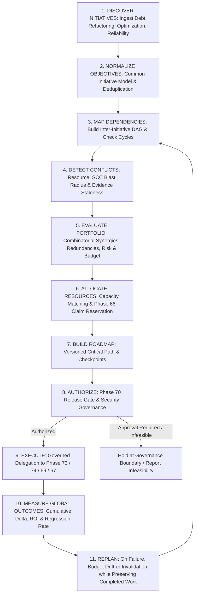

# Architecture & System Design — Phase 75: Autonomous Engineering Strategy & Portfolio Orchestration

**Author**: Antigravity Assistant (Google DeepMind)  
**Date**: 2026-10-22  
**Target Subsystems**: `backend/agents/portfolio_orchestration/` & `agents/portfolio_orchestration/`  
**Status**: APPROVED FOR IMPLEMENTATION  

---

## 1. Architectural Mission & Principles

Phase 75 establishes the strategic portfolio orchestration layer for JARVIS OS. It shifts JARVIS from treating engineering tasks as isolated, independently prioritized operations to coordinating a coherent, evidence-based engineering portfolio.

### The 11-Stage Closed-Loop Strategic Lifecycle



### Core Systemic Principles

1. **Portfolio Optimization $\neq$ Independent Candidate Ranking**.
   A portfolio's net value is not the simple sum of individual candidate scores:
   $$V(P) = \sum_{i \in P} v_i + \sum_{(i,j) \in \text{Synergies}} s_{ij} - \sum_{(i,j) \in \text{Redundancies}} r_{ij} - \sum_{i \in P} \text{RiskPenalty}(i)$$
   - *Synergies*: Initiative A unlocks or amplifies the benefit of Initiative B.
   - *Redundancies*: Initiatives A and B solve overlapping problems; selecting both is wasteful.
   - *Cannibalization*: Initiative A makes Initiative B obsolete.
   - *Negative Interactions*: Running A and B concurrently multiplies architectural disruption.

2. **Hard Constraints Trump Weighted Utility**.
   No utility score or synergy bonus may override:
   - Security constraints (Sentinel security policies).
   - Required human approvals (high-risk or breaking API changes).
   - Release-readiness governance (Phase 70 gates).
   - Global budget and resource ceilings.
   - Invariant preservation and non-negotiable architectural constraints.
   If no candidate set satisfies the constraints, an explicit `InfeasibilityReport` is returned rather than relaxing constraints.

3. **Governed Delegation — Zero Subsystem Duplication**.
   The portfolio orchestrator does not contain refactoring engines, optimization benchmarks, or mission execution loops. It delegates directly to:
   - **Phase 74** (`ArchitecturalOptimizationBridge`) for evidence-backed architectural changes.
   - **Phase 73** (`MacroRefactoringBridge`) for multi-component structural refactorings.
   - **Phase 69** (`QualityDebtBridge`) for technical debt remediation.
   - **Phase 67** (`MissionController`) for long-horizon mission execution.
   - **Phase 66** (`ClaimManager`) for authoritative resource leasing and concurrency arbitration.
   - **Phase 70** (`ReleaseGovernanceGate`) for release approval boundaries.

4. **Preservation of Completed Work & Selective Invalidation**.
   When an initiative fails or drift occurs during roadmap execution, replanning must never trigger an unnecessary global restart. Completed initiatives and verified invariants are preserved. Downstream initiatives whose baseline evidence was invalidated by upstream modifications are selectively scheduled for re-benchmarking or replanning.

5. **Bounded Replanning & Loop Prevention**.
   Replanning attempts are explicitly bounded (e.g. maximum 3 replan iterations per roadmap). If replanning fails to produce a feasible, non-conflicting roadmap, execution safely halts and escalates to human governance.

---

## 2. Domain Models & Lifecycle States

### Initiative Lifecycle States
```python
class InitiativeState(str, enum.Enum):
    PROPOSED = "PROPOSED"
    SELECTED = "SELECTED"
    SCHEDULED = "SCHEDULED"
    AWAITING_APPROVAL = "AWAITING_APPROVAL"
    AUTHORIZED = "AUTHORIZED"
    EXECUTING = "EXECUTING"
    VERIFICATION_PENDING = "VERIFICATION_PENDING"
    COMPLETED = "COMPLETED"
    FAILED = "FAILED"
    DEFERRED = "DEFERRED"
    CANCELLED = "CANCELLED"
```

### Initiative Types
```python
class InitiativeType(str, enum.Enum):
    ARCHITECTURAL_OPTIMIZATION = "ARCHITECTURAL_OPTIMIZATION"
    MACRO_REFACTORING = "MACRO_REFACTORING"
    TECHNICAL_DEBT_REMEDIATION = "TECHNICAL_DEBT_REMEDIATION"
    RELIABILITY_IMPROVEMENT = "RELIABILITY_IMPROVEMENT"
    VERIFICATION_HARDENING = "VERIFICATION_HARDENING"
```

### Inter-Initiative Dependency Relations
```python
class DependencyType(str, enum.Enum):
    HARD_PREREQUISITE = "HARD_PREREQUISITE"        # B cannot start until A is COMPLETED
    SOFT_PREFERENCE = "SOFT_PREFERENCE"            # B prefers A to run first if both selected
    MUTUAL_EXCLUSION = "MUTUAL_EXCLUSION"          # A and B cannot both be in the same portfolio
    SHARED_RESOURCE = "SHARED_RESOURCE"            # A and B touch same component; cannot run concurrently
    EVIDENCE_INVALIDATION = "EVIDENCE_INVALIDATION"# A modifying targets invalidates B's baseline evidence
```

### Conflict Classification
```python
class ConflictType(str, enum.Enum):
    MUTUAL_EXCLUSION = "MUTUAL_EXCLUSION"
    RESOURCE_CONTENTION = "RESOURCE_CONTENTION"
    OVERLAPPING_COMPONENTS = "OVERLAPPING_COMPONENTS"
    EVIDENCE_STALENESS = "EVIDENCE_STALENESS"
    BUDGET_EXCEEDED = "BUDGET_EXCEEDED"
    CYCLE_DETECTED = "CYCLE_DETECTED"
```

---

## 3. Detailed Component Architecture

### 3.1 Backlog Manager & Objective Normalizer (`backlog.py`)
- Ingests diverse initiative proposals from Phase 68/69, Phase 72, Phase 73, and Phase 74.
- Normalizes them into unified `EngineeringInitiative` records with consistent effort, risk, affected components, and evidence provenance.
- Identifies duplicate objectives (e.g., two initiatives targeting the exact same code smell or refactoring goal) and merges or deduplicates them before evaluation.

### 3.2 Dependency & Conflict Graph Engine (`dependency_graph.py`)
- Builds an inter-initiative directed acyclic graph (DAG).
- Implements Tarjan's Strongly Connected Components (SCC) algorithm to detect dependency cycles. If a cycle is detected, returns an explicit `CycleDetectedDiagnostic` with the cycle path, preventing execution.
- Evaluates component overlap across initiatives:
  - If Initiative A and B modify disjoint files/modules $\rightarrow$ marks them as concurrent-safe.
  - If Initiative A and B share mutable components $\rightarrow$ marks them as requiring serialized scheduling or Phase 66 claim locking.
  - If Initiative A modifies an interface that Initiative B's baseline relies upon $\rightarrow$ marks an `EVIDENCE_INVALIDATION` edge.

### 3.3 Combinatorial Portfolio Evaluator (`evaluator.py`)
- Evaluates candidate sets $P \subseteq \text{Backlog}$ under global resource and budget constraints.
- Formulates the portfolio objective function:
  $$U(P) = \sum_{i \in P} (\text{benefit}_i \cdot \text{confidence}_i) + \text{SynergyBonus}(P) - \text{RedundancyPenalty}(P) - \text{RiskPenalty}(P)$$
  Subject to:
  $$\sum_{i \in P} \text{effort}_i \le \text{Budget}_{\text{effort}}$$
  $$\sum_{i \in P} \text{cost}_i \le \text{Budget}_{\text{cost}}$$
  $$\forall i \in P, \text{RequiresApproval}(i) \implies \text{HasToken}(i)$$
  $$\forall (i, j) \in P, (i, j) \notin \text{MutualExclusions}$$
- Employs deterministic knapsack branch-and-bound / Pareto selection when multiple objectives compete.
- Emits an `InfeasibilityResult` with explicit explanations if no feasible non-empty portfolio satisfies constraints.

### 3.4 Capacity Scheduler & Coordination Allocator (`scheduler.py`)
- Computes topological stages (waves) and critical path from the dependency DAG.
- Matches required agent capabilities and enforces maximum concurrency limits ($K$ parallel initiatives).
- Interfaces with Phase 66 `ClaimManager` to check resource availability and acquire preliminary leases before dispatching tasks.
- Produces an `ExecutionSchedule` mapping initiatives to time slots/waves and agent assignments.

### 3.5 Versioned Roadmap Engine (`roadmap.py`)
- Generates a versioned `PortfolioRoadmap` document (e.g. `roadmap_v1.0.0`).
- Outlines:
  - Selected initiatives and rejected/deferred candidates with rationale.
  - Execution sequence, dependency constraints, and milestone checkpoints.
  - Required verification evidence at each milestone.
  - Success criteria and replanning triggers.

### 3.6 Governed Execution & Engine Delegation (`bridge.py`)
- The central controller that coordinates the 11-stage lifecycle.
- Inspects the type of each initiative and delegates execution to the authoritative subsystem:
  - `ARCHITECTURAL_OPTIMIZATION` $\rightarrow$ Phase 74 `ArchitecturalOptimizationBridge`
  - `MACRO_REFACTORING` $\rightarrow$ Phase 73 `MacroRefactoringBridge`
  - `TECHNICAL_DEBT_REMEDIATION` $\rightarrow$ Phase 69 `QualityDebtBridge`
  - `LONG_HORIZON_MISSION` $\rightarrow$ Phase 67 `MissionController`
- Enforces Phase 70 `ReleaseGovernanceGate` approval boundaries before delegating.
- Validates that completion is proven by actual subsystem verification reports, not merely exit codes.

### 3.7 Dynamic Replanning Engine (`replanning.py`)
- Triggered by:
  1. Initiative execution failure (`FAILED`).
  2. Budget/cost deviation exceeding threshold ($\Delta > 20\%$).
  3. Evidence invalidation from an upstream unexpected change.
  4. Newly arrived critical security or reliability initiative.
- Workflow:
  1. Freezes active execution.
  2. Preserves already completed initiatives and their recorded outcomes.
  3. Identifies downstream initiatives affected by the failure/invalidation.
  4. Increments roadmap version (e.g., `v1.0.0` $\rightarrow$ `v1.1.0`).
  5. Re-evaluates remaining candidate pool and produces a revised schedule.
  6. Enforces `max_replan_attempts = 3` to prevent infinite loops.

### 3.8 Cumulative Outcome & Strategic ROI Tracker (`metrics.py`)
- Records baseline, expected, and measured outcomes for every completed initiative.
- Computes portfolio-level indicators:
  - Realized Benefit vs Predicted Benefit ($\Delta_{\text{benefit}}$).
  - Budget Utilization Ratio ($\text{ActualCost} / \text{AllocatedBudget}$).
  - Schedule Deviation ($\text{ActualDuration} / \text{EstimatedDuration}$).
  - Verification Pass Rate and Regression Incidence.
  - Net Strategic Improvement (aggregate debt reduced, coupling reduced, latency saved).

### 3.9 Persistence & Recovery Store (`persistence.py`)
- Stores roadmaps, initiatives, execution traces, and replanning logs in `.jarvis/portfolio_orchestration/`.
- Reconciles persisted state against authoritative execution engines upon process restarts to prevent duplicate execution or resuming stale initiatives.

---

## 4. Integration Contracts with Existing Phases

| Subsystem | Integration Point | Authoritative Contract |
|---|---|---|
| **Phase 66 Coordination** | `backend.agents.multi_agent_coordination.claims.ClaimManager` | Acquire and verify file/resource claims before scheduling concurrent initiatives. |
| **Phase 67 Missions** | `backend.agents.long_horizon_missions.mission_state.MissionState` | Manage mission lifecycle, checkpoints, and recovery for long-running workflows. |
| **Phase 68 & 69 Quality Debt** | `backend.agents.quality_debt_remediation.bridge.QualityDebtBridge` | Ingest debt items and delegate remediation missions. |
| **Phase 70 Release Readiness** | `backend.agents.release_readiness.governance.ReleaseGovernanceGate` | Verify release readiness and human approval boundaries before roadmap authorization. |
| **Phase 72 Reliability** | `backend.agents.reliability_intelligence.baselines.BaselineCalculator` | Ingest incident predictions and retrieve performance/anomaly baselines. |
| **Phase 73 Macro-Refactoring** | `backend.agents.macro_refactoring.bridge.MacroRefactoringBridge` | Delegate large cross-component migration DAGs. |
| **Phase 74 Architectural Optimization** | `backend.agents.architectural_optimization.bridge.ArchitecturalOptimizationBridge` | Ingest opportunities, delegate hypothesis-driven isolated benchmarking and optimizations. |

---

## 5. Verification & Acceptance Criteria

1. **Deterministic Selection**: Identical backlog, constraints, and configuration produce identical selected portfolios and roadmap schedules.
2. **Cycle Prevention**: Circular prerequisites produce an explicit diagnostic and halt planning cleanly.
3. **Synergy Modeling**: Combinatorial portfolio evaluation selects synergistic pairs over higher individually ranked independent candidates when aggregate value is superior.
4. **Hard Constraint Enforcement**: Any candidate exceeding security, approval, or budget thresholds is rejected or halts at the governance gate.
5. **Replanning Resilience**: Injected step failure triggers automated replan, preserving completed work while rescheduling or dropping unviable dependents.
6. **No Duplicate Engines**: Codebase reuses existing subsystems without implementing duplicate refactoring, optimization, or claim locking logic.
