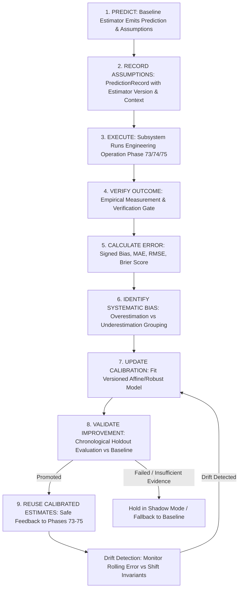

# Architecture & System Design — Phase 76: Autonomous Engineering Learning & Predictive Calibration

**Author**: Antigravity Assistant (Google DeepMind)  
**Date**: 2026-10-22  
**Target Subsystems**: `backend/agents/predictive_calibration/` & `agents/predictive_calibration/`  
**Status**: APPROVED FOR IMPLEMENTATION  

---

## 1. Architectural Mission & Principles

Phase 76 establishes the persistent learning and predictive calibration capability for JARVIS OS. It shifts JARVIS from relying on static heuristic estimation formulas to systematically learning from verified historical outcomes, progressively improving its predictive accuracy across refactoring, architectural optimization, and portfolio orchestration.

### The 9-Stage Predictive Calibration Feedback Loop



### Core Systemic Principles

1. **Measurable Decision Improvement $\neq$ Data Hoarding**.
   Storing historical records is meaningless unless calibrated estimators demonstrably improve prediction accuracy (lower error on unseen test observations) relative to uncalibrated baselines.

2. **Out-of-Sample Holdout Validation Before Promotion**.
   No calibration model may be promoted into active use without being validated on held-out chronological observations not used in fitting calibration parameters. Temporal ordering is strictly preserved to prevent data leakage.

3. **Signed Directional Bias $\neq$ Absolute Error**.
   Signed error ($\text{predicted} - \text{measured}$) must be tracked to isolate whether JARVIS systematically overestimates benefits or underestimates effort/durations. Absolute errors conceal directional bias.

4. **Hard Governance & Safety Boundaries are Inviolable**.
   Calibrated estimates can never relax security constraints (Sentinel policies), release gates (Phase 70), or human approval tokens. Calibration functions strictly as an advisory refinement layer for effort, duration, and benefit estimates.

5. **Safe Fallback & Outlier Robustness**.
   When sample size is below minimum threshold ($N < N_{\min}$), uncertainty is high, or data drift is detected, estimators must explicitly fall back to baseline models with clear provenance.

---

## 2. Domain Models & Lifecycle States

### Prediction Types
```python
class PredictionType(str, enum.Enum):
    CONTINUOUS_EFFORT = "CONTINUOUS_EFFORT"          # Effort units (e.g. story points, person-hours)
    CONTINUOUS_DURATION = "CONTINUOUS_DURATION"      # Execution time in seconds
    CONTINUOUS_BENEFIT = "CONTINUOUS_BENEFIT"        # Quantitative metric improvement (e.g. % or latency ms)
    CONTINUOUS_COST = "CONTINUOUS_COST"              # Budget cost in USD
    PROBABILITY_FAILURE = "PROBABILITY_FAILURE"      # Probability of failure [0.0, 1.0]
    PROBABILITY_REGRESSION = "PROBABILITY_REGRESSION"# Probability of regression [0.0, 1.0]
```

### Outcome Verification Status
```python
class OutcomeVerificationStatus(str, enum.Enum):
    UNOBSERVED = "UNOBSERVED"                        # Operation pending or in-flight
    MEASURED_UNVERIFIED = "MEASURED_UNVERIFIED"      # Measurement recorded but unverified
    VERIFIED = "VERIFIED"                            # Empirically verified by authoritative suite
    INVALID_MEASUREMENT = "INVALID_MEASUREMENT"      # Measurement instrument corrupted or failed
    INCOMPARABLE_ENVIRONMENT = "INCOMPARABLE_ENVIRONMENT" # Environment shifted; observation quarantined
```

### Calibration Lifecycle State
```python
class CalibrationState(str, enum.Enum):
    EXPERIMENTAL = "EXPERIMENTAL"                    # Newly created, undergoing holdout evaluation
    SHADOW = "SHADOW"                                # Tracking live predictions in parallel without influence
    PROMOTED = "PROMOTED"                            # Authoritatively active for production estimates
    SUSPENDED = "SUSPENDED"                          # Drift detected; temporarily fallen back to baseline
    ROLLED_BACK = "ROLLED_BACK"                      # Deprecated in favor of earlier stable version
```

---

## 3. Mathematical Formulation of Calibration

### 3.1 Error Analytics
Given $N$ paired predictions $\hat{y}_i$ and verified actuals $y_i$:

1. **Signed Mean Directional Bias**:
   $$\text{Bias} = \frac{1}{N} \sum_{i=1}^N (\hat{y}_i - y_i)$$
   - $\text{Bias} > 0 \implies$ Systematic Overestimation (predictions exceed reality).
   - $\text{Bias} < 0 \implies$ Systematic Underestimation (reality exceeds predictions).

2. **Mean Absolute Error (MAE)**:
   $$\text{MAE} = \frac{1}{N} \sum_{i=1}^N |\hat{y}_i - y_i|$$

3. **Root Mean Squared Error (RMSE)**:
   $$\text{RMSE} = \sqrt{\frac{1}{N} \sum_{i=1}^N (\hat{y}_i - y_i)^2}$$

4. **Probabilistic Calibration (Brier Score)** for binary outcomes $y_i \in \{0, 1\}$ and predicted probabilities $p_i \in [0, 1]$:
   $$\text{Brier} = \frac{1}{N} \sum_{i=1}^N (p_i - y_i)^2$$

### 3.2 Calibration Models
1. **Affine Bias-Correction Model**:
   For predictions where systematic offset or scaling exists:
   $$\hat{y}_{\text{cal}} = \alpha \cdot \hat{y} + \beta$$
   Where parameters $\alpha, \beta$ are derived via least-squares or robust median regression:
   $$\beta = \text{median}(y_i - \hat{y}_i), \quad \alpha = \text{clip}\left(\frac{\text{Cov}(\hat{y}, y)}{\text{Var}(\hat{y})}, 0.5, 2.0\right)$$

2. **Robust Median Filtering**:
   To prevent single extreme outliers from distorting calibration parameters, outliers beyond $1.5 \times \text{IQR}$ are downweighted or quarantined.

3. **Probability Calibration (Platt Scaling)**:
   $$p_{\text{cal}} = \frac{1}{1 + \exp(- (A \cdot \text{logit}(p) + B))}$$

---

## 4. Subsystem Components

### 4.1 Prediction & Outcome Recorder (`recorder.py`)
- Ingests `PredictionRecord` instances before operation execution.
- Ingests `ObservedOutcome` instances after empirical verification.
- Links prediction to outcome idempotently using `operation_id` or `prediction_id`.
- Enforces unit matching (e.g. rejects pairing seconds with dollars) and quarantines invalid observations.

### 4.2 Prediction Error Analyzer (`error_analyzer.py`)
- Computes signed bias, MAE, RMSE, Brier score, and variance.
- Groups observations by prediction type, target component, and complexity tier.
- Formulates explicit diagnostics on whether the system exhibits statistically significant bias.

### 4.3 Persistent Calibration Engine (`calibrator.py`)
- Fits versioned `CalibrationVersion` objects (e.g. `cal_v1.0.0`).
- Enforces minimum sample size threshold ($N \ge N_{\min}$, default 5 observations).
- Generates calibrated point predictions and prediction intervals ($[\hat{y}_{\text{low}}, \hat{y}_{\text{high}}]$).

### 4.4 Holdout Evaluator & Promotion Gate (`evaluator.py`)
- Splits historical observations chronologically (e.g. 70% train, 30% test holdout).
- Evaluates baseline vs candidate calibration on the holdout test set.
- Enforces Predefined Promotion Criteria:
  $$\text{MAE}_{\text{cal}} < \text{MAE}_{\text{base}} \land \text{RMSE}_{\text{cal}} \le \text{RMSE}_{\text{base}} \land |\text{Bias}_{\text{cal}}| < |\text{Bias}_{\text{base}}|$$
- Automatically marks calibration as `PROMOTED` if criteria are met, or leaves in `SHADOW` / `EXPERIMENTAL` if not.

### 4.5 Drift Detector & Invalidation Monitor (`drift_detector.py`)
- Computes rolling prediction error over a sliding window of recent observations.
- If rolling MAE increases by $> 30\%$ over the calibration baseline, emits a `DriftSignal`.
- Automatically suspends active calibration and falls back to baseline until recalibration.

### 4.6 Safe Feedback Adapters (`adapters.py`)
Provides non-invasive, governed extension points:
- **Phase 73 Adapter**: Returns calibrated duration and effort for macro-refactoring migrations.
- **Phase 74 Adapter**: Returns calibrated performance deltas for architectural alternatives.
- **Phase 75 Adapter**: Returns calibrated effort, cost, and benefit for portfolio initiatives.
- Returns structured `EstimateResult(baseline_value, calibrated_value, version, is_calibrated, explanation)`.

---

## 5. Integration Contracts with Existing Phases

| Subsystem | Integration Target | Calibration Value Added |
|---|---|---|
| **Phase 73 Macro-Refactoring** | Migration Step Effort & Duration | Calibrates step execution time and verification cost based on component count. |
| **Phase 74 Architectural Optimization** | Performance Gain & Cost Predictions | Corrects optimistic benefit predictions and scales implementation effort estimates. |
| **Phase 75 Portfolio Orchestration** | Initiative Effort, Budget & Expected Benefit | Refines initiative utility and prevents budget overruns in roadmap scheduling. |
| **Phase 72 Reliability Intelligence** | Anomaly & Failure Probabilities | Calibrates alert probabilities to reduce false positives and false negatives. |

---

## 6. Verification & Acceptance Criteria

1. **Prediction-Outcome Integrity**: Every verified observation links to its prediction without data loss or duplication.
2. **Directional Bias Discovery**: The system accurately identifies whether an estimator is overestimating or underestimating.
3. **Out-of-Sample Proof**: Calibration promotion requires empirical verification of error reduction on unseen chronological holdout data.
4. **Outlier Resilience**: Extreme outliers do not corrupt the calibration parameters.
5. **Safe Fallback**: Zero failures or crashes when calibration is disabled, missing, or suspended due to drift.
6. **Governance Preservation**: Security policies and release approval boundaries remain 100% intact.
