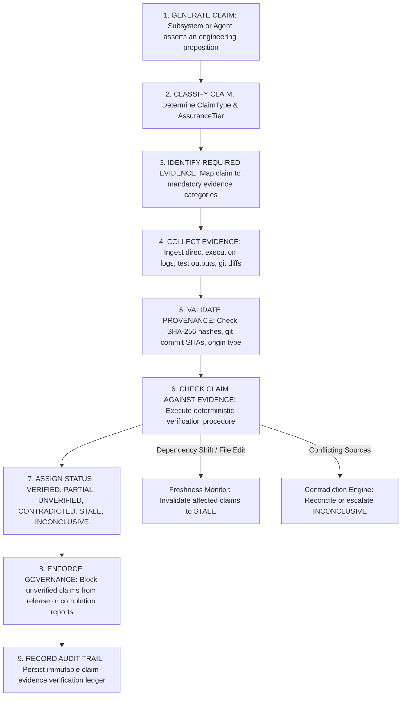

# Architecture & System Design — Phase 77: Autonomous Evidence Verification & Engineering Claims Governance

**Author**: Antigravity Assistant (Google DeepMind)  
**Date**: 2026-10-25  
**Target Subsystems**: `backend/agents/evidence_governance/` & `agents/evidence_governance/`  
**Status**: APPROVED FOR IMPLEMENTATION  

---

## 1. Architectural Mission & Principles

Phase 77 establishes the **Autonomous Evidence Verification & Engineering Claims Governance Subsystem** for JARVIS OS. Its purpose is to ensure that consequential claims made by JARVIS about its codebase, engineering operations, test results, measured improvements, autonomous actions, and system capabilities are backed by traceable, authoritative, and uncorrupted evidence.

### The 9-Stage Claims Verification Lifecycle



### Core Axioms

1. **Attempted $\neq$ Succeeded**. An operation being launched or running does not constitute proof that it completed successfully.
2. **Test Existing $\neq$ Test Passing**. The existence of a test file does not establish that the test was executed and passed against current code.
3. **Prediction $\neq$ Measurement**. A forecast, calibration estimate, or theoretical hypothesis is never an empirical measurement.
4. **Synthetic Demonstration $\neq$ Production Proof**. Synthetically generated benchmark data must never be claimed as proof of real-world operational performance.
5. **Model-Generated Explanation $\neq$ Independent Verification**. A language model asserting that "all tests pass" cannot verify itself without external, deterministic execution evidence.
6. **Integrity $\neq$ Truth**. A cryptographic SHA-256 hash confirms that an evidence record was not tampered with; it does not prove that the underlying event occurred or that the claim is true.
7. **Inviolable Governance**. No evidence-verification score or confidence metric may bypass mandatory human approvals, release gates, or security policies.

---

## 2. Domain Models & Lifecycle States

### Claim Types (`ClaimType`)
```python
class ClaimType(str, enum.Enum):
    REPOSITORY_STATE = "REPOSITORY_STATE"            # File modifications, deletions, git commit states
    SOURCE_INTEGRATION = "SOURCE_INTEGRATION"        # AST symbols exist, type signatures, interfaces match
    TEST_EXECUTION = "TEST_EXECUTION"                # Test suite executed, explicit pass count, zero failures
    PERFORMANCE_BENCHMARK = "PERFORMANCE_BENCHMARK"  # Measured improvement against comparable baseline
    SECURITY_GOVERNANCE = "SECURITY_GOVERNANCE"      # Authorization token present, Sentinel policies satisfied
    PREDICTIVE_CALIBRATION = "PREDICTIVE_CALIBRATION"# Holdout error reduction, calibration version promoted
    RECOVERY_ROLLBACK = "RECOVERY_ROLLBACK"          # Rollback executed, working tree restored cleanly
    PHASE_COMPLETION = "PHASE_COMPLETION"            # All phase acceptance criteria verified
```

### Evidence Categories (`EvidenceCategory`)
```python
class EvidenceCategory(str, enum.Enum):
    DIRECT_EXECUTION_OUTPUT = "DIRECT_EXECUTION_OUTPUT" # Raw stdout/stderr and process exit codes
    TEST_RUNNER_RESULT = "TEST_RUNNER_RESULT"           # Pytest execution ledger, passed/failed counts
    GIT_REVISION_RECORD = "GIT_REVISION_RECORD"         # Git commit SHA, diff hunks, status list
    AST_INSPECTION_PROOF = "AST_INSPECTION_PROOF"       # Parsed AST nodes and symbol signatures
    BENCHMARK_MEASUREMENT = "BENCHMARK_MEASUREMENT"     # Empirical metrics with documented baseline
    HUMAN_APPROVAL_RECORD = "HUMAN_APPROVAL_RECORD"     # Cryptographic token, reviewer ID, timestamp
    SYNTHETIC_FIXTURE_EVIDENCE = "SYNTHETIC_FIXTURE"    # Explicitly labeled synthetic benchmark fixture
```

### Verification Status (`VerificationStatus`)
```python
class VerificationStatus(str, enum.Enum):
    VERIFIED = "VERIFIED"                      # Sufficient valid evidence supports the claim
    PARTIALLY_VERIFIED = "PARTIALLY_VERIFIED"  # Some elements supported; material requirements unmet
    UNVERIFIED = "UNVERIFIED"                  # Required evidence is missing or unexamined
    CONTRADICTED = "CONTRADICTED"              # Authoritative evidence disproves the claim
    STALE = "STALE"                            # Previously valid, but invalidated by code/environment change
    INCONCLUSIVE = "INCONCLUSIVE"              # Conflicting or insufficient evidence
```

### Assurance Tiers (`AssuranceTier`)
```python
class AssuranceTier(str, enum.Enum):
    TIER_1_INFORMATIONAL = "TIER_1_INFORMATIONAL"    # Low risk; descriptive narrative, soft verification
    TIER_2_OPERATIONAL = "TIER_2_OPERATIONAL"        # Intermediate risk; task execution; requires logs
    TIER_3_ARCHITECTURAL = "TIER_3_ARCHITECTURAL"    # High risk; refactoring; requires test proof & diffs
    TIER_4_MISSION_CRITICAL = "TIER_4_MISSION_CRITICAL" # Highest risk; release/production; requires token + diffs + test proof
```

---

## 3. Evidence Provenance & Integrity Architecture

Every piece of evidence is ingested as an immutable `EvidenceArtifact`:
- **`artifact_id`**: Unique identifier (e.g. `ev_test_8f2a1b`).
- **`category`**: One of `EvidenceCategory`.
- **`origin_type`**: `REAL_EXECUTION` vs `SYNTHETIC_FIXTURE`.
- **`content_hash`**: SHA-256 hash of the canonical serialized payload or file contents.
- **`commit_sha`**: Repository revision at the moment of evidence generation.
- **`created_at`**: Timestamp of evidence capture.
- **`payload`**: The structured evidence data (e.g. `{ "passed": 30, "failed": 0 }`).

### Provenance Validation Rules
1. **Hash Verification**: Ingested data is re-hashed; any tampering or corrupt payload is rejected immediately.
2. **Revision Alignment**: If a claim concerns commit $C_A$, but the evidence was generated on commit $C_B \ne C_A$, it is flagged as `REVISION_MISMATCH`.
3. **Synthetic Grounding**: If a claim asserts "production performance improvement", but the evidence is typed `SYNTHETIC_FIXTURE`, the verifier rejects full verification, assigning `PARTIALLY_VERIFIED` with diagnostic: `Claim asserts production performance but evidence is synthetic`.

---

## 4. Claim-to-Evidence Verification Engine

The verification engine resolves claims deterministically through specialized verifiers:

### 4.1 Test Execution Verifier
Checks that:
1. `EvidenceCategory.TEST_RUNNER_RESULT` is attached.
2. Evidence was generated by an authoritative runner (e.g. `pytest`).
3. Total passed matches the claim's asserted pass count.
4. Total failed is strictly zero (or matches claimed failures).
5. The test files exist in the repository at the referenced commit.

### 4.2 Repository State Verifier
Checks that:
1. `EvidenceCategory.GIT_REVISION_RECORD` is attached.
2. Asserted modified/created files appear in `git status` or `git diff`.
3. If file modification is claimed, the file hash is different from the parent commit.

### 4.3 Benchmark & Performance Verifier
Checks that:
1. Candidate and baseline measurements exist in the evidence artifact.
2. Baseline conditions match candidate conditions (same commit/environment).
3. The claimed delta is mathematically derived from the actual measurements ($\Delta = \frac{T_{\text{base}} - T_{\text{cand}}}{T_{\text{base}}}$).

### 4.4 Governance & Security Verifier
Checks that:
1. `EvidenceCategory.HUMAN_APPROVAL_RECORD` is present for Tier 4 claims.
2. Token signature matches authorization authority.
3. No active release blockers or Sentinel violations exist in the evidence.

### 4.5 Phase Completion Verifier
Composite claim verification:
- Requires sub-claims for all mandated deliverables, test execution, regression runs, and empirical validation to all be `VERIFIED`.
- If any sub-claim is `UNVERIFIED`, `CONTRADICTED`, or `STALE`, the phase completion claim is rejected.

---

## 5. Evidence Freshness & Invalidation Tracking

Evidence does not stay valid forever.
1. **File Dependency Mapping**: Each claim records `dependency_files: List[str]`.
2. **Filesystem / Git Watcher**: When any file in `dependency_files` has a modification time $> \text{evidence.timestamp}$ or diff hunks in git, the claim's status is automatically transitioned from `VERIFIED` to `STALE`.
3. **Granular Invalidation**: Only claims whose actual dependency files were modified are invalidated; unaffected claims remain `VERIFIED`.

---

## 6. Contradiction Detection & Evidence Reconciliation

When multiple evidence records or reports assert conflicting propositions:
1. **Detection**:
   - Report asserts "All tests passed (30/30)", but test runner artifact reports "29 passed, 1 failed" $\implies$ `CONTRADICTED`.
   - Report asserts "Initiative completed", but portfolio execution ledger reports `EXECUTING` $\implies$ `CONTRADICTED`.
2. **Reconciliation Hierarchy**:
   - Direct execution artifacts (test runner output, git diffs) have higher authority than model-generated text or secondary summaries.
   - If two authoritative execution artifacts disagree (e.g. two conflicting test runs on the same commit), the claim is marked `INCONCLUSIVE` and escalated.
   - Discrepancy history is preserved in `ContradictionRecord` for auditability.

---

## 7. Report Auditing & Governance Enforcement

### 7.1 Completion Report Auditor (`report_auditor.py`)
Parses Markdown completion reports (`docs/PHASE_*_REPORT.md`):
- Extracts all material success claims (e.g. test counts, performance deltas, file additions, phase status).
- Cross-references each claim against the ground-truth evidence store.
- Produces an `AuditReport`:
  - `verified_claims`: List of statements supported by evidence.
  - `unverified_claims`: List of statements lacking evidence.
  - `contradicted_claims`: List of statements contradicted by evidence.
  - `synthetic_caveats`: Explicitly notes where synthetic benchmarks were used.

### 7.2 Governance Gate (`enforcement.py`)
- Rejects promotion of reports with `CONTRADICTED` or unverified Tier 4 claims.
- Blocks downstream operations (e.g. release deployment, portfolio progression) if prerequisite claims are unverified.

---

## 8. Persistence & Recovery

All claims, evidence artifacts, and verification records are persisted in:
- `.jarvis/evidence_governance/claims.json`
- `.jarvis/evidence_governance/artifacts/`
- `.jarvis/evidence_governance/audit_ledger.json`

On process startup:
- Loads persisted claims and artifacts.
- Reconciles any in-flight verification jobs.
- Re-checks freshness against current git HEAD and file modification times.
