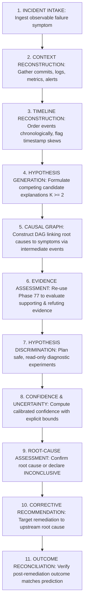

# Architecture & System Design — Phase 78: Autonomous Causal Diagnosis & Root-Cause Analysis

**Author**: Antigravity Assistant (Google DeepMind)  
**Date**: 2026-10-25  
**Target Subsystems**: `backend/agents/causal_diagnosis/` & `agents/causal_diagnosis/`  
**Status**: APPROVED FOR IMPLEMENTATION  

---

## 1. Architectural Mission & Principles

Phase 78 establishes the **Autonomous Causal Diagnosis & Root-Cause Analysis (RCA) Engine** for JARVIS OS. Its purpose is to connect observable engineering incidents, regressions, telemetry alerts, and failed missions into evidence-grounded, defensible causal explanations, avoiding superficial correlation or premature single-hypothesis lock-in.

### The 11-Stage Causal Diagnosis Lifecycle



### Core Causal Axioms

1. **Temporal Precedence $\ne$ Causation**. Just because event $A$ occurred before event $B$ does not prove $A$ caused $B$ (rejection of *post hoc ergo propter hoc*).
2. **Correlation $\ne$ Causation**. Statistical co-occurrence without a mechanistic or architectural dependency path is not causal proof.
3. **Root Cause $\ne$ Symptom**. Downstream alerts and HTTP 5xx errors are terminal symptoms; root causes are the unmitigated origin triggers.
4. **Direct Evidence $>$ Model Inferences**. Deterministic execution and verification artifacts always outweigh heuristic explanations.
5. **Multi-Hypothesis Competition**. The engine must always maintain multiple competing hypotheses until evidence decisively discriminates between them.
6. **Honest Inconclusiveness**. When evidence is contradictory or insufficient, the engine must return `INCONCLUSIVE` rather than fabricating an explanation.
7. **Safe Diagnostic Experiments**. Diagnostic tests must be read-only and non-destructive by default, strictly governed by Phase 65/77 authorization gates.

---

## 2. Domain Models & Lifecycle States

### Causal Node Types (`CausalNodeType`)
```python
class CausalNodeType(str, enum.Enum):
    ROOT_CAUSE = "ROOT_CAUSE"                      # Originating defect, trigger, or failure
    CONTRIBUTING_FACTOR = "CONTRIBUTING_FACTOR"    # Environmental condition that exacerbated the failure
    INTERMEDIATE_EVENT = "INTERMEDIATE_EVENT"      # Cascading state transition in the causal chain
    OBSERVABLE_SYMPTOM = "OBSERVABLE_SYMPTOM"      # Direct failure manifestation (e.g. 504 Gateway Timeout)
    COMPETING_HYPOTHESIS = "COMPETING_HYPOTHESIS"  # Candidate unconfirmed root cause
```

### Causal Edge Types (`CausalEdgeType`)
```python
class CausalEdgeType(str, enum.Enum):
    DIRECTLY_CAUSES = "DIRECTLY_CAUSES"          # A directly causes B (deterministic or verified transition)
    EXACERBATES = "EXACERBATES"                  # A increases the likelihood or severity of B
    TRIGGERS = "TRIGGERS"                        # A initiates the occurrence of B
    CORRELATED_WITH = "CORRELATED_WITH"          # Co-occurs without demonstrated causal mechanism
```

### Hypothesis Status (`HypothesisStatus`)
```python
class HypothesisStatus(str, enum.Enum):
    CANDIDATE = "CANDIDATE"          # Formulated, awaiting evaluation
    SUPPORTED = "SUPPORTED"          # Corroborated by available evidence
    CONFIRMED = "CONFIRMED"          # Authoritatively proven as the root cause
    REJECTED = "REJECTED"            # Contradicted by authoritative evidence
    INCONCLUSIVE = "INCONCLUSIVE"    # Evidence insufficient to confirm or refute
```

### Diagnostic Outcome (`DiagnosticOutcome`)
```python
class DiagnosticOutcome(str, enum.Enum):
    ROOT_CAUSE_CONFIRMED = "ROOT_CAUSE_CONFIRMED"
    MULTIPLE_INTERACTING_CAUSES = "MULTIPLE_INTERACTING_CAUSES"
    INCONCLUSIVE_INSUFFICIENT_EVIDENCE = "INCONCLUSIVE_INSUFFICIENT_EVIDENCE"
    CONTRADICTED_BY_EVIDENCE = "CONTRADICTED_BY_EVIDENCE"
    NO_CAUSAL_LINK_FOUND = "NO_CAUSAL_LINK_FOUND"
```

---

## 3. Causal Graph & DAG Construction

The causal chain is modeled as a Directed Acyclic Graph (`CausalGraph`):
- **Nodes**: Events with metadata (timestamp, subsystem, source, confidence, evidence references).
- **Edges**: Directed relationships linking root causes $\rightarrow$ intermediate states $\rightarrow$ symptoms.
- **Topological Sorting**: Enforces that causes strictly precede effects in sequence numbers or timestamps.
- **Cycle Prevention**: DFS check ensures that causal feedback loops are split into temporal state transitions ($S_{t} \rightarrow S_{t+1}$) avoiding cyclic graph deadlocks.
- **Root Cause Extraction**: Identified by evaluating source nodes (in-degree 0) that have reachable directed paths to the terminal symptom nodes (out-degree 0).

---

## 4. Evidence Grounding & Phase 77 Integration

Phase 78 does not maintain a private evidence store. It integrates directly with Phase 77:
1. Every candidate node or edge cites `evidence_refs` pointing to `EvidenceArtifact` in Phase 77.
2. If Phase 77 invalidates an artifact (marking a claim `STALE`), Phase 78's freshness listener re-evaluates the affected hypothesis.
3. If an evidence artifact is typed `SYNTHETIC_FIXTURE`, the hypothesis confidence is penalized and flagged with a synthetic caveat.

---

## 5. Hypothesis Discrimination & Safe Diagnostic Experiments

When multiple hypotheses have similar support, the engine plans a `DiagnosticExperiment`:
- **Read-Only Inspection**: Querying specific log files, examining ASTs, or checking database pool metrics.
- **Safe Test Invocations**: Running isolated test suites in a temporary sandbox.
- **Safety Policy**:
  - No destructive actions (e.g. no process termination, no DB drops, no production config overwrites).
  - Privileged actions require an authentic Phase 77 `HUMAN_APPROVAL_RECORD`.
- **Expected Observations**: Explicitly defines what will be observed if Hypothesis A is true versus if Hypothesis B is true.

---

## 6. Calibrated Confidence Calculation

Rather than arbitrary static floats (e.g. 0.95), confidence is derived mathematically:
$$C = \left( \frac{N_{\text{supporting}}}{N_{\text{supporting}} + 2 \cdot N_{\text{contradicting}} + N_{\text{missing}}} \right) \times (1 - P_{\text{uncertainty}})$$
where:
- $N_{\text{supporting}}$: Count of verified supporting evidence items.
- $N_{\text{contradicting}}$: Count of contradicting evidence items (weighted $2\times$ to penalize conflicting signals).
- $N_{\text{missing}}$: Count of unexamined required evidence items.
- $P_{\text{uncertainty}}$: Penalty for missing timestamps, clock skew, or synthetic fixtures.

If $C < 0.65$ or if competing hypotheses have overlapping intervals, the status remains `INCONCLUSIVE`.

---

## 7. Persistence, Recovery & Outcome Reconciliation

All diagnostic sessions are atomically stored in `.jarvis/causal_diagnosis/`:
- `incidents.json`
- `causal_graphs.json`
- `diagnoses.json`
- `audit_ledger.json`

On system startup or crash recovery, incomplete diagnoses are reconciled against Phase 77 evidence and re-evaluated.
Following authorized remediation, the `OutcomeReconciler` compares post-remediation metrics with the predicted resolution to verify that the root cause was eliminated.
