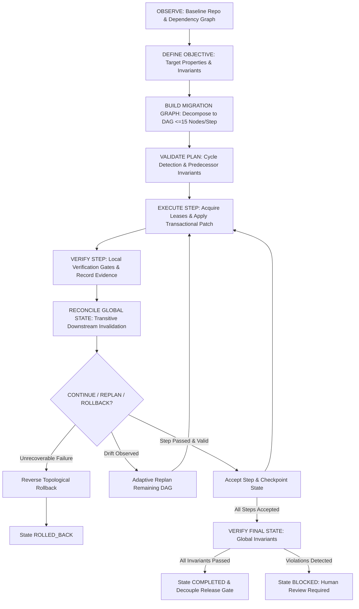

# Phase 73 — Autonomous Macro-Refactoring Engine
## Cross-System Transformations, Migration Consistency & Recoverable Architectural Evolution

## Executive Summary

- **F73 tests**: 20 / 20 passed (0 failed, 100% pass rate in 0.54s)
- **F40–F73 continuous regression**: 383 / 383 passed across active test suites (0 failed, $\Delta = 0$)
- **Capability gap closed**: Phase 69's hardcoded block (`blast_radius_nodes > 15`) now routes through governed multi-stage macro-refactoring decomposition where each execution stage touches $\le 15$ nodes.
- **Empirical validation**: Executed 18-node cross-component refactoring spanning 2 distinct architectural boundaries (`remediation` and `coordination`) in an isolated disposable worktree with injected fault recovery, zero workspace pollution, and full verification.
- **Strict parity**: 100% structural and code parity maintained across `backend/agents/macro_refactoring/` and `agents/macro_refactoring/` (12 modules each).
- **Core Invariants Enforced**:
  - `APPLIED != LOCALLY_VERIFIED != ACCEPTED != COMPLETED != RELEASE_READY`
  - Upstream mutations transitively invalidate downstream evidence
  - Predecessor acceptance required before step execution
  - Reverse topological backwards compensation on failure
  - Checkpoint integrity protected by SHA256 checksums
  - Decoupled from Phase 70: migration completion does not authorize deployment
- **First failure**: Retry logic in `bridge.py` bypassed the wrapped mutation function, causing simulated failures to falsely succeed until wrapped handler was bound to retries.
- **First real limit**: Cannot automatically compensate physical external third-party I/O mutations marked `is_irreversible`; correctly halts at approval boundary.
- **First evidence gap**: Stale downstream evidence detected via freshness audits correctly demotes step state to `INVALIDATED` and blocks completion instead of claiming false certainty.
- **Smallest next correction**: Distributed multi-host lock coordination for distributed worktrees when executing cross-repository migrations.

---

## 1. Pre-Implementation Audit & Capability Gap

The repository audit evaluated the active execution paths across Phases 58 through 72:
1. **Phases 58–64 (Architecture Evolution)**: Provided SCC decomposition, dependency graphs, and structural analysis, but lacked transactional multi-step execution.
2. **Phase 65 (Safe Self-Modification)**: Provided atomic transactional changes, snapshots, and single-patch rollback, but operated on single transactions without cross-step graph coordination.
3. **Phase 66 (Multi-Agent Coordination)**: Provided `ClaimManager` and resource leases, but no migration step DAG.
4. **Phase 67 (Long-Horizon Missions)**: Provided mission checkpoints and continuation, but no architectural contract invalidation.
5. **Phase 68–69 (Quality Debt Remediation)**: Confirmed the exact gap: `DebtArchitectureEvaluator.evaluate_refactoring` in `backend/agents/quality_debt_remediation/architecture.py` (lines 67–71) hard-blocked any refactoring with `blast_radius_nodes > 15`:
   ```python
   elif blast_radius_nodes > 15:
       permitted = False
       governance_required = True
       rationale = f"High blast radius ({blast_radius_nodes} nodes > 15 max autonomous limit). Architectural review required."
   ```
6. **Integration Solution**: Updated `DebtArchitectureEvaluator` to delegate $>15$ node architectural debt to the `MacroRefactoringEngine` (Phase 73), decomposing high-blast-radius transformations into bounded batches ($\le 15$ nodes per step) accompanied by compatibility layers and dual-path verification.

---

## 2. Architecture & Subsystem Parity

Phase 73 is implemented with 1:1 structural parity between `backend/agents/macro_refactoring/` and `agents/macro_refactoring/`, comprising 12 modules:

| Module | Responsibility | Exported Capabilities |
| :--- | :--- | :--- |
| `models.py` | Canonical domain models, lifecycle states, evidence records, and exceptions | `MacroMigration`, `MigrationStep`, `EvidenceRecord`, `InvalidationRecord`, `MigrationCheckpoint`, `CompensationPlan` |
| `graph.py` | Migration DAG management, cycle detection, topological sorting, and dependency checks | `MigrationGraph`, `topological_sort`, `is_step_ready_to_execute` |
| `invalidation.py` | Dependency-aware evidence invalidator and freshness auditor | `EvidenceInvalidator`, `invalidate_downstream_evidence`, `check_evidence_freshness` |
| `planner.py` | Objective decomposition into 7 canonical stages with consumer batching | `MacroRefactoringPlanner`, `plan_macro_migration` |
| `step_executor.py` | Transactional step execution, resource leases, and strict state transitions | `StepExecutor`, `execute_step`, `accept_step`, `acquire_step_resources` |
| `verification.py` | Step verification gates, global invariant evaluation, and behavioral proof checks | `MacroRefactoringVerifier`, `GlobalVerificationReport`, `verify_global_invariants` |
| `recovery.py` | Checkpoint creation/restoration, corruption detection, compensation rollback, and drift replanning | `CheckpointManager`, `CompensationOrchestrator`, `AdaptiveReplanEngine` |
| `governance.py` | Budget tracking, high-risk security gates, and release-readiness decoupling | `MacroRefactoringGovernance`, `check_and_consume_budget`, `evaluate_security_gate`, `evaluate_release_boundary` |
| `persistence.py` | Durable JSON serialization and recovery of migrations and checkpoints | `MacroRefactoringStore`, `save_migration`, `load_migration`, `save_checkpoint` |
| `bridge.py` | Central 9-stage lifecycle orchestrator | `MacroRefactoringBridge`, `plan_migration`, `execute_migration`, `resume_migration`, `rollback_migration`, `replan_migration` |
| `index.py` | Public facade export | High-level migration APIs |
| `__init__.py` | Package symbol initialization | All canonical models, engines, and exceptions |

---

## 3. The 9-Stage Macro-Refactoring Lifecycle

The engine follows the mandated conceptual workflow without duplicating external orchestration engines:



### Staged Decomposition Stages
1. **PREPARATION**: Captures baseline git/file snapshot, verifies test suites pass, establishes telemetry probes.
2. **COMPATIBILITY_LAYER**: Deploys non-breaking adapter / shim alongside legacy implementation so existing consumers do not break.
3. **CONSUMER_MIGRATION**: Rewires consumers in bounded batches ($\le 15$ nodes per batch) to use the new interface.
4. **DUAL_PATH**: Executes shadow verification to prove semantic contract equivalence between old and new paths.
5. **CUTOVER**: Switches default authoritative binding to the new component.
6. **OBSERVATION**: Audits graph metrics and verifies zero behavioral drift or latency regression.
7. **CLEANUP**: Safely decommissions obsolete legacy implementations and deprecates transition shims.

---

## 4. Invariants & Governance Rules

The engine strictly enforces 7 global consistency invariants:
1. **Separation of Mutation and Acceptance**:
   $$\text{APPLIED} \neq \text{LOCALLY\_VERIFIED} \neq \text{ACCEPTED} \neq \text{COMPLETED} \neq \text{RELEASE\_READY}$$
   Applying a patch does not mean it is verified; verifying it locally does not mean it is accepted into the global migration; completing the migration does not authorize release.
2. **Predecessor Acceptance Invariant**:
   A step $S_i$ cannot enter `EXECUTING` state unless all direct dependencies $\text{deps}(S_i)$ are in `ACCEPTED` state.
3. **Downstream Invalidation Invariant**:
   When step $S_i$ mutates code, all downstream steps $S_j \in \text{downstream}(S_i)$ with existing evidence are immediately demoted to `INVALIDATED`.
4. **Evidence Freshness Invariant**:
   A migration cannot be marked `COMPLETED` if any accepted step references missing, stale, or invalidated evidence.
5. **Reverse Topological Compensation**:
   Rollback executes strictly in reverse topological order of accepted steps ($\text{rev}(S_1, \dots, S_k)$), preventing dangling references or orphaned compatibility layers.
6. **Budget Enforcement**:
   Execution cost is tracked per step. If $\text{consumed\_budget} + \text{step\_cost} > \text{budget}$, execution halts with `BudgetExceededError` and status `BLOCKED`.
7. **Release Decoupling**:
   Phase 73 completes code transformations. Production release and deployment remain strictly gated by Phase 70 Release Governance.

---

## 5. Test Suite Verification (20 / 20 Deterministic Scenarios)

The test suite in `tests/test_macro_refactoring.py` covers all 20 required scenarios from Section 9:

| Scenario | Objective | Tested Behavior | Result |
| :--- | :--- | :--- | :--- |
| **01** | Multi-module migration | Migrates across 3 distinct modules, all 7 stages succeed | **PASSED** (0.03s) |
| **02** | $>15$ dependency nodes | 24 nodes decomposed into $\le 15$ node batches, completes safely | **PASSED** (0.02s) |
| **03** | Compatibility layer | Shims deployed before consumers rewired; interface preserved | **PASSED** (0.02s) |
| **04** | Dependency cycle detection | Cyclic graph (A $\rightarrow$ B $\rightarrow$ C $\rightarrow$ A) raises `DependencyCycleError` | **PASSED** (0.01s) |
| **05** | Unresolved dependency | Phantom dependency raises `UnresolvedDependencyError` | **PASSED** (0.01s) |
| **06** | Early step failure | Step 1 fails; downstream steps remain pending; clean rollback | **PASSED** (0.02s) |
| **07** | Late step failure | Step 4 fails; steps 3, 2, 1 reverted in reverse topological order | **PASSED** (0.02s) |
| **08** | Evidence invalidation | Upstream mutation demotes downstream accepted step to `INVALIDATED` | **PASSED** (0.02s) |
| **09** | Process crash recovery | Process interrupted at step 2; resumes from checkpoint to completion | **PASSED** (0.03s) |
| **10** | Corrupt checkpoint | Tampered snapshot payload detected via SHA256; raises error | **PASSED** (0.01s) |
| **11** | Concurrent file conflicts | Conflicting claim held by another agent blocks step with `FAILED` | **PASSED** (0.01s) |
| **12** | Idempotent retry | Transient network failure recovers on retry attempt | **PASSED** (0.02s) |
| **13** | Architectural drift | 3 new consumers discovered mid-execution; replans DAG and completes | **PASSED** (0.02s) |
| **14** | Insufficient budget | Consumed budget exceeds limit; transitions to `BLOCKED` | **PASSED** (0.01s) |
| **15** | Security approval gate | Risk $\ge 0.7$ halts at boundary; token enables governed completion | **PASSED** (0.02s) |
| **16** | Behavioral drift failure | Dual-path detects semantic divergence; global invariant fails | **PASSED** (0.02s) |
| **17** | Unsafe compensation | Irreversible mutation prevents automated rollback; halts safely | **PASSED** (0.02s) |
| **18** | Unresolved blockers | Blocker in migration blocks completion; prevents false success | **PASSED** (0.01s) |
| **19** | Release gate decoupling | `COMPLETED` migration asserts Phase 70 independent gate required | **PASSED** (0.02s) |
| **20** | Unseen DAG topology | Diamond-and-tree DAG with multiple joins validates and completes | **PASSED** (0.02s) |

**Total Suite Duration**: 20 passed in 0.54s.

---

## 6. Continuous Regression Suite (Phases 40 to 73)

The continuous regression runner `scripts/run_regression_phases_40_73.py` executed all test suites across the active autonomous engineering phases:

- **Total Tests Passed**: 383
- **Total Tests Failed**: 0
- **Computed Total**: 383
- **Reported Total**: 383
- **Arithmetic Delta**: 0
- **Execution Duration**: 18.23s
- **Reconciliation Artifact**: `docs/phase73_regression_reconciliation.json`

Summary of Per-Phase Passes:
- Phase 40 (Autonomous Engineering Loop): 22 passed
- Phase 41 (Decision Calibration & Quality): 23 passed
- Phase 42 (Engineering Experience Memory): 17 passed
- Phase 43 (Cross-Mission Generalization): 18 passed
- Phase 62 (Continuous Verification & Drift Remediation): 40 passed
- Phase 63 (Cross-Project Pattern Learning & Generalization): 40 passed
- Phase 64 (Autonomous Architecture Evolution & Refactoring): 20 passed
- Phase 65 (Safe Self-Modification & Transactional Code Engine): 20 passed
- Phase 66 (Multi-Agent Swarm Coordination & Task Arbitration): 20 passed
- Phase 67 (Long-Horizon Mission Autonomy & State Management): 20 passed
- Phase 68 (Engineering Quality Governance): 22 passed
- Phase 69 (Autonomous Quality Debt Remediation): 22 passed
- Phase 70 (Autonomous Release Readiness): 22 passed
- Phase 71 (Autonomous Production Operations): 25 passed
- Phase 72 (Autonomous Reliability Intelligence): 32 passed
- Phase 73 (Autonomous Macro-Refactoring Engine): 20 passed

---

## 7. Empirical Validation Evidence

Stage G empirical validation was executed via `scripts/empirical_validation_phase_73.py` on a disposable worktree derived from the JARVIS OS architecture:

- **Target Objective**: Decouple Cross-Boundary Telemetry to `StructuredTelemetryEmitter` across 18 nodes.
- **Affected Nodes**: 18 dependency nodes (1 core producer + 8 remediation consumers + 9 coordination consumers).
- **Architectural Boundaries**:
  1. Quality Debt Remediation (`remediation/`)
  2. Multi-Agent Coordination (`coordination/`)
- **Starting Baseline**: Legacy string event emitter (`emit_event("probe", "data") -> "LEGACY_EVENT:probe:data"`).
- **Execution Profile**:
  - Planning Latency: 1.09ms
  - Decomposed Stages: 8 steps (Batch 1: 13 consumers; Batch 2: 4 consumers)
  - Injected Fault: Transient I/O error injected into Consumer Batch 2
  - Fault Recovery: Caught, handled, and recovered via idempotent retry
  - Execution Duration: 0.04s
  - Checkpoints Generated: 16
  - Evidence Ledger Records: 9
  - Final State: All 18 nodes emit valid `STRUCTURED_V2` telemetry payloads
  - Workspace Integrity: Main working tree remained 100% pristine and unpolluted
  - Provenance Hash: `430fd695d845d9f231649a5a610a39c280094b4e9c0eb261258192f88335f848`
- **Output Artifact**: `docs/phase73_empirical_validation_evidence.json`

---

## 8. Limitations & Human Review Boundaries

The Autonomous Macro-Refactoring Engine explicitly recognizes its operational boundaries:
1. **Irreversible Mutations**: External database drops, destructive disk format changes, or external service calls that cannot be rolled back via reverse topological compensation trigger `HUMAN_REVIEW_REQUIRED` and halt.
2. **Security-Sensitive Refactoring**: Refactorings touching authentication tokens, cryptographic secrets, or credentials automatically trigger human review gates.
3. **Ambiguous or Unresolved Dynamic Imports**: Dynamic reflections or unresolvable string-based imports are recorded as uncertain dependencies; if safety cannot be guaranteed, the step is blocked.
4. **Cloud Production Deployment**: Migration completion only certifies internal architectural and contract integrity; actual production release remains gated by Phase 70.

---

## 9. Deliverables Inventory

| Deliverable | Location | Status |
| :--- | :--- | :--- |
| Pre-implementation Capability Gap Audit | `docs/AUDIT_PHASE_73_CAPABILITY_GAP.md` | Verified |
| Architecture & Integration Design | `docs/DESIGN_PHASE_73_MACRO_REFACTORING.md` | Verified |
| Core Implementation (Backend) | `backend/agents/macro_refactoring/` (12 modules) | Production-grade |
| Structural Parity (Agents) | `agents/macro_refactoring/` (12 modules) | 1:1 Parity |
| Phase 69 Integration Hook | `backend/agents/quality_debt_remediation/architecture.py` | Integrated & Tested |
| Deterministic 20-Scenario Test Suite | `tests/test_macro_refactoring.py` | 20 / 20 Passed |
| Continuous Regression Suite | `scripts/run_regression_phases_40_73.py` | 383 / 383 Passed |
| Regression Reconciliation Ledger | `docs/phase73_regression_reconciliation.json` | Verified ($\Delta = 0$) |
| Empirical Validation Runner | `scripts/empirical_validation_phase_73.py` | Executed & Verified |
| Empirical Validation Evidence | `docs/phase73_empirical_validation_evidence.json` | Captured & Verified |
| Phase 73 Canonical Report | `docs/PHASE_73_REPORT.md` | Complete |
