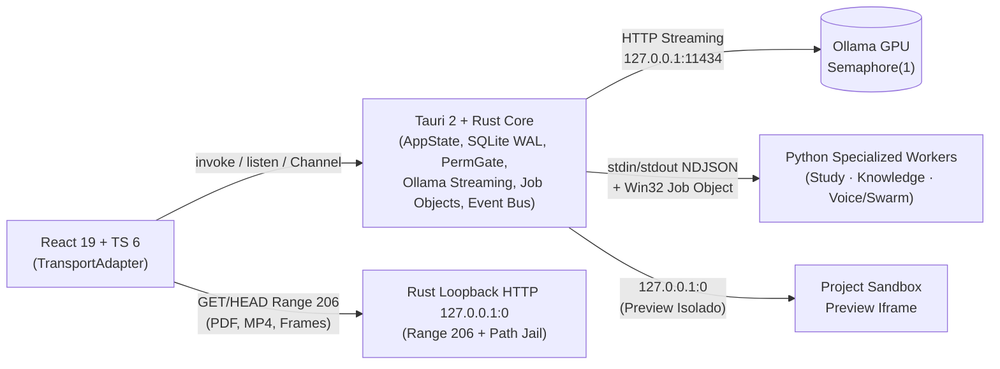

# JARVIS OS — Stage 0: Auditoria Arquitetural Completa & Plano de Migração para Tauri 2 + Rust

**Repositório:** `joaofarys200/ai-company-orchestrator`  
**Branch:** `main`  
**Commit de referência:** `fb1aeeda10652ed1662e7e5c24ed381d7635f8d0`  
**Natureza da etapa:** Auditoria, análise e planeamento técnico (**ZERO alterações no código-fonte, dependências, configurações ou dados persistidos**).

### Documentos Complementares desta Auditoria
- [TAURI_TARGET_ARCHITECTURE.md](./TAURI_TARGET_ARCHITECTURE.md) — Arquitetura alvo em 5 camadas, árvore `src-tauri/`, crates Rust, traits, lifecycle de sidecars e servidor loopback `127.0.0.1:0`.
- [TAURI_COMMUNICATION_MATRIX.md](./TAURI_COMMUNICATION_MATRIX.md) — Inventário completo de comunicação (263 `CLIENT_MESSAGE_TYPES`, 272+ `SERVER_MESSAGE_TYPES`, 101 mensagens despachadas pela UI, HTTP `:8000`, `window.jarvisIPC`, Sandbox `:8080`, Ollama `:11434`).
- [TAURI_SECURITY_MODEL.md](./TAURI_SECURITY_MODEL.md) — Capabilities Tauri 2, CSP, Path Jail, Win32 Job Objects, `.jarvis/permissions/` HITL, análise das 7 falhas de evasão de comandos, injeção PowerShell e 22 pontos de escrita não-atómica.
- [TAURI_MIGRATION_ROADMAP.md](./TAURI_MIGRATION_ROADMAP.md) — Roadmap incremental Stage 0 → Stage 8, inversão de precedência de transporte, coexistência controlada, rollback e os 7 portões de aceitação.
- [TAURI_PERSISTENCE_OWNERSHIP.md](./TAURI_PERSISTENCE_OWNERSHIP.md) — Auditoria e matriz exaustiva de propriedade de persistência (18 recursos em disco, `database.db`, 4x `state.db`, pragmas, índices e Abordagem C).
- [TAURI_WORKER_PROTOCOL.md](./TAURI_WORKER_PROTOCOL.md) — Especificação técnica do protocolo NDJSON / JSON-RPC 2.0 (framing, isolamento `stdout`/`stderr`, streams, cancelamento e Reverse RPC para HITL).
- [TAURI_FUNCTIONAL_PARITY.md](./TAURI_FUNCTIONAL_PARITY.md) — Matriz de paridade funcional de 26 capacidades com riscos de regressão e portões de verificação.
- [TAURI_ARCHITECTURAL_DECISIONS.md](./TAURI_ARCHITECTURAL_DECISIONS.md) — Registo formal de decisões arquiteturais (ADRs) com respostas fundamentadas às 12 questões da Secção 13.

> **Nota de rigor epistémico:** Ao longo desta auditoria distingue-se explicitamente entre:
> - **[Confirmado no código]**: observado diretamente em ficheiros, símbolos, contagens e outputs reais da baseline `fb1aeeda10652ed1662e7e5c24ed381d7635f8d0`.
> - **[Descrito em docs]**: descrito na documentação do repositório, mas não comprovado ou contrariado pelo runtime.
> - **[Hipótese]**: inferência técnica ou estimativa que requer validação empírica na implementação.
> - **[Recomendação]**: decisão arquitetural proposta para a migração.

---

## 1. Resumo Executivo

1. **Descoberta central sobre o runtime atual [Confirmado no código]:** Embora documentação e premissas falem em *Electron + Python/FastAPI + WebSockets*, **o runtime atual NÃO utiliza FastAPI, Uvicorn nem Starlette**. A camada servidora em Python `3.14` assenta em:
   - WebSocket server com `websockets==16.0` em `127.0.0.1:8001` (`server.py:674`, `backend/websocket/gateway.py`);
   - Servidor HTTP stdlib (`http.server.SimpleHTTPRequestHandler` + `GracefulThreadingTCPServer` em `127.0.0.1:8000` e `LoopbackIPv6Server` `::1:8000` em `backend/services/sandbox_service.py`) para ficheiros Study (`206 Partial Content` em PDF/MP4) e estáticos SPA;
   - Gateway stdio NDJSON (`backend/transport_gateway.py`: `StdioTransportGateway` + `VirtualIPCClient`) ligado ao `stdin`/`stdout` do `server.py` pelo `main.js`;
   - Sandbox HTTP secundário em `sandbox.py` com `TCPServer(("", 8080), ...)` (bind inseguro a `0.0.0.0:8080`).
2. **Viabilidade da migração para Tauri 2 + Rust [Recomendação]:** A migração é **altamente viável e benéfica** se seguir uma **arquitetura híbrida pragmática**:
   - O **Núcleo Rust / Tauri 2** substitui **100% do Electron** (`main.js`, `preload.js`), o transporte HTTP `:8000` / WS `:8001` (via `invoke`/`emit`/`Channel<T>` + **Loopback HTTP `127.0.0.1:0`**), a gestão de processos com Win32 Job Objects, a persistência SQLite unificada (`database.db` em `WAL` na Stage 4), a `PermissionGate` (`.jarvis/permissions/`), o `PreviewServer` (`127.0.0.1:0`), e o fanout de streams de eventos LLM para a UI.
   - **Python permanece como runtime de workers especializados (*Bounded Sidecar Workers*)** via NDJSON sobre `stdin`/`stdout` para bibliotecas pesadas e nativas ao ecossistema Python: `PyMuPDF`, `pdfplumber`, `python-docx`, Word COM, WinRT OCR, `ffmpeg`/`ffprobe`, `faster_whisper` opcional, `youtube-transcript-api`, `ObsidianGraphEngine`, `tree-sitter`/`chromadb`, `sounddevice`/`webrtcvad`/`gemini_live` e (na transição) `CrewAI` Swarm.
3. **Oportunidade massiva de limpeza arquitetural [Confirmado no código]:** Existem **~65 módulos em `agents/` sem qualquer import em `server.py`, `backend/` ou `services/`**, **~58 eventos de telemetria distribuída nunca emitidos**, **33 operações em `MISSION_HANDLERS` sem ramo no `handle()`** e **14 ramos mortos em `missions.py`**. Separar a superfície produtiva deste código experimental evita migrar dezenas de milhares de linhas não utilizadas.
4. **Riscos imediatos identificados no código [Confirmado no código]:**
   - `database.db` (724.992 B, 11 tabelas) é partilhada sem `WAL`, sem `busy_timeout`, sem `PRAGMA foreign_keys = ON` e sem versionamento de schema entre `database.py`/`persistence/db.py` e `backend/model_harness/rho.py`.
   - `sandbox.py` abre `0.0.0.0:8080` na rede.
   - `main.js` executa `netstat` + `taskkill /F /T` sobre qualquer processo externo nas portas `8000`/`8001`.
   - Existem **8 localizações de escrita em disco não-atómica** no código Python.

---

## 2. Inventário Real da Arquitetura Atual [Confirmado no código]

### 2.1 Camada Desktop (`Electron`)
- **`package.json`**: `"start": "electron ."`, `"dev": "concurrently ... \"npm run dev --prefix frontend\" \"electron . --dev\""`; `devDependencies`: `concurrently ^10.0.3`, `electron ^31.7.7`. Não existe `electron-builder`.
- **`main.js` (590 linhas)**:
  - Gera token efémero `SESSION_HTTP_TOKEN` (`JARVIS_HTTP_TOKEN`) no processo Electron.
  - Configura Chromium (`autoplay-policy`, `disable-http-cache`).
  - Liberta portas `8000` e `8001` via `freePortIfLocked` (`netstat` + `taskkill /F /T`).
  - Lança `venv/Scripts/python.exe -u server.py` (máximo 3 reinícios, delay `1500ms`, shutdown gracioso `SIGINT` com timeout `5000ms` seguido de `taskkill`).
  - Faz pipe `stdout` NDJSON (`jarvis-from-backend`) e `stdin` (`jarvis-to-backend`).
  - Injeta header `X-Jarvis-Token` via `session.webRequest.onBeforeSendHeaders` para `127.0.0.1:8000/*`, `localhost:8000/*`, `127.0.0.1:5173/{api,data}/*`, `localhost:5173/{api,data}/*`.
  - Expõe IPC `select-folder` e `open-path` (validado contra `__dirname`, `data`, `obsidian_vault`, `os.tmpdir()`).
- **`preload.js` (61 linhas)**: expõe `window.jarvisIPC = { send, onMessage, getPathForFile, selectFolder, openPath, isNativeIPC: true }`.

### 2.2 Camada Frontend (`frontend/`)
- Stack: React 19, Vite 8, TypeScript 6, Monaco `0.56`, `pdfjs-dist` `6.3`, Framer Motion `12`.
- **Zero imports de pacotes Electron/Node** em `frontend/package.json` ou `frontend/src`.
- **`WebSocketContext.tsx` (4.302 linhas)**: monolito de transporte + correlação + estado com `129` `switch` cases de entrada, `pendingNoteRequestsRef` (`6s`), `pendingStudyRequestsRef` (`4s`–`900s`), deduplicação de `1500ms` em 32 tipos sobre `window.jarvisIPC`, e reconexão de `3s` para `ws://127.0.0.1:8001/?token=...`.
- Consome HTTP `:8000` diretamente em `StudyReaderView.tsx` (PDF + `pdf.worker.min.mjs`), `StudyVideoReaderView.tsx` (`<video>` e `` com `?token=window.__JARVIS_HTTP_TOKEN__`) e `WorkspaceViewer.tsx` (`<iframe src={previewUrl}>`).
- `window.jarvisIPC` usado apenas em `WebSocketContext.tsx`, `StudyContainer.tsx:594`, e `StudyLibraryView.tsx:146,385-387,468-469,565-568`.
- Apenas `13` ficheiros importam `useWebSocket`. `hooks/index.ts` e `services/index.ts` são stubs vazios.
- Armazenamento browser: `IndexedDB` não usado; `17` chaves em `localStorage` e `1` em `sessionStorage`.

### 2.3 Camada Backend (`server.py`, `backend/`, `agents/`, `intelligence/`, `services/`, `security/`)
- `server.py` (697 linhas) inicializa o router WebSocket (`websockets==16.0` em `:8001`, `max_size=33554432`), o servidor HTTP `:8000`, `StdioTransportGateway` e handlers de domínio.
- Diretórios vazios confirmados: `backend/api/`, `backend/models/`, `agents/core/`, `agents/policy/`. `backend/app.py` contém apenas um comentário placeholder.
- Startup verifica assertivamente: `CLIENT_MESSAGE_TYPES` (`263`) == `EXPECTED_MESSAGE_TYPES` (`263`) == `WebSocketDispatcher.message_types` (`263`).
- Distribuição real dos `263` handlers de entrada: `chat`(2), `voice`(1), `system`(2), `coding`(4), `permissions`(6), `lectures`(6), `sentinel`(10), `projects`(13), `knowledge`(15), `study`(75), `missions`(129).

### 2.4 Suite de Testes & Documentação Existente
- `383` ficheiros Python em `tests/` (`376` `test_*.py`, **`3.380` testes recolhidos** pelo `pytest`, incluindo `22` testes browser Playwright).
- `0` testes Jest/Vitest em `frontend/`.
- `tests/test_documentation_integrity.py` valida 10 SVGs (`docs/diagrams/`), 11 Draft-07 schemas (`schemas/`), 6 ADRs (`docs/decisions/`) e links relativos em 8 docs principais (`README.md`, `ARCHITECTURE.md`, `SECURITY.md`, `CONTRIBUTING.md`, `CHANGELOG.md`, `docs/PROJECT_MAP.md`, `docs/REPOSITORY_PRESENTATION_AUDIT.md`, `schemas/README.md`).

---

## 3. Divergências entre Documentação, Suposições Iniciais e Código Real [Confirmado no código]

| Afirmação em Documentos ou Premissas `[Descrito em docs]` | Realidade Verificada na Baseline `[Confirmado no código]` | Impacto na Migração |
|---|---|---|
| Backend corre em **FastAPI / Uvicorn** (`ARCHITECTURE.md`, `README.md`, `docs/PROJECT_MAP.md`, prompt Stage 0) | **Falso em runtime.** `fastapi` e `uvicorn` aparecem apenas num template gerador de código em `intelligence/artifact_inference.py:2003-2004,2047`. O backend real usa stdlib `http.server` + `websockets==16.0` + `stdin`/`stdout` NDJSON. | Não há servidor FastAPI para portar rota-a-rota; a migração foca-se nos handlers do dispatcher WS, `sandbox_service.py` e `StdioTransportGateway`. |
| WebSocket único em **`ws://127.0.0.1:8000/ws`** (`ADR-002-websocket-protocol-multiplexing.md`) | HTTP estático/Study corre em **`:8000`**, WebSocket corre separado em **`:8001`**, e Sandbox preview em **`:8080`**. | Simplifica a substituição: em Tauri desaparecem `:8000`, `:8001` e a porta fixa `:8080`. |
| Checklists afirmam ausência de kill externo de portas | Verdadeiro no shutdown, **falso no arranque**: `main.js` `freePortIfLocked` mata qualquer PID nas portas `8000`/`8001` via `netstat` + `taskkill /F /T`. | Eliminar na raiz substituindo sockets de controlo por pipes anónimos + Win32 Job Objects. |
| "Study RAG e Obsidian usam ChromaDB / embeddings" *(suposição comum)* | **Parcialmente falso:** Study RAG e Obsidian RAG usam **pesquisa lexical pura por palavras-chave**. `chromadb==1.1.1` + `all-MiniLM-L6-v2` é usado **apenas** em `intelligence/semantic_index.py` para AST de código. | Rust substitui facilmente pesquisa lexical ou usa FTS5 no SQLite; `chromadb` fica confinado ao `knowledge_worker` (AST código). |
| "Study usa `reportlab` ou Whisper obrigatório" | **Falso:** não existe `reportlab` no repo (PDF usa `PyMuPDF` `PDFDocumentComposer`). `faster_whisper` está comentado em `requirements.txt:11` (Smart App Control bloqueia DLLs PyAV no Windows) e usa import lazy opcional. | Evita empacotar dependências inexistentes; trata `faster_whisper` como opcional no `study_worker`. |
| "Todos os `CLIENT_MESSAGE_TYPES` (263) estão ativos" | `33` chaves em `MISSION_HANDLERS` não têm ramo em `missions.py:handle()`; `14` ramos `elif` em `missions.py:1456-1716` não estão em `CLIENT_MESSAGE_TYPES`; ~58 eventos em `SERVER_MESSAGE_TYPES` não têm emissor ativo. | Poda prévia reduz drasticamente a superfície IPC real a migrar. |

---

## 4. Auditoria por Subsistema Funcional [Confirmado no código]

### 4.1 Shell Desktop & Electron (`main.js`, `preload.js`, `frontend/`)
- `main.js` acumula 4 responsabilidades: supervisor de processo Python, ponte NDJSON (`jarvis-to-backend`/`jarvis-from-backend`), proxy de injeção `X-Jarvis-Token` para `:8000`/`:5173`, e 2 diálogos nativos (`select-folder`, `open-path`).
- **Acoplamento Electron no Frontend:** mínimo (`window.jarvisIPC` em apenas 3 ficheiros; `File.path` legado em `StudyLibraryView.tsx`). O frontend está pronto para abstração por interface.

### 4.2 Comunicação, Gateways & Streaming (`server.py`, `backend/websocket/`, `backend/transport_gateway.py`, `backend/services/sandbox_service.py`)
- Coexistem 3 caminhos de transporte: WebSocket (`:8001`), HTTP Range/static (`:8000`) e Stdio NDJSON (`StdioTransportGateway`).
- `StdioTransportGateway` ativa `InitialSyncHandler` e hooks no `connection_manager`, mas **omite `validate_client_message()`**.
- No React, `ws.onopen` envia bootstrap diretamente via `ws.send`, dependendo de o WS abrir mesmo quando `window.jarvisIPC` está ativo (mitigado apenas pelo `InitialSyncHandler` em push).

### 4.3 Orquestrador, Agentes, Swarm & Missões (`agents/`)
- **Superfície ativa:** `agents/orchestrator/*`, `tools.py`/`tool_registry.py` (34 ferramentas: 22 base + 12 estudo), `agent_profiles.py`, `obsidian_tools.py`, `study_tools.py`, `memory.py`, `providers/*`, `mission_{state,persistence,planner,executor,autonomy,orchestrator,recovery}.py`, `executors/*`, `file_lease_manager.py`, `planner_engine.py`, `swarm.py` (CrewAI), `swarm_coordinator.py`, `swarm_agents.py`, `task_graph.py`, `dynamic_subdag.py`, `adaptive_planning.py`, `collaboration_engine.py`, `incremental_checkpoint_engine.py`.
- **Superfície isolada/dormente:** **~65 módulos e subpacotes em `agents/`** (incl. `local_ipc.py`, `streaming_transport.py`, `quic_*`, `native_rio_transport/` com C/DLLs `rio_native.*`, `autonomous_*`, `behavioral_*`, `scc_aware_graph/`) **têm zero imports no runtime principal** (`server.py`/`backend/`/`services/`).
- **Nota:** As 4 DBs de missão (`workspace/.jarvis/projects/{aba,dina}/missions/*/state.db`, 12 tabelas) já aplicam boas práticas (`WAL`, `busy_timeout=30000`, `storage_metadata`).

### 4.4 Model Harness, Ollama & Routing (`backend/model_harness/`)
- **`providers/ollama.py`**: comunica com `http://127.0.0.1:11434` (`/api/chat`, `/api/generate`, `/api/tags`, `/api/ps`). Auto-spawna `ollama serve` com `OLLAMA_FLASH_ATTENTION=1` e `OLLAMA_KV_CACHE_TYPE=q8_0`.
- **Concorrência GPU:** `_OLLAMA_GPU_SEM = threading.Semaphore(1)` serializa chamadas GPU.
- **Limitação crítica atual:** lê o stream NDJSON do Ollama *internamente* antes de construir `ProviderResult` — **não faz streaming token-a-token até à WebView**. Suporta `cancellation_check` (`asyncio.CancelledError`), redução automática de `num_ctx` em HTTP 500 e failover Gemini via `ModelHarness` (`harness.py`, `router.py`, regras SHE+RHO em `database.db`).

### 4.5 Study Engine — Fases 1–8 (`services/study_*`, `study_fs.py`)
- Pipeline rico e fortemente dependente de bibliotecas nativas Python/Windows:
  - Extração/composição PDF: `PyMuPDF==1.26.7` (`PDFDocumentComposer`, rasterização 150 DPI) + `pdfplumber==0.11.9`.
  - Office/OCR/Media: `python-docx`, PowerShell `Word.Application` COM / LibreOffice, WinRT OCR (`Windows.Media.Ocr.OcrEngine` via PowerShell), `pillow==12.2.0`, `ffmpeg`/`ffprobe`, `youtube-transcript-api==1.2.4`, `faster_whisper` (opcional lazy).
  - Persistência Study: `data/study/` (`documents.json` 3,15 MB com 22 documentos), usando escrita atómica exemplar em `study_fs.py` (`mkstemp` + `fsync` + `os.replace`).

### 4.6 Obsidian Vault & Conhecimento (`services/obsidian_graph_engine.py`, `agents/obsidian_tools.py`)
- Vault com 143+ notas Markdown (`total_notes=255` reportado em `graph_diagnostics.json`).
- `ObsidianGraphEngine` implementa `NoteFileLock` (`O_CREAT|O_EXCL`), `.history/` e `os.replace`, sendo **instanciado por chamada WebSocket** no `KnowledgeWebSocketHandler` (overhead desnecessário e fonte de inconsistência com `obsidian_tools.py:206` que escreve de forma não-atómica).

### 4.7 Projetos, IDE, AST & Sandbox (`intelligence/`, `sandbox.py`, `project_builder.py`)
- Editor Monaco no frontend; análise AST em Python via `tree-sitter` (Python/JS) + script Node opcional `scripts/ts_ast_parser.js` + `SemanticCodeIndex` (`chromadb`).
- `CodingSession` (`intelligence/coding_session.py`) gera checkpoints via `git_blob`/backup (mas tem escrita não-atómica na linha `1596`, tal como `project_context.py:1049`, `project_intelligence.py:274`, `project_intake.py:931` e `typescript_dependency/cache.py:162`).
- `project_builder.py` (559 build runs em `.jarvis/`) já utiliza Win32 `_WindowsJob` (`JOB_OBJECT_LIMIT_KILL_ON_JOB_CLOSE`), `CreateToolhelp32Snapshot` e `taskkill /T /F`.
- `sandbox.py` expõe preview na porta `8080` ligada a `""` (`0.0.0.0`).

### 4.8 Sentinel & Permissões (`security/sentinel/`, `security/permission_gateway/`)
- **Sentinel:** 6 coletores Windows (`Process`, `Network`, `Persistence`, `Hosts`, `Browser`, `WindowsSecurityEvents`), ciclo de `60s`, `shadow_mode=True` por omissão; `ResponseEngine` com 5 executores (`schtasks`, `netsh advfirewall`, `taskkill` com proteção de `python.exe`/`node.exe`/`electron.exe`, `sentinel/quarantine/`, `sentinel/response_history.json` — escrita não-atómica na linha `73`).
- **Permissões:** `PermissionGatewayService` (TTL `300s`, 23 ficheiros em `.jarvis/permissions/requests/*.json`, `audit_log.jsonl` com 25.182 B), `CrossProjectApprovalError`, `PermissionPolicyEngine` fail-closed e `DeliveryGovernance`.

### 4.9 Voz, Memória & Persistência (`services/gemini_live.py`, `database.py`, `persistence/db.py`)
- **Voz:** `sounddevice==0.5.5` + `webrtcvad-wheels==2.0.14` + `gemini_live.py` (WS externo para Gemini Live API). **Não há motor TTS local.**
- **Persistência SQLite:** `database.db` (724.992 B, 11 tabelas) partilhada sem `WAL`, sem `busy_timeout`, sem `PRAGMA foreign_keys = ON` e sem tabela de migrações entre `database.py`/`persistence/db.py` (8 tabelas, 317 sessões, 69 projetos) e `rho.py` (2 tabelas, 1.954 trajetórias, 430 `rho_rules`). Existem ainda `sandbox_dir/test_rho_she.db` e `docs/phase58_real_state.db`.

---

## 5. Mapa Completo de Componentes e Responsabilidades

| Domínio / Ficheiro Atual | Responsabilidade Real `[Confirmado]` | Acoplamento Crítico |
|---|---|---|
| `main.js`, `preload.js` | Ciclo de vida Electron, kill `:8000`/`:8001`, spawn Python, proxy `X-Jarvis-Token`, `select-folder`/`open-path` | 100% acoplado a Electron 31 |
| `server.py`, `backend/websocket/*`, `backend/transport_gateway.py` | Dispatch 263 ops WS + stdio NDJSON + lifecycle de serviços | Mistura transporte com bootstrap de todos os domínios |
| `backend/services/sandbox_service.py` | HTTP `:8000` com `Range 206` para PDF/MP4/media + static `dist/` | Depende de token por header/query string e CORS `:5173`/`:8000` |
| `sandbox.py`, `project_builder.py`, `workspace_policy.py` | Build runner Win32 Job Object + HTTP preview `0.0.0.0:8080` + blocklist 9 regexes | `0.0.0.0:8080` exposto em rede; lógica Win32 ideal para Rust |
| `database.py`, `persistence/db.py`, `backend/model_harness/rho.py` | SQLite `database.db` (sessões, projetos, regras, trajetórias, rho rules) | Sem WAL, sem `busy_timeout`, sem FKs, sem migrações |
| `backend/model_harness/*` | Cliente Ollama HTTP, GPU Semaphore, warmup, SHE+RHO routing, Gemini failover | Serializa stream internamente; acoplado ao `rho.py` SQLite |
| `security/permission_gateway/*` | Aprovações HITL (300s), cross-project isolation, audit log | Partilha memória com ferramentas que deve restringir |
| `security/sentinel/*` | Monitorização Windows (60s, shadow mode) e contenção/rollback | Protege `electron.exe` (precisa atualizar para `jarvis-os.exe`) |
| `services/study_*`, `study_fs.py` | Ingestão PDF/DOCX/Vídeo/YouTube/OCR, Reasoning, Editorial, PDF/DOCX Composer, Modos SRS | Forte dependência de `PyMuPDF`, `pdfplumber`, `python-docx`, `ffmpeg`, WinRT/COM |
| `services/obsidian_graph_engine.py`, `agents/obsidian_tools.py` | Grafo Obsidian, `NoteFileLock`, histórico, auditoria | Instanciado por pedido WS; `obsidian_tools.py:206` sem escrita atómica |
| `intelligence/*` | AST `tree-sitter` + `ts_ast_parser.js`, `chromadb`, `CodingSession` checkpoints | 5 pontos de escrita não-atómica confirmados |
| `services/gemini_live.py` + `lectures` | Captura áudio microfone (`sounddevice`, `webrtcvad`) + Gemini Live WS | Áudio hardware real-time; depende de drivers locais |
| `agents/orchestrator/*`, `mission_*`, `swarm*` | Execução de diretivas, 34 ferramentas, missões em `state.db` WAL, CrewAI Swarm | Acoplamento CrewAI Python; ~65 módulos sem uso no runtime |
| `frontend/src/contexts/WebSocketContext.tsx` | Transporte WS/IPC + correlação timeouts + estado global UI | Monolito de 4.302L acoplado a `:8001` e `:8000` |

---

## 6. Classificação dos Componentes para Migração

| Classificação | Componentes Exatos | Justificação Técnica Baseada no Código |
|---|---|---|
| **Substituir por nativo Tauri** | `main.js`, `preload.js`, `electron ^31.7.7`, `concurrently` wrapper Electron; `window.jarvisIPC.{selectFolder,openPath,getPathForFile}`; `session.webRequest` injection; `sandbox_service.py` HTTP `:8000` (substituído por Loopback HTTP `127.0.0.1:0`) | WebView2 nativo + `tauri-plugin-dialog` + `tauri-plugin-opener` + `tauri://drag-drop` + `register_asynchronous_uri_scheme_protocol` eliminam duplicação de Chromium, tokens em query strings e kill global de portas `:8000`/`:8001`. |
| **Migrar para Rust** | `SidecarSupervisor` + Win32 Job Objects (`_WindowsJob`); `CommandGuard` (`workspace_policy.py`); `PreviewServer` (`sandbox.py` → `127.0.0.1:0`); `PermissionGatewayService` (`.jarvis/permissions/`); `SqlitePoolManager` (`database.db` WAL + migrações + `state.db` coordenação); `OllamaGateway` (streaming token-a-token + `_OLLAMA_GPU_SEM` + SHE/RHO router); `Sentinel` scheduler/contenção + `atomic_fs` + `SessionManager` / `MissionCoordinator` base | Concorrência real sem GIL, segurança de memória e capabilities, controlo nativo de Win32 Job Objects e pipes, streaming HTTP cancelável com `CancellationToken`, e serialização segura de SQLite WAL. |
| **Manter em Python como worker especializado** | **`study_worker`**: `PyMuPDF`, `pdfplumber`, `python-docx`, Word COM/LibreOffice, WinRT OCR, `ffmpeg`/`ffprobe`, `faster_whisper` opcional, `youtube-transcript-api` **`knowledge_worker`**: `ObsidianGraphEngine`, `NoteFileLock`, `tree-sitter`, `ts_ast_parser.js`, `chromadb` **`voice_swarm_worker` (transição)**: `sounddevice`, `webrtcvad`, `gemini_live.py`, `CrewAI` Swarm (`agents/swarm*.py`) | Não existe equivalente Rust maduro e sem risco de regressão para `PyMuPDF`+`PDFDocumentComposer`+`pdfplumber`+`python-docx`+`chromadb`+`sounddevice`/`webrtcvad`+`CrewAI`. Mantê-los como workers NDJSON preserva **3.380 testes de domínio** e isola falhas/GIL fora do núcleo. |
| **Manter em TypeScript / React** | Views React (`Study*`, `Obsidian*`, `WorkspaceViewer`, `Sentinel*`, `Spatial*`), Monaco `0.56`, `pdfjs-dist` `6.3`, Framer Motion `12`; nova camada `JarvisTransport` + `useJarvisTransport` abstraindo `WebSocketContext.tsx` | Zero acoplamento a módulos Electron Node; UI moderna já funcional que precisa apenas de camada de transporte desacoplada. |
| **Avaliar posteriormente / Podar** | Os **~65 módulos sem import em `agents/`** (`native_rio_transport/rio_native.*`, `quic_*`, `local_ipc.py`, `streaming_transport.py`, `autonomous_*`, etc.); **~58 eventos fantasma** de telemetria distribuída; **33 handlers no-op** + **14 ramos mortos** em `missions.py`; artefactos `sandbox_dir/test_rho_she.db` e `docs/phase58_real_state.db` | Código morto ou experimental não ligado ao `server.py`. Migrar isto para Rust desperdiçaria esforço sem ganho de produto; auditar testes antes de remover na Stage 7. |

---

## 7. Resumo da Arquitetura Alvo em Tauri 2 + Rust

*(Detalhe integral de pastas, traits e crates em [TAURI_TARGET_ARCHITECTURE.md](./TAURI_TARGET_ARCHITECTURE.md).)*

---

## 8. Resumo da Matriz de Comunicação e Eventos

*(Inventário completo operação-a-operação em [TAURI_COMMUNICATION_MATRIX.md](./TAURI_COMMUNICATION_MATRIX.md).)*

- **263 operações cliente → servidor** reorganizadas em comandos Tauri tipados (`#[tauri::command]`) por domínio, eliminando `pendingStudyRequestsRef` (`4s–900s`), `pendingNoteRequestsRef` (`6s`) e o deduplicador `1500ms` sobre `window.jarvisIPC`.
- **Streams contínuos** (`chat` tokens Ollama, `project_output`, `lecture_audio_level`, `study_*_progress`) migrados para **`tauri::ipc::Channel<T>`** com cancelamento ligado a `CancellationToken`.
- **Broadcasts assíncronos** (`permission_request_created`, `sentinel_action_proposed`, `study_document_ready/failed`) migrados para **`app.emit()`**.
- **Media binária Study** (`:8000/api/study/document/{id}/{file,video,media}`) migrada para **Servidor Loopback HTTP Rust (`127.0.0.1:0`)** com streaming `206 Partial Content`.
- **Correções obrigatórias pré-migração:** alinhar `StudyVideoReaderView.tsx` (`study_update_video_progress`, `study_save_video_note`), tratar `note_saved`, validar schema em `StdioTransportGateway`, e limpar os `33` handlers no-op / `14` ramos mortos / `~39` eventos emitidos fora de `SERVER_MESSAGE_TYPES`.

---

## 9. Plano de Integração com Ollama, Streaming e Concorrência [Validado na Etapa 0.1]

1. **Abordagem B / Híbrida C (Preservação do `ModelHarness` em Python):**
   - A auditoria empírica confirmou que `backend/model_harness/` contém **12 subsistemas vitais de auto-cura cognitiva** (injeção dinâmica de regras SHE/RHO, fallbacks determinísticos, semáforo GPU, controlo de contexto e quantização).
   - O tempo de inferência local varia entre `5.000 ms` e `15.000 ms`, enquanto o overhead de ligação HTTP em Python para `127.0.0.1:11434` é de cerca de `1 ms`. Reescrever o cliente em Rust na v1 destruiria a inteligência de resiliência sem ganho percetível de latência.
   - **Decisão Validada:** `ModelExecutionService` e `ModelHarness` permanecem **no Worker Python**. Para o streaming de tokens na UI, o Worker emite micro-lotes de 16 ms pelo protocolo NDJSON e o Rust Core atua exclusivamente como barramento de distribuição (*fanout*) para o `Channel<TokenDelta>` do WebView2.
2. **Correção de Violação de Transporte Ativa:**
   - Resolvida na Etapa 1 a chamada HTTP direta ao Ollama em `services/obsidian_graph_engine.py:1495`, que atualmente faz falhar `tests/test_model_transport_architecture.py`.

---

## 10. Modelo de Persistência e Integridade de Dados [Validado na Etapa 0.1 — Abordagem C]

*(Especificação integral em [TAURI_PERSISTENCE_OWNERSHIP.md](./TAURI_PERSISTENCE_OWNERSHIP.md).)*

| Repositório de Dados | Estado Atual `[Confirmado]` | Plano Alvo `[Abordagem C]` |
|---|---|---|
| `database.db` (724.992 B, 10 tabelas aplicacionais) | Sem `WAL`, sem `busy_timeout`, `foreign_keys=0`, `user_version=0`, 0 índices; partilhado entre `database.py` (317 sessões, 69 projetos) e `rho.py` (1.954 trajetórias, 430 regras) | **Etapa 1:** Hardening em Python (`WAL`, `busy_timeout=10000`, `FK=ON`, índice em `model_trajectories`) + split de `rho.db`. **Etapa 4:** Rust `SqlitePoolManager` assume escrita exclusiva de `database.db`. |
| `workspace/.jarvis/projects/*/missions/*/state.db` | 4 DBs (147.456 B cada, 12 tabelas, 7 índices B-Tree), já com `WAL` e `busy_timeout=30000` | **Propriedade permanente do Python** para evitar tráfego IPC de alta frequência na orquestração de missões. |
| `data/study/` (`documents.json` 3,15 MB, 22 docs + PDFs/vídeos) | `study_fs.py` usa escrita atómica exemplar (`mkstemp` + `fsync` + `os.replace`) | Ficheiros geridos pelo `study_worker`; servidos exclusivamente por **Rust Loopback HTTP (`127.0.0.1:0`)** com suporte a `Range 206`. |
| `obsidian_vault/` (261 notas) & Serviços Python | `NoteFileLock` presente, mas confirmados **22 pontos de escrita não-atómica** em serviços, inteligência, segurança e ferramentas de agentes | Padronização universal para `atomic_write` + `NoteFileLock` nas 22 localizações identificadas. |
| `.jarvis/permissions/` (`requests/*.json` [23], `audit_log.jsonl` [25.182 B]) | Gerido por `PermissionGatewayService` (TTL 300s); `audit_log.jsonl` faz append sem lock | Autoridade migrada para Rust `PermissionGate` com acesso via **Reverse RPC (`reverse_request`)** para ferramentas Python. |

---

## 11. Resumo do Modelo de Segurança, Permissões e Sandboxing [Validado na Etapa 0.1]

*(Especificação completa e catálogo forense em [TAURI_SECURITY_MODEL.md](./TAURI_SECURITY_MODEL.md).)*

1. **Capabilities & CSP estritas:** `capabilities/main-window.json` com mínimo privilégio; previews de projeto confinados a `127.0.0.1:0` sem acesso a `__TAURI_INTERNALS__`.
2. **Erradicação de Vulnerabilidades Confirmadas:**
   - **Substituição de `COMMAND_BLOCKLIST` (`workspace_policy.py`):** Resolvidas as **7 lacunas de evasão** (barras `/`, caminhos UNC, expansão de variáveis `%COMSPEC%`, LOLBins, aliases PowerShell, redirecionamento `>`, encadeamento `&`) com lexer estrito em Rust.
   - **Eliminação de Scriptblock Injection (`project_builder.py:3405-3412`):** Substituição de `f"& {{ {command} }}"` por passagem de lista de tokens diretos sem shell.
   - **Prevenção de Spawn-vs-Job Race (`project_builder.py:3474-3483`):** Processos criados com `CREATE_SUSPENDED`, anexados ao Win32 Job Object (`0x00002000`), e só então retomados.
   - **Bloqueio de SSRF & DNS Rebinding (`video_intelligence_service.py:700`):** Eliminação do bypass por sufixo `.mp4` com resolução DNS pré-voo e fixação de IP.

---

## 12. Riscos Técnicos, Armadilhas e Mitigações Principais

1. **Deadlocks no IPC ao Pedir Permissões HITL a partir de Python:** Um worker que aguarda resposta bloqueando o reader de `stdin` causa bloqueio mútuo. *Mitigação:* Protocolo de **RPC Reverso (`reverse_request`)** não bloqueante em loop `asyncio` (`TAURI_WORKER_PROTOCOL.md`).
2. **Poluição do `stdout` nos Sidecars Python:** `print()` ou logs C++ de bibliotecas como `PyMuPDF`/`onnxruntime` corrompem o JSON-RPC. *Mitigação:* Duplicar FD 1 no arranque e redirecionar `sys.stdout = sys.stderr`.
3. **Instabilidade de Custom URI Schemes (`jarvis-media://`) no WebView2:** Limitações conhecidas de seeking MP4 e Web Workers (`pdf.worker.min.mjs`). *Mitigação:* Adotar diretamente servidor **Loopback HTTP Rust `127.0.0.1:0`** com `Range 206` e bearer token de sessão.
4. **Monolito `WebSocketContext.tsx` (4.302L) & 101/20/144 Dessincronizações:** *Mitigação:* Extrair `JarvisTransport` **na Etapa 1** (antes do bootstrap Tauri) e validar 100% da UI contra Playwright antes de mudar o transporte.
5. **Duplicação Massiva e Acoplamento Cruzado em `agents/` vs `backend/agents/`:** Existem **98 unidades raiz (815 ficheiros)** em `agents/`, com **30 subpacotes duplicados byte-a-byte** de `backend/agents/`. A auditoria profunda revelou 367 imports de `agents.*` dentro de `backend/agents` e 81 imports inversos em `agents/long_horizon_missions`. *Mitigação:* **Preservar integralmente ambas as diretorias na Stage 1** para garantir risco zero de quebra no runtime e testes; consolidar via shims dinâmicos (`sys.modules`) e codemods AST na Stage 7.

---

## 13. Plano de Migração Incremental Refinado & Decisões Consolidadas

*(Roadmap detalhado em [TAURI_MIGRATION_ROADMAP.md](./TAURI_MIGRATION_ROADMAP.md) e decisões para as 12 questões em [TAURI_ARCHITECTURAL_DECISIONS.md](./TAURI_ARCHITECTURAL_DECISIONS.md).)*

- **Stage 1 (Pré-Tauri):** `JarvisTransport` adapter no frontend, testes de compatibilidade do transporte, alinhamento de contratos/tipos de protocolo, hardening SQLite Python no caminho canónico `PROJECT_ROOT / "database.db"`, preparação e teste isolado em sandbox da migração RHO (dados de produção de RHO permanecem intactos em `database.db`), e correção da violação Ollama no `obsidian_graph_engine.py:1495`. Preservação integral de `agents/` e `backend/agents/` sem podas prematuras.
- **Stage 2–3 (Tauri Shell & Loopback Media):** Bootstrap `src-tauri/`, `TauriTransportAdapter`, Loopback HTTP Server (`127.0.0.1:0`) com Range 206 para PDF/Vídeo/Preview.
- **Stage 4–5 (Workers, Reverse RPC & Domínios):** Protocolo NDJSON (`TAURI_WORKER_PROTOCOL.md`), Job Objects anti-race, Rust escritor único de `database.db`, workers Study/Knowledge e poda de Missões (33 handlers no-op / 14 ramos mortos).
- **Stage 6 (Hardening Segurança):** Correção do Scriptblock injection, lexer de comandos, 22 escritas atómicas, SSRF DNS rebinding.
- **Stage 7–8 (Paridade, 7 Portões & Release):** Execução dos 7 portões de aceitação, **aprovação formal do utilizador**, remoção do Electron, e empacotamento NSIS/MSI assinado.

