# JARVIS OS — Roadmap Incremental de Migração para Tauri 2 + Rust

**Baseline analisada:** `main` @ `fb1aeeda10652ed1662e7e5c24ed381d7635f8d0`  
**Princípio de execução:** Nenhuma etapa pode quebrar o fluxo principal de desenvolvimento, estudos, projetos ou a suíte existente de `pytest` (`3.380` testes recolhidos, incluindo `22` testes Playwright) [Confirmado no código]. Cada etapa possui portão de aceitação mensurável e plano de rollback imediato.

---

## Visão Geral das Etapas (Stage 0 → Stage 8 Refinada)

```mermaid
flowchart LR
    S0["Stage 0 / 0.1 / 0.3\nAuditoria, Baseline &amp;\nConsistência Documental"] --> S1["Stage 1\nFrontend Transport &amp;\nHardening SQLite Python"]
    S1 --> S2["Stage 2\nBootstrap Tauri 2\n&amp; Shell Desktop"]
    S2 --> S3["Stage 3\nLoopback HTTP 127.0.0.1:0\n&amp; Range 206 Media/Preview"]
    S3 --> S4["Stage 4\nHost Controller Workers,\nReverse RPC &amp; SQLite Core"]
    S4 --> S5["Stage 5\nWorkers Especializados\n(Study, Knowledge, Missions)"]
    S5 --> S6["Stage 6\nHardening de Segurança\n&amp; Erradicação de Falhas"]
    S6 --> S7["Stage 7\nValidação E2E, Poda de Duplicados\n&amp; Remoção do Electron"]
    S7 --> S8["Stage 8\nEmpacotamento NSIS/MSI\n&amp; Otimização Release"]
```

---

## Stage 0 / 0.1 / 0.3 — Auditoria, Validação Arquitetural & Baseline Final (CONCLUÍDA)

- **Objetivo:** Produzir diagnóstico forense, validação crítica com 7 subagentes paralelos, matriz de 26 capacidades funcionais, protocolo de workers NDJSON, ADR formal para as 12 decisões e reconciliação documental completa de todas as contradições, sem modificar qualquer linha de código ou base de dados da aplicação.
- **Componentes afetados:** Exclusivamente documentos e especificações em `docs/architecture/TAURI_*.md`.
- **Critério de aceitação:** `git status --short` sem alterações em código, dependências ou base de dados; testes de integridade documental (`test_documentation_integrity.py`) 100% verdes; aprovação formal do utilizador para iniciar a Stage 1.

---

## Stage 1 — Abstração de Transporte no Frontend & Hardening SQLite em Python

- **Objetivo:** Isolar o frontend do runtime de transporte e proteger a integridade dos dados persistidos **antes** de introduzir qualquer código Tauri/Rust.
- **Componentes afetados:** `frontend/src/services/transport/`, `frontend/src/context/WebSocketContext.tsx`, `frontend/src/features/study/StudyVideoReaderView.tsx`, `database.py`, `backend/model_harness/rho.py`, `obsidian_graph_engine.py`.
- **Os 6 Incrementos Concretos Permitidos na Stage 1:**
  1. **Interface `JarvisTransport` e `WebSocketTransportAdapter`:** Criar contrato unificado agnóstico (`invoke`, `subscribe`, `openStream`, `system`) e implementar `WebSocketTransportAdapter`. Refatorar `StudyVideoReaderView.tsx` para usar o adapter em vez do import direto de `WebSocketContext`.
  2. **Testes de Compatibilidade do Transporte:** Desenvolver suíte de testes unitários e de integração para o adapter de transporte com mocks e WebSocket real, garantindo compatibilidade reversível.
  3. **Correções dos Contratos e Tipagem do Protocolo:** Alinhar os contratos TypeScript com os schemas JSON do backend (`CLIENT_MESSAGE_TYPES` vs `MISSION_HANDLERS` vs `switch` no frontend), corrigindo tipos desfasados sem remover handlers.
  4. **Hardening SQLite em Python:** Ativar `PRAGMA journal_mode=WAL`, `busy_timeout=10000`, `synchronous=NORMAL`, `foreign_keys=ON` em `database.py`. Ancorar o caminho canónico para `PROJECT_ROOT / "database.db"`. Criar índice composto em `model_trajectories (task_profile, failure_reason, created_at)`.
  5. **Preparação e Teste Isolado da Migração RHO:** Desenvolver o script de migração `scripts/migrate_rho_db.py` e executar validações **exclusivamente sobre cópias temporárias em sandbox** (validando 1.954 trajetórias, 430 regras, schema DDL, foreign keys e rollback com checksum SHA256). **NENHUMA alteração física ou de titularidade dos dados de produção de RHO é realizada na Stage 1** (os dados de produção permanecem intactos em `database.db`).
  6. **Correção da Violação de Arquitetura Ollama no Obsidian Graph Engine:** Redirecionar a chamada direta ao Ollama em `obsidian_graph_engine.py:1495` para passar pelo `ModelExecutionService` / `ModelHarness`, resolvendo a falha ativa em `tests/test_model_transport_architecture.py`.
- **O que NÃO pertence à Stage 1 (Limites Rígidos de Escopo):**
  - **NÃO fazer bootstrap de `src-tauri/`** (agendado para a Stage 2).
  - **NÃO executar migração efetiva de produção de `rho.db`** (agendada para a Stage 4 sob portão de aprovação dedicado).
  - **NÃO eliminar, mover, renomear ou arquivar módulos em `agents/` ou `backend/agents/`** (ambas as pastas permanecem 100% intocadas; consolidação agendada para a Stage 7).
  - **NÃO transferir a titularidade de escrita SQLite para Rust** (agendada para a Stage 4).
  - **NÃO remover nem desativar o Electron** (agendado para a Stage 7).
  - **NÃO implementar o Workflow Engine** (fora do escopo de migração).
- **Limite de coexistência:** O sistema continua a rodar 100% em Electron + WebSocket; zero quebra para utilizadores ou testes existentes.
- **Portão de Aceitação:** 100% dos 22 testes Playwright a passar; `pytest tests/test_model_transport_architecture.py` verde; testes de concorrência SQLite em Python verdes; dados de produção de RHO intactos em `database.db`.

---

## Stage 2 — Bootstrap do Tauri 2, Shell Desktop & IPC Adapter

- **Objetivo:** Inicializar o projeto `src-tauri/`, configurar capacidades de segurança e plugar o `TauriTransportAdapter` no frontend.
- **Componentes afetados:** Criação de `src-tauri/` (`Cargo.toml`, `tauri.conf.json`, `capabilities/main-window.json`, `src/lib.rs`, `src/main.rs`), `frontend/src/services/transport/tauriTransport.ts`.
- **Mudanças esperadas:**
  - Setup do workspace Tauri 2 apontando para `frontend/dist` / `http://127.0.0.1:5173`.
  - Configurar plugins oficiais: `tauri-plugin-dialog` e `tauri-plugin-opener`.
  - Conectar `TauriTransportAdapter` aos comandos básicos de sistema (`system_ping`, `system_info`).
  - Execução da Matriz de Testes Empíricos de Compatibilidade WebView2 (Monaco Editor, Web Workers, permissions).
- **Limite de coexistência:** Execução dual: `npm run dev` corre Electron original; `npm run tauri:dev` corre a nova shell desktop.
- **Portão de Aceitação:** UI abre na janela Tauri com WebView2 renderizando perfeitamente; comandos `ping` respondem via IPC nativo.

---

## Stage 3 — Servidor HTTP Loopback Rust (`127.0.0.1:0`) & Media/Filesystem

- **Objetivo:** Eliminar os riscos de segurança de `sandbox.py` (`0.0.0.0:8080`) e os problemas de Range 206 de esquemas customizados, fornecendo media e previews via loopback seguro com autenticação híbrida.
- **Componentes afetados:** `src-tauri/src/http/loopback.rs`, `src-tauri/src/permissions/path_jail.rs`, Monaco Editor e `pdfjs-dist` configs.
- **Mudanças esperadas:**
  - Servidor HTTP assíncrono interno em Rust vinculado estritamente a `127.0.0.1:0` (porta efémera com validação de Host header contra DNS Rebinding).
  - Autenticação Híbrida: Bearer token para chamadas IPC/fetch + tickets efémeros temporários (60s) via query param para tags `<video>` e ``.
  - Suporte completo a HTTP Range 206 (`http-range-header`) para PDF.js e vídeo MP4 com scrubbing suave.
  - Servidor de preview de projetos IDE confinado ao diretório do workspace com Path Jail e renderizado em `<iframe sandbox="allow-scripts allow-forms">` (estritamente sem `allow-same-origin`).
- **Portão de Aceitação:** Leitura de PDF multi-página e seek de vídeo MP4 funcionam sem bloqueios no WebView2; portas `8000` e `8080` fechadas no modo Tauri; tentativas de escape com `../` bloqueadas.

---

## Stage 4 — Supervisor de Workers, Protocolo NDJSON & SQLite Core

- **Objetivo:** Implementar o controlador de workers em Rust, o protocolo bidirecional com Reverse RPC e transferir a titularidade de escrita de `database.db` para o Rust Core.
- **Componentes afetados:** `src-tauri/src/workers/supervisor.rs`, `src-tauri/src/storage/sqlite.rs`, `workers/worker_boot.py`, `backend/transport_gateway.py`.
- **Mudanças esperadas:**
  - Implementação fiel da especificação `TAURI_WORKER_PROTOCOL.md` (handshake, isolamento `sys.stdout = sys.stderr`, RPC multiplexado, heartbeat 5s/15s).
  - **Reverse RPC HITL:** Canal assíncrono não-bloqueante para ferramentas de agentes pedirem permissões ao utilizador via diálogo de UI.
  - **Rust Single Writer para `database.db`:** `rusqlite` gerencia sessões, projetos e regras em modo WAL com transações imediatas no caminho canónico `PROJECT_ROOT / "database.db"`.
  - **Titularidade de Bases de Dados Formalizada:**
    - `database.db`: Rust Core (escritor único para sessões, projetos, regras e permissões).
    - `state.db`: Python permanente (Mission State Worker detém titularidade exclusiva).
    - `rho.db`: Python / ModelHarness (após migração formal de produção sob portão dedicado com backup e rollback verificáveis).
    - **Zero escrita concorrente descoordenada** entre Rust e Python em qualquer base de dados.
- **Portão de Aceitação:** Teste de kill de processo demonstra zero órfãos no Windows; teste de reverse RPC HITL resolve permissão sem deadlock de transporte; integridade de `database.db` validada.

---

## Stage 5 — Especialização de Domínios (Estudos, Missões, Conhecimento)

- **Objetivo:** Ligar os domínios de aplicação aos respetivos workers especializados e resolver anomalias históricas de protocolo.
- **Componentes afetados:** `workers/study_worker.py`, `workers/knowledge_worker.py`, `backend/websocket/handlers/missions.py`.
- **Mudanças esperadas:**
  - Conexão do Study Worker (`PyMuPDF`, OCR, FFmpeg, Whisper) com emissão de progresso via NDJSON.
  - Resolução dos 33 handlers de missões órfãos e consolidação dos ramos ativos em `missions.py`.
  - Obsidian Vault gerido via `knowledge_worker` com aplicação estrita de `NoteFileLock` e `atomic_write`.
- **Portão de Aceitação:** Fluxos completos de ingestão de estudo, geração de Cornell Notes e navegação de vault Obsidian operacionais em modo Tauri.

---

## Stage 6 — Hardening de Segurança & Erradicação de Vulnerabilidades

- **Objetivo:** Corrigir as 7 falhas de evasão do blocklist, a injeção de scriptblock no PowerShell, a janela de corrida de spawn de processos e os 22 pontos de escrita não-atómica.
- **Componentes afetados:** `src-tauri/src/process/command_guard.rs`, `project_builder.py`, todos os 22 ficheiros de persistência identificados em `TAURI_SECURITY_MODEL.md`.
- **Mudanças esperadas:**
  - Substituição da regex ingénua do `COMMAND_BLOCKLIST` por lexer estrito em Rust e passagem de argumentos por tokens nativos (eliminando `& { {command} }`).
  - Utilização de `CREATE_SUSPENDED` ao spawnar processos de build no Windows antes de anexar ao Job Object.
  - Migração de todas as 22 localizações não-atómicas para `atomic_write`.
  - Validação estrita de SSRF e prevenção de DNS Rebinding em `video_intelligence_service.py`.
- **Portão de Aceitação:** Testes adversariais de injeção de comandos e path traversal 100% bloqueados; zero corrupção após terminação abrupta durante escritas.

---

## Stage 7 — Validação End-to-End, Poda de Código Duplicado & Aposentação do Electron

- **Objetivo:** Executar a bateria completa de testes de regressão e performance, consolidar os pacotes duplicados em `agents/` e `backend/agents/`, obter a aprovação formal do utilizador e desativar permanentemente o Electron.
- **Componentes afetados:** Remoção de `main.js`, `preload.js`, dependências de Electron no `package.json`, scripts legados, consolidação definitiva de `agents/`.
- **Consolidação de Módulos Duplicados (`agents/` vs `backend/agents/`):**
  - Implementação de shims dinâmicos de aliasing (`sys.modules["agents"] = sys.modules["backend.agents"]`) não destrutivos.
  - Aplicação de codemods AST automatizados para atualizar os 367 imports em `backend/agents` e os 81 imports em `agents/long_horizon_missions`.
  - Verificação de cobertura de 100% dos testes `pytest` antes da remoção física dos ficheiros redundantes.
- **Os 7 Portões de Aceitação Cumulativos:**
  1. 100% dos testes E2E Playwright verdes em execução contra a build Tauri 2.
  2. Validação sem regressão das 26 capacidades funcionais da matriz de paridade.
  3. Redução de RAM > 40% vs baseline Electron.
  4. Cold start até UI interativa < 1.500 ms.
  5. Zero processos órfãos (`python.exe`) após crash/kill forçado.
  6. Suíte de integridade de documentação (`test_documentation_integrity.py`) verde.
  7. **Aprovação formal e explícita do utilizador**.
- **Portão de Aceitação:** Remoção completa e segura dos ficheiros de Electron após validação dos 7 portões.

---

## Stage 8 — Otimização de Produção, Telemetria & Empacotamento Windows

- **Objetivo:** Gerar o instalador final assinado para Windows e afinar a telemetria do sistema.
- **Componentes afetados:** `src-tauri/tauri.conf.json`, NSIS/WiX bundler, pipelines de build.
- **Mudanças esperadas:**
  - Geração de instalador NSIS / MSI com runtime Python embebido (`python-build-standalone` ou wheelhouse).
  - Assinatura digital de executáveis e bibliotecas DLL.
  - Verificação de telemetria Sentinel em ambiente de produção limpo.
- **Portão de Aceitação:** Instalação bem-sucedida em máquina limpa Windows sem Python pré-instalado.

---

## Matriz de Paridade de Testes por Camada [Confirmado + Recomendação]

| Camada | Baseline Atual [Confirmado] | Estratégia na Migração (Stages 1–8) |
|---|---|---|
| **Backend Python** | `383` ficheiros em `tests/`, `3.380` testes recolhidos em `pytest` | Manter testes de domínio (Study, Obsidian, Harness, Sentinel) adaptados aos entrypoints `workers/*`; remover apenas suites presas a transporte WS/HTTP após Stage 8 |
| **Core Rust (`src-tauri`)** | Não existe (`0` testes) | Introduzir `cargo test` unitário + integração (`rusqlite` WAL, Path Jail, `http-range-header`, Ollama mock HTTP, Job Object lifecycle) desde a Stage 2 |
| **Frontend (`frontend/`)** | `0` testes Jest/Vitest; `22` testes Playwright E2E | Adicionar testes de unidade para `JarvisTransport` e reducers de estado na Stage 1; manter os `22` testes Playwright durante coexistência e convertê-los para runner Tauri na Stage 8 |
| **Integridade Documental** | `tests/test_documentation_integrity.py` (8 docs, 10 SVGs, 11 schemas, 6 ADRs) | Executar continuamente; atualizar os 8 docs core + novo ADR Tauri **apenas na Stage 8** quando a arquitetura estiver em produção |
