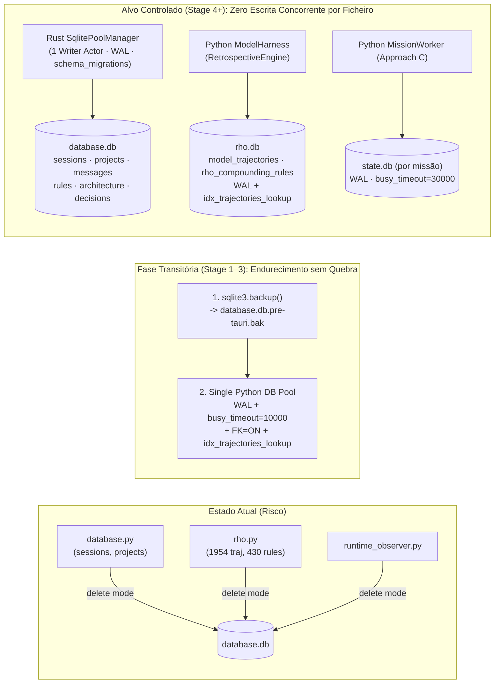

# JARVIS OS — Stage 0.1: Auditoria de Persistência, Propriedade de Dados & Transição SQLite

**Baseline verificada:** `main` @ `fb1aeeda10652ed1662e7e5c24ed381d7635f8d0`  
**Natureza:** Validação crítica e especificação de propriedade de persistência (Stage 0.1 — Sem alterações de código ou BD).  
**Documento principal associado:** [TAURI_MIGRATION_AUDIT.md](./TAURI_MIGRATION_AUDIT.md)

---

## 1. Descobertas Críticas na Auditoria de Disco e Código [Factos Verificados]

1. **`database.db` (`724.992 bytes`, `10` tabelas aplicacionais, NÃO 11):**
   - **Localização física real no disco:** `C:\Users\joaor\Desktop\JarvisOS\database.db` (na raiz do workspace).
   - **Verificação empírica de caminho:** `data/database.db` **NÃO existe**.
   - **Defeito crítico de resolução:** `database.py:24`, `persistence/db.py:7`, `backend/model_harness/rho.py:12` e `intelligence/runtime_observer.py:7` utilizam caminhos relativos literais não ancorados (`"database.db"`), gerando risco de criar uma nova base vazia se o diretório de trabalho mudar.
   - `PRAGMA journal_mode` = **`delete`** (WAL **NÃO** está ativo).
   - `PRAGMA foreign_keys` = **`0`** (Desativado, apesar de `projects` e `messages` definirem `FOREIGN KEY (session_id) REFERENCES sessions (id)`).
   - `PRAGMA busy_timeout` = **`5000`** (Default do driver; sem configuração explícita).
   - `PRAGMA user_version` = **`0`** (Sem versionamento de migrações); `PRAGMA schema_version` = `10` (contador interno DDL); `PRAGMA synchronous` = `2` (`FULL`); `PRAGMA integrity_check` = `ok`.
   - **Zero índices personalizados** (apenas `sqlite_autoindex_compounding_memory_1` e `sqlite_autoindex_architecture_memory_1`).
   - **Contagens verificadas por tabela:** `model_trajectories` (`1.954`), `rho_compounding_rules` (`430`), `sessions` (`317`), `projects` (`69`), `messages` (`0`), `compounding_memory` (`0`), `architecture_memory` (`0`), `engineering_decisions` (`0`), `strategic_goals` (`0`), `event_sourcing_log` (`0`).
   - **Gargalo ativo:** `backend/model_harness/rho.py:101-105` executa `SELECT COUNT(*) FROM model_trajectories WHERE task_profile = ? AND failure_reason = ? AND created_at > ?` em **full table scan** sobre `1.954` linhas.
   - **Múltiplos escritores/leitores descoordenados em `database.db`:** `database.py` (via `persistence/db.py:10-11` e `persistence/repositories/*`), `backend/model_harness/rho.py:38,75,98,122`, e `intelligence/runtime_observer.py:30` abrem conexões `sqlite3.connect` independentes sem locks inter-processo nem WAL.

2. **`state.db` de Missões (Arquitetura Já Robusta):**
   - `4` ficheiros ativos (`147.456 bytes` cada): `workspace/.jarvis/projects/aba/missions/m_61b3e665147d/state.db` e `workspace/.jarvis/projects/dina/missions/{m_2a228fb54faa,m_4448068632c3,m_f01dd44234cf}/state.db`.
   - Geridos por `agents/mission_persistence.py` (`SQLiteMissionPersistence`, `HybridMissionPersistence:176-195`) e `agents/mission_state.py` (`MissionStateManager:188-195`).
   - Configurados corretamente com `PRAGMA journal_mode=WAL`, `PRAGMA synchronous=NORMAL`, `PRAGMA busy_timeout=30000` (`timeout=30.0`), **`12` tabelas** e **`7` índices B-Tree** (`idx_wp_status`, `idx_wp_priority`, `idx_wp_parent`, `idx_wp_subdag`, `idx_deliv_wp`, `idx_ev_wp`, `idx_crit_owner`).
   - `HybridMissionPersistence` sincroniza `mission.json` (L1404-1407) e `checkpoints/checkpoint_XXXX.json` (L1447-1450) atomicamente (`.tmp.<uuid>` + `os.replace`) e `MissionMigrationEngine` (L1559-1587) cria `.backup_pre_migration_<ts>`.

3. **22 Localizações Não-Atómicas Confirmadas (8 Obsidian/Knowledge + 14 Adicionais):**
   - Stage 0 citou `8` pontos; a auditoria Stage 0.1 confirmou os `8` e identificou **+14 pontos vulneráveis** em segurança, inteligência, contexto de projeto e ferramentas de agentes.

---

## 2. Matriz Completa de Propriedade de Persistência

| Recurso / Domínio | Caminho no Disco | Formato / Esquema | Dono Atual / Escritores | Leitores Atuais | Transações / Concorrência / Atomicidade | Backup / Recuperação Atual | Dono Alvo & Etapa |
|---|---|---|---|---|---|---|---|
| **Core DB (Sessões, Projetos, Regras, Mensagens)** | `database.db` (8 tabelas core) | SQLite (`delete`, FK OFF, `user_version=0`) | `database.py`, `persistence/repositories/*` | `server.py`, `intelligence/runtime_observer.py:30`, UI | `conn.commit()`/`close()` manual; **sem locks inter-processo, sem WAL** | Nenhum | **Abordagem C:** Python coordenado (Stages 1–3) → **Rust `SqlitePoolManager`** (Stage 4+ após split/isolamento) |
| **Model Harness Telemetry (RHO)** | `database.db` (`model_trajectories`, `rho_compounding_rules`) | SQLite (sem índice em `model_trajectories`) | `backend/model_harness/rho.py:38,75,98,122` | `backend/model_harness/rho.py` | Conexões `sqlite3.connect` ad-hoc; colisão potencial com `database.py` | Nenhum | **Split recomendado em Stage 4:** migrar para `rho.db` próprio em `WAL` sob `ModelHarness` Python (evita RPC por inferência!) |
| **Estado de Missões** | `workspace/.jarvis/projects/<p>/missions/<m>/state.db` | SQLite (12 tabelas, 7 índices B-Tree) | `agents/mission_persistence.py`, `mission_state.py` | `mission_orchestrator.py`, `mission_recovery.py`, UI | **Robusto:** `WAL`, `NORMAL`, `busy_timeout=30000`, `with conn:` | `MissionMigrationEngine` `.backup_pre_migration_*` + checkpoints JSON | Preservar esquema WAL; Titularidade permanente do Python Worker por missão (Abordagem C); Rust Core apenas coordena ciclo de vida |
| **Manifestos de Missão** | `.../missions/<m>/mission.json`, `checkpoints/*.json` | JSON | `HybridMissionPersistence` (`mission_persistence.py:1404,1447`) | IDE UI, `list_missions()`, recovery | **Atómico:** `.tmp.<uuid>` + `os.replace` | Checkpoints sequenciais | Manter JSON mirror |
| **Catálogo & Modos Study** | `data/study/{documents,collections,quizzes,flashcards}.json` | JSON (`documents.json` = 3,15 MB, 22 docs) | `services/study_service.py` | `services/study_*`, `sandbox_service.py` | **Atómico exemplar:** `services/study_fs.py` (`mkstemp` + `fsync` + retry Win32 + `os.replace`) | `.corrupt.<ts>.<pid>.bak` (`backup_corrupt_file`) | `study_worker` escreve artefactos via `study_fs`; metadados leves espelhados no Rust (Stage 6) |
| **Media & Áudio Study** | `data/study/{audio,keyframes,videos_cache,documents}/*` | Binários (`.wav`, `.jpg`, `.mp4`, `.pdf`, `ast.json`) | `study_service.py`, `video_intelligence_service.py` | `study_ai_engine.py`, leitor PDF/Vídeo | **Atómico:** `atomic_write_bytes` (`study_fs.py:176-201`) | Preservar no disco | Escrito por `study_worker`; servido por **HTTP Loopback Rust `127.0.0.1:0`** (Stage 4/6) |
| **Exportação Study → Obsidian** | `obsidian_vault/10 - Lectures/**/*.md` | Markdown | `study_service.py:4676`, `video_intelligence_service.py:1979,2028` | Vault, linker | **NÃO-ATÓMICO:** `open("w")` / `write_text()` direto | Nenhum | Corrigir já na Stage 2/6 com `study_fs.atomic_write_text` + `NoteFileLock` |
| **Obsidian Vault Notes** | `obsidian_vault/**/*.md` (261 notas, 78 pastas) | Markdown | `obsidian_graph_engine.py`, `agents/obsidian_tools.py:206` | `KnowledgeWebSocketHandler`, busca lexical | **Híbrido:** `atomic_write_note` + `NoteFileLock` (`O_CREAT\|O_EXCL`), mas `obsidian_tools.py:206` e bridge (`:1340`) contornam o lock | `.history/` snapshots | **`knowledge_worker`** impondo `atomic_write_note` + `NoteFileLock` universalmente |
| **Obsidian Metadados & Propostas** | `data/obsidian/{graph_diagnostics,improvement_queue,vault_graph_snapshot}.json`, `proposals/*.json` | JSON | `obsidian_graph_engine.py` | UI Knowledge | Fila/diagnóstico atómicos; **propostas `:1246,1677` NÃO-ATÓMICAS** | `baseline_forensic_snapshot_read_only.json` | **`knowledge_worker`** com escrita atómica obrigatória nas propostas |
| **Lições de Falha IA** | `obsidian_vault/09 - JARVIS/Lessons/**/*.md` | Markdown | `intelligence/failure_memory.py:90` | Loop reparo | **NÃO-ATÓMICO:** `open("w")` direto | Nenhum | Corrigir com `atomic_write_text` |
| **Pedidos Permissão HITL** | `.jarvis/permissions/requests/*.json` (23 ficheiros) | JSON (TTL 300s) | `security/permission_gateway/gateway.py:89-100` | UI Modal, handlers | **Atómico:** `.tmp` + `flush` + `os.fsync` + `os.replace` + `RLock` | Persistido em disco + reidratação | **Rust `PermissionGate` (Stage 4)** mantendo compatibilidade de formato |
| **Audit Log Permissões** | `.jarvis/permissions/audit_log.jsonl` (25.182 B) | JSONL | `security/permission_gateway/gateway.py:180` | Auditoria / Sentinel | **APPEND SEM LOCK** (risco de intercalação multi-worker) | Append contínuo | **Rust `PermissionGate`** (escritor único com `BufWriter`+`sync` ou tabela SQLite) |
| **Sentinel Histórico & Quarentena** | `.jarvis/sentinel/response_history.json`, `baselines/*.json`, `quarantine/*.json`, `audit` | JSON / JSONL / `.quarantine` | `sentinel/response/engine.py:73`, `baseline.py:147`, `quarantine.py:120`, `audit.py:59` | Watchdog, UI Sentinel | **NÃO-ATÓMICOS** (todos os 4 usam `open("w")` / append sem rotação) | Quarentena guarda SHA-256 original | **Rust Sentinel Core (Stage 7)** após correção atómica imediata em Python |
| **IDE Caches, Contexto & Sessões Código** | `.jarvis/ts_dependency_cache.json` (2,35 MB), `workspace/.jarvis/projects/<p>/{project_context,symbols_index,architecture_snapshot}.json`, `coding_sessions/*.json` | JSON | `typescript_dependency/cache.py:162`, `project_context.py:256,1049`, `project_intelligence.py:274`, `project_intake.py:931`, `coding_session.py:1202,1596` | IDE, CodingAgent | **NÃO-ATÓMICOS** (`write_text` / `open("w")` diretos) | `coding_session` usa `git_blob`/backups para código (mas não no `_save` JSON nem no auto-repair L1202) | Corrigir com escrita atómica antes de mover gestão de projetos para Rust (Stage 4/6) |
| **Build Flight Recorder** | `workspace/.jarvis/project_builder/runs/*.json` (559 runs) | JSON | `project_builder.py:874-884` | Preflight, diagnósticos | **Atómico exemplar:** `.tmp` + `flush` + `os.fsync` + `os.replace` + `RLock` | 559 ficheiros imutáveis por run | Manter padrão |
| **Tool `write_file` & Memória Agentes** | Ficheiros workspace + `config/{session_memory,loop_metrics}.json` | Texto / JSON | `agents/tools.py:84` (`write_file_sync`), `agents/memory.py:50,101` | Ferramentas LLM, loops agentes | **NÃO-ATÓMICOS** | Nenhum em `tools.py:84` | Atualizar `write_file_sync` para staging atómico + swap |
| **Preferências UI** | Browser `localStorage` (7 módulos) + `sessionStorage` (`MissionPlanner.tsx:190,249`) | Key-Value DOM | Componentes React (`projects`, `study`, `chat`, `voice`, `usePersistedPaneSize`) | UI | Efemeridade WebView2 (`localStorage` preservado se `userDataFolder` fixo no Tauri) | Exportável se necessário | Manter em `WebView2` `appDataDir` estável |
| **Artefactos de Referência / Teste** | `sandbox_dir/test_rho_she.db` (24 KB), `docs/phase58_real_state.db` (147 KB) | SQLite | Scripts/Testes históricos | Referência | Não aplicável em runtime | N/A | **Nunca migrar**; excluir do bundle release |

---

## 3. Questão Arquitetural Crítica: O Rust Deve Ser o Escritor Exclusivo de `database.db`?

### Comparação das 3 Abordagens Exigidas

| Critério | Abordagem A: Rust Exclusivo (Stage 4 imediato; Python via RPC) | Abordagem B: Python Mantém Dono de `database.db` (Rust apenas orquestra shell/UI) | Abordagem C: Migração Gradual por Domínio + Separação de BD Cognitiva **[RECOMENDADA]** |
|---|---|---|---|
| **Complexidade** | **Muito Alta:** exige portar todas as queries de `database.py`, `rho.py` e `runtime_observer.py` e reescrever `rho.py` para fazer IPC a cada tentativa do LLM | **Baixa:** nenhuma reescrita imediata de SQL; Rust trata apenas ciclo de vida e transporte | **Moderada e Controlada:** endurece SQLite já em Python (WAL + índices), separa `rho_telemetry.db` de `database.db`, e migra tabelas core (`sessions`, `projects`, `messages`, `rules`) para Rust por domínio |
| **Desempenho & Latência** | **Degradação em loops LLM:** `rho.record_trajectory` e `get_compounding_rules` em `ModelHarness.execute()` passariam a pagar overhead RPC inter-processo | **Ótimo para Python**, mas impede o Rust Core de ler sessões/projetos diretamente sem pedir ao worker | **Ótimo:** `rho.db` (`WAL`) fica local ao `ModelHarness` (0 IPC no caminho quente LLM); Rust detém escrita exclusiva de `database.db` assim que `sessions`/`projects` migrarem na Stage 4 |
| **Integridade & Concorrência** | Alta após conclusão, mas **alto risco durante transição** se algum módulo Python ainda abrir `sqlite3.connect("database.db")` | **Frágil:** enquanto `database.py`, `rho.py` e `runtime_observer.py` abrirem conexões `delete`-mode sem lock único, o risco `SQLITE_BUSY` mantém-se | **Excelente desde o início:** `WAL` + `busy_timeout=10000` + 1 único escritor por ficheiro `.db` elimina escritores concorrentes descoordenados em todas as etapas |
| **Acoplamento** | Acopla `ModelHarness` (Python) à API interna do storage Rust | Mantém acoplamento atual de UI/sessões a um processo Python único | **Desacoplado:** fronteira clara (`database.db` Core/UI ↔ `rho.db` ModelHarness ↔ `state.db` Missions) |
| **Risco de Migração** | **Alto** (refatoração massiva e regressões silenciosas nos 3.380 testes pytest) | **Baixo**, mas não resolve o problema de fundo | **Baixo / Reversível:** cada passo tem backup `.bak` e rollback limpo |

### Decisão Final e Transição Segura (Abordagem C) [Recomendação]

**Não é prático nem benéfico forçar `backend/model_harness/rho.py` a falar com `database.db` por RPC ao Rust enquanto `ModelHarness` permanecer em Python.** Em contrapartida, **o Rust Core deve tornar-se o escritor único de `database.db` para sessões, projetos, regras e auditoria de sistema.**

Para impedir escritores concorrentes descoordenados durante a transição:



### Protocolo Obrigatório de Segurança SQLite
1. **Backup pré-migração:** usar `sqlite3.Connection.backup()` (cópia consistente a quente) antes de qualquer alteração DDL (`database.db.pre-tauri.bak`), seguido de `PRAGMA integrity_check;` e `PRAGMA foreign_key_check;`.
2. **Pragmas obrigatórios em TODA a conexão (Rust e Python):**
   - `PRAGMA journal_mode = WAL;`
   - `PRAGMA synchronous = NORMAL;`
   - `PRAGMA busy_timeout = 10000;`
   - `PRAGMA foreign_keys = ON;`
3. **Migração de Schema & Legado:** introduzir `PRAGMA user_version` + tabela `schema_migrations(version INTEGER PRIMARY KEY, name TEXT, applied_at TEXT)`. Na criação de `idx_trajectories_lookup ON model_trajectories(task_profile, failure_reason, created_at)`, preservar integralmente os `1.954` registos, `430` regras rho, `317` sessões e `69` projetos existentes.
4. **Crash Recovery & Rollback:** em caso de falha na Stage 4/6, fechar conexões, restaurar `database.db.pre-tauri.bak` (removendo `-wal`/`-shm` órfãos) e reverter flag para modo legado Python.


---

## 4. Especificação Forense de Migração RHO (`rho.db`)

### 4.1 Schema DDL Alvo para `data/rho.db`
O ficheiro da base de dados alvo residirá em `data/rho.db` (resolvido canonicamente a partir de `PROJECT_ROOT`):

```sql
PRAGMA journal_mode = WAL;
PRAGMA synchronous = NORMAL;
PRAGMA busy_timeout = 30000;
PRAGMA foreign_keys = ON;
PRAGMA user_version = 1;

CREATE TABLE IF NOT EXISTS model_trajectories (
    id INTEGER PRIMARY KEY AUTOINCREMENT,
    request_id TEXT NOT NULL,
    task_profile TEXT NOT NULL,
    fingerprint TEXT NOT NULL,
    status TEXT NOT NULL,
    attempts_count INTEGER NOT NULL,
    failure_reason TEXT,
    created_at REAL NOT NULL
);

CREATE INDEX IF NOT EXISTS idx_model_trajectories_pattern 
    ON model_trajectories(task_profile, failure_reason, created_at);
CREATE INDEX IF NOT EXISTS idx_model_trajectories_request_id 
    ON model_trajectories(request_id);
CREATE INDEX IF NOT EXISTS idx_model_trajectories_fingerprint 
    ON model_trajectories(fingerprint);

CREATE TABLE IF NOT EXISTS rho_compounding_rules (
    id INTEGER PRIMARY KEY AUTOINCREMENT,
    task_profile TEXT NOT NULL,
    rule_text TEXT NOT NULL,
    failure_trigger TEXT NOT NULL,
    occurrences INTEGER DEFAULT 1,
    created_at REAL NOT NULL
);

CREATE INDEX IF NOT EXISTS idx_rho_rules_task_profile_id 
    ON rho_compounding_rules(task_profile, id DESC);
CREATE INDEX IF NOT EXISTS idx_rho_rules_trigger 
    ON rho_compounding_rules(task_profile, failure_trigger);
```

### 4.2 Baseline Empírica de Dados Preservados (Checksums Criptográficos)
- **`model_trajectories`**:
  - Contagem exata: **1.954 registos**
  - Amplitude temporal: `1787082828.9751422` a `1794492170.473098`
  - Distribuição: `SUCCEEDED` (1.036), `PROVIDER_FAILED` (784), `VALIDATION_FAILED` (90), `STOPPED` (44)
  - **Checksum SHA256:** `8fdea79a9faa2b7d9463a32928554798dbae194ae575eaf70d057d8102b5f9f1`
- **`rho_compounding_rules`**:
  - Contagem exata: **430 registos** (24 templates de regras ativas)
  - **Checksum SHA256:** `fd51ff24006ec25d94d94f2dc987ecdc0c5a6a592f4b5416ec23d289ca38f30e`

### 4.3 Protocolo Atómico de Migração (Zero-Window via ATTACH DATABASE)
Para impedir escritas concorrentes e inconsistências, a migração corre dentro de um único bloco `BEGIN EXCLUSIVE` usando `ATTACH DATABASE`:
1. Snapshot físico pré-voo: `database.db.bak`.
2. Criação do esquema e índices em `data/rho.db`.
3. Cópia atómica `INSERT INTO target_rho.model_trajectories ... SELECT ... FROM main.model_trajectories`.
4. Verificação de contagens e SHA256 antes do commit.
5. Renomeação segura das tabelas de origem para `_legacy_*`.
6. Em caso de qualquer discrepância, `ROLLBACK` imediato e restauro do `.bak`.
