# JARVIS OS — Arquitetura Alvo em Tauri 2 + Rust

**Estado do documento:** Auditoria & Planeamento Arquitetural (Stage 0 — Sem alterações de código)  
**Baseline de código analisada:** `main` @ `fb1aeeda10652ed1662e7e5c24ed381d7635f8d0`  
**Documento principal associado:** [TAURI_MIGRATION_AUDIT.md](./TAURI_MIGRATION_AUDIT.md)

---

## Legenda Epistémica

Para manter rigor técnico absoluto entre factos verificados no repositório atual e desenho proposto:

- **[Confirmado no código]**: Comportamento, ficheiro, contagem ou símbolo observado diretamente na baseline `fb1aeeda10652ed1662e7e5c24ed381d7635f8d0`.
- **[Descrito em docs]**: Afirmação presente em documentação pré-existente do repositório (por vezes divergente do runtime real).
- **[Hipótese]**: Estimativa técnica ou comportamento esperado sujeito a validação empírica na Fase 1+.
- **[Recomendação]**: Decisão arquitetural proposta para a arquitetura Tauri 2 + Rust.

---

## 1. Visão Geral da Arquitetura Alvo (5 Camadas)

### Diagnóstico de Partida [Confirmado no código]
Embora documentos existentes (`ARCHITECTURE.md`, `README.md`, `docs/PROJECT_MAP.md`) e o enunciado histórico refiram *Electron + Python/FastAPI + WebSockets*, a inspeção ao código confirma que **não existe FastAPI, Uvicorn nem Starlette em execução**:
1. **Electron (`main.js`, `preload.js`)**: gere o ciclo de vida, liberta portas `8000`/`8001` via `netstat` + `taskkill /F /T`, arranca `venv/Scripts/python.exe -u server.py`, faz ponte `stdin`/`stdout` NDJSON (`window.jarvisIPC`) e injeta `X-Jarvis-Token` via `session.webRequest.onBeforeSendHeaders`.
2. **Backend Python 3.14 (`server.py`, `backend/`)**: expõe WebSocket (`websockets==16.0` em `127.0.0.1:8001`), servidor HTTP stdlib (`http.server.SimpleHTTPRequestHandler` / `GracefulThreadingTCPServer` em `127.0.0.1:8000` + `::1:8000` em `backend/services/sandbox_service.py`) e gateway stdio (`backend/transport_gateway.py` com `StdioTransportGateway`).
3. **Frontend (`frontend/src/`)**: React 19 + TypeScript 6 + Vite 8 + Monaco 0.56 + `pdfjs-dist` 6.3, acoplado a `WebSocketContext.tsx` (4.302 linhas) e chamadas diretas a `:8000` / `window.jarvisIPC`.

### Arquitetura Alvo Proposta [Recomendação Validada na Etapa 0.1]
Consolidar o shell Electron, a coordenação de processos, a política de permissão/caminho (Path Jail) e a entrega de media e preview num **núcleo nativo Rust em Tauri 2**, mantendo **Python como runtime especializado de IA e domínio** (*Bounded Sidecar Workers*).

A validação empírica da Etapa 0.1 refinou a estratégia original:
1. **Ollama & Model Harness (Abordagem Híbrida C):** Em vez de reescrever ingenuamente o cliente Ollama em Rust (o que destruiria 12 subsistemas de auto-cura cognitiva, semáforo GPU e injeção de regras SHE/RHO no `ModelHarness`), o runtime de inferência **permanece em Python no `ModelExecutionService`**. O Rust Core atua como despachante de streams para a UI via Tauri Events.
2. **Persistência de Dados (Abordagem C - Partição de Domínio & Ancoragem Canónica):**
   - Caminho Físico Canónico: Ancorado em `PROJECT_ROOT / "database.db"` (a auditoria empírica confirmou que `data/database.db` não existe). Qualquer relocação futura para `data/` exige migração formal com backup `.bak`, integridade e rollback.
   - Na Etapa 1: Hardening imediato do SQLite em Python (`WAL`, `busy_timeout=10000`, `synchronous=NORMAL`, `foreign_keys=ON` e índice composto em `model_trajectories`).
   - Realidade do SQLite WAL: Permite leituras concorrentes simultâneas com 1 escritor ativo, mas o SQLite mantém **estritamente um único escritor simultâneo**. `SQLITE_BUSY` pode ocorrer se uma escrita exceder o `busy_timeout` (10.000 ms) ou durante DDL/checkpointing.
   - Preparação de `rho.db` na Etapa 1: O script de migração é testado exclusivamente em sandbox (cópias temporárias); os dados de produção de RHO permanecem intactos em `database.db`.
   - Na Etapa 4: Rust Core assume a titularidade de escritor único de `database.db`. `state.db` (missões) e `rho.db` (telemetria do ModelHarness) permanecem permanentemente sob titularidade do Python. Zero escrita concorrente descoordenada entre Rust e Python.
3. **Serviço de Media e Preview via HTTP Loopback (`127.0.0.1:0`) & Autenticação Híbrida:** Devido a limitações comprovadas do WebView2 do Windows com esquemas customizados (`tauri-media://`) no suporte a HTTP Range 206 (scrubbing de vídeo MP4) e isolamento de Web Workers do `pdfjs-dist` (`pdf.worker.min.mjs`), a entrega de media e o preview do IDE são unificados num **servidor HTTP assíncrono interno em Rust (`warp`/`axum`) vinculado estritamente a `127.0.0.1:0` (porta efémera)**. A autenticação adota um modelo híbrido: Bearer token para chamadas IPC/fetch, tickets efémeros temporários (60s) via query param para tags `<video>` e ``, validação de Host header (`127.0.0.1:{bound_port}`) contra DNS Rebinding, Path Jail canónico, e preview de projetos web em `<iframe sandbox="allow-scripts allow-forms">` (estritamente sem `allow-same-origin`).
4. **RPC Reverso para Human-In-The-Loop (HITL):** Introdução de framing de RPC reverso (`reverse_request`) permitindo que ferramentas Python executadas por agentes peçam aprovação ao `PermissionGate` do Rust sem bloquear ou entrar em deadlock no fluxo de stdio.
5. **Preservação Integral de `agents/` e `backend/agents/` na Stage 1:** Ambas as diretorias permanecem 100% intocadas durante a transição de transporte. A auditoria profunda comprovou um acoplamento cruzado massivo (367 imports diretos de `agents.*` dentro de `backend/agents` e 81 imports de `backend.agents.*` em `agents/long_horizon_missions`). A consolidação é formalmente adiada para a Stage 7 / pós-migração, utilizando shims dinâmicos de aliasing (`sys.modules`) e codemods AST.

```mermaid
flowchart TB
    subgraph L1["Camada 1 — Apresentação & UI (WebView2 / Edge Runtime)"]
        UI["React 19 + TypeScript 6 + Vite 8\nMonaco 0.56 · PDF.js 6.3 · Framer Motion 12"]
        TA["JarvisTransport (Frontend Transport Adapter)\n(types.ts · tauriTransport.ts · wsFallbackTransport.ts)"]
        UI --> TA
    end

    subgraph L2["Camada 2 — Fronteira IPC & Protocolos Tauri 2"]
        CMD["Tauri Commands (@tauri-apps/api invoke)\nRequest/Response Tipado"]
        EVT["Tauri Events (app.emit)\nBroadcasts de Estado & Domínio"]
        CHN["Tauri Channel&lt;T&gt;\nStreaming Tokens, Logs & Progresso"]
        LOOP["Rust Loopback HTTP Server (127.0.0.1:0)\nRange 206 Streaming (PDF.js, MP4 Video, IDE Preview)"]
        ACL["Capabilities &amp; CSP (src-tauri/capabilities/*.json)"]
        TA --> CMD
        TA <-- EVT
        TA <-- CHN
        UI -- "PDF.js / video / iframe preview" --> LOOP
        ACL -. "Autoriza / Restringe" .-> CMD
        ACL -. "Autoriza / Restringe" .-> LOOP
    end

    subgraph L3["Camada 3 — Núcleo Nativo Tauri 2 + Rust Core (src-tauri/src)"]
        APP["App Lifecycle &amp; State Registry (Arc&lt;AppState&gt;)"]
        BUS["Internal Event Bus (tokio::sync::mpsc / broadcast)"]
        PERM["Permission &amp; Policy Engine (PermissionGate)\n(.jarvis/permissions + Path Jail)"]
        PROC["Process &amp; Sandbox Supervisor\n(Win32 Job Objects + KILL_ON_JOB_CLOSE)"]
        STOR["SQLite Pool Manager (database.db Single Writer - Stage 4)\n&amp; Atomic File Store"]
        HTTPD["Internal Loopback HTTP Daemon (127.0.0.1:0)\nPath Jail + Range 206 Engine"]
        SENT["Sentinel Core Scheduler &amp; Win32 Collectors\n(Modo Shadow + Contenção HITL)"]
        WPOOL["Python Worker Pool Supervisor\n(tokio::process + NDJSON Framing + Reverse RPC)"]

        CMD --> APP
        APP --> BUS
        APP --> PERM
        APP --> PROC
        APP --> STOR
        APP --> HTTPD
        APP --> SENT
        APP --> WPOOL
        HTTPD --> STOR
        BUS --> EVT
        BUS --> CHN
    end

    subgraph L4["Camada 4 — Python Specialized Sidecar Workers (NDJSON sobre stdio)"]
        PW1["Worker AI &amp; Model Harness\nModelExecutionService · ModelHarness (12 Subsistemas)\nSHE/RHO Dynamic Rules · Ollama HTTP Client"]
        PW2["Worker Document &amp; Study\nPyMuPDF · pdfplumber · python-docx\nWinRT OCR · ffmpeg/ffprobe · faster_whisper"]
        PW3["Worker Knowledge, Agents &amp; Code\nObsidianGraphEngine · Missions Engine\nagents/ + backend/agents/ (Preservados integralmente)"]
        WPOOL <== "stdin/stdout NDJSON\n+ Reverse RPC HITL + Cancel" ==> PW1
        WPOOL <== "stdin/stdout NDJSON\n+ Reverse RPC HITL + Cancel" ==> PW2
        WPOOL <== "stdin/stdout NDJSON\n+ Reverse RPC HITL + Cancel" ==> PW3
    end

    subgraph L5["Camada 5 — Infraestrutura Local &amp; Serviços Externos"]
        OLLAMA[("Ollama Daemon\n127.0.0.1:11434\n/api/chat · /api/generate · /api/tags")]
        SQLITE[("SQLite WAL Databases\ndatabase.db (Rust single writer) · state.db (Python) · rho.db")]
        FS[("Filesystem Local\ndata/study · obsidian_vault · .jarvis/permissions")]
        GEMINI(("Gemini API / Gemini Live WSS\n(Opt-in Cloud)"))
        WIN32["Windows OS APIs\nWin32 Job Objects · WinRT OCR · Word COM"]

        PW1 --> OLLAMA
        STOR --> SQLITE
        PW2 --> FS
        PW3 --> SQLITE
        PW3 --> FS
        PROC --> WIN32
        PW1 -. "Failover opt-in" .-> GEMINI
    end
```

---

## 2. Responsabilidades por Camada [Recomendação]

| Camada | Componentes | O que detém | O que NÃO deve fazer |
|---|---|---|---|
| **1. Apresentação (React/TS)** | Views (`StudyReaderView`, `StudyVideoReaderView`, `WorkspaceViewer`, etc.), Monaco, `pdfjs-dist` | Renderização UI, estado efémero de interface, editor local, seleção de texto/página, invocação do `TransportAdapter` | Acesso direto a filesystem fora de diálogos nativos, gestão de tokens HTTP secretos, spawning de processos ou lógica de segurança |
| **2. Fronteira IPC Tauri 2** | `invoke`, `emit`, `Channel<T>`, Loopback HTTP `127.0.0.1:0`, `capabilities/*.json` | Serialização fortemente tipada, validação de capabilities por janela, streaming binário HTTP `206` sem servidor `:8000` público | Multiplexação ad-hoc não tipada sem contrato ou bypass de permissões |
| **3. Núcleo Nativo Rust** | `src-tauri/src/*` | Lifecycle de arranque/shutdown determinístico, Win32 Job Objects, SQLite WAL + migrações, políticas de permissão (`.jarvis/permissions/`), Despachante de streams LLM para UI (fanout zero-copy), orquestração incremental, supervisão de workers Python | Reimplementar parsers PDF complexos (`PyMuPDF`), geração DOCX/COM, OCR WinRT via PowerShell ad-hoc sem ganho, ou bindings ML em C++ quando Python já resolve em worker isolado |
| **4. Python Specialized Workers** | Subprocessos Python geridos por `WPOOL` sobre `stdin`/`stdout` NDJSON | Extração/composição PDF (`PyMuPDF`, `pdfplumber`), DOCX/Office (`python-docx`, Word COM, LibreOffice), vídeo/áudio (`ffmpeg`, `ffprobe`, `faster_whisper`, `youtube-transcript-api`), AST/RAG (`tree-sitter`, `chromadb`), áudio real-time (`sounddevice`, `webrtcvad`, `gemini_live`), ponte transitória para CrewAI Swarm | Abrir sockets HTTP/WS sem autenticação ou fora de loopback; escrever diretamente na tabela partilhada de `database.db` enquanto o Rust Core também escreve (deve delegar persistência transacional ao Rust Core via RPC ou usar ficheiros atómicos por artefacto); matar processos globais |
| **5. Serviços Locais & Externos** | Ollama (`:11434`), SQLite, FS, Gemini Live, Windows API | Inferência local, armazenamento durável, serviços do SO | Expor portas para `0.0.0.0` (eliminar comportamento atual de `sandbox.py` na porta `8080`) |

---

## 3. Estrutura de Diretórios Proposta (`src-tauri/` + `workers/` + `frontend/`) [Recomendação]

```text
JarvisOS/
├── frontend/
│   └── src/
│       ├── services/
│       │   └── transport/
│       │       ├── types.ts              # Contrato unificado (Commands, Events, Streams)
│       │       ├── tauriTransport.ts     # Implementação nativa (@tauri-apps/api)
│       │       ├── wsFallbackTransport.ts# Ponte temporária na fase de coexistência
│       │       └── platformCapabilities.ts # openPath, selectFolder, mediaUrl resolver
│       └── hooks/
│           └── useJarvisTransport.ts     # Substitui acoplamento direto de 4.302L em WebSocketContext
├── src-tauri/
│   ├── Cargo.toml
│   ├── tauri.conf.json
│   ├── build.rs
│   ├── capabilities/
│   │   ├── main-window.json              # ACL estrita da janela principal
│   │   └── preview-sandbox.json          # ACL mínima (sem FS/shell) para previews de projetos
│   └── src/
│       ├── main.rs                       # Entrypoint Windows (WINAPI subsystem)
│       ├── lib.rs                        # Builder Tauri, setup, plugins, shutdown hook
│       ├── error.rs                      # JarvisError tipado -> serializável para Frontend
│       ├── app/
│       │   ├── mod.rs
│       │   ├── state.rs                  # AppState (Arc<RwLock/Mutex>, pools, cancel tokens)
│       │   └── lifecycle.rs              # Startup sequencial, health checks, shutdown ordenado
│       ├── commands/                     # Tauri #[tauri::command] handlers por domínio
│       │   ├── mod.rs
│       │   ├── chat.rs
│       │   ├── system.rs
│       │   ├── projects.rs
│       │   ├── permissions.rs
│       │   ├── study.rs
│       │   ├── knowledge.rs
│       │   ├── sentinel.rs
│       │   ├── missions.rs
│       │   └── voice.rs
│       ├── protocol/
│       │   ├── mod.rs
│       │   └── loopback.rs               # Loopback HTTP 127.0.0.1:0 com Range 206 & canonical path jail
│       ├── bus/
│       │   └── mod.rs                    # EventRouter (tokio::sync::broadcast + Tauri emit/Channel)
│       ├── storage/
│       │   ├── mod.rs
│       │   ├── sqlite.rs                 # Pool WAL, busy_timeout=10s, PRAGMA foreign_keys=ON
│       │   ├── migrations.rs             # schema_version + SQL migrations para database.db
│       │   └── atomic_fs.rs              # Tempfile + sync_all + persist/replace atómico
│       ├── permissions/
│       │   ├── mod.rs
│       │   ├── gateway.rs                # Compatível com .jarvis/permissions/requests/*.json (TTL 300s)
│       │   ├── policy.rs                 # Fail-closed PermissionPolicyEngine + CrossProject guard
│       │   └── path_jail.rs              # Canonicalização, anti-symlink escape, nomes reservados Win32
│       ├── process/
│       │   ├── mod.rs
│       │   ├── job_object.rs             # Win32 JOB_OBJECT_LIMIT_KILL_ON_JOB_CLOSE nativo
│       │   ├── command_guard.rs          # Equivalente Rust ao COMMAND_BLOCKLIST + SafetyClassifier
│       │   └── preview_server.rs         # Preview loopback 127.0.0.1:ephemeral (substitui 0.0.0.0:8080)
│       ├── ollama/
│       │   ├── mod.rs
│       │   ├── client.rs                 # reqwest HTTP/NDJSON streaming + auto-spawn + num_ctx fallback
│       │   ├── gpu_semaphore.rs          # Semáforo FIFO (1 slot GPU por defeito, paridade _OLLAMA_GPU_SEM)
│       │   └── router.rs                 # Leitura de rho rules / routing SHE+RHO + Gemini failover opt-in
│       ├── orchestrator/
│       │   ├── mod.rs
│       │   ├── session_manager.rs        # Isolamento por conversation_id + CancellationToken
│       │   └── mission_coordinator.rs    # Leases de ficheiros, checkpoint, eventos de progresso
│       ├── sentinel/
│       │   ├── mod.rs
│       │   ├── scheduler.rs              # Ciclo configurável (default 60s), shadow_mode=true
│       │   └── collectors_win.rs         # Processos/rede/persistência/hosts (ou delegação auditada)
│       └── workers/
│           ├── mod.rs
│           ├── supervisor.rs             # Spawn venv python / sidecar binário, ping, backoff restart
│           ├── rpc_client.rs             # NDJSON multiplexer (id, method, params, cancel, progress)
│           └── pools.rs                  # StudyWorker, KnowledgeWorker, LegacySwarmWorker
├── workers/                              # Evolução modular dos domínios Python especializados
│   ├── common/
│   │   ├── stdio_rpc.py                  # Evolução tipada do backend/transport_gateway.py
│   │   └── health.py
│   ├── study_worker.py                   # Entrypoint PyMuPDF/pdfplumber/OCR/ffmpeg/Whisper/YouTube
│   ├── knowledge_worker.py               # Entrypoint ObsidianGraphEngine + tree-sitter + chromadb
│   └── voice_swarm_worker.py             # Entrypoint sounddevice/webrtcvad/gemini_live + Swarm transição
└── docs/
    └── architecture/                     # Documentação Stage 0
```

---

## 4. Contratos e Traits Principais em Rust [Recomendação]

Os contratos abaixo formalizam as fronteiras internas para impedir a replicação do monolito atual (`WebSocketContext.tsx` de 4.302 linhas no frontend e `server.py` + `websockets` dispatcher no backend):

```rust
use async_trait::async_trait;
use serde::{Deserialize, Serialize};
use serde_json::Value;
use tokio::sync::mpsc;
use tokio_util::sync::CancellationToken;

/// Envelope unificado para comunicação Rust <-> Python Worker (evolução do StdioTransportGateway)
#[derive(Debug, Clone, Serialize, Deserialize)]
pub struct WorkerRequest {
    pub request_id: String,
    pub correlation_id: Option<String>,
    pub domain: WorkerDomain,      // Study | Knowledge | Voice | LegacyMission
    pub operation: String,         // ex.: "study.ingest_document", "knowledge.scan_vault"
    pub payload: Value,
    pub timeout_ms: u64,
}

#[derive(Debug, Clone, Serialize, Deserialize)]
#[serde(tag = "kind", rename_all = "snake_case")]
pub enum WorkerFrame {
    Progress {
        request_id: String,
        percent: f32,
        stage: String,
        detail: Value,
    },
    Chunk {
        request_id: String,
        stream: String,
        data: Value,
    },
    Result {
        request_id: String,
        ok: bool,
        payload: Option<Value>,
        error: Option<WorkerError>,
    },
    Event {
        topic: String,
        payload: Value,
    },
}

#[async_trait]
pub trait WorkerRpcClient: Send + Sync {
    async fn call(
        &self,
        req: WorkerRequest,
        progress_tx: Option<mpsc::Sender<WorkerFrame>>,
        cancel: CancellationToken,
    ) -> Result<Value, JarvisError>;

    async fn health(&self) -> WorkerHealth;
    async fn shutdown(&self) -> Result<(), JarvisError>;
}

// Nota: A inferência e as 12 heurísticas SHE/RHO permanecem no ModelExecutionService em Python;
// Este trait em Rust atua como despachante de streams e failover para o frontend.
#[async_trait]
pub trait OllamaGateway: Send + Sync {
    async fn chat_stream(
        &self,
        req: OllamaChatRequest,
        token_tx: mpsc::Sender<StreamToken>,
        cancel: CancellationToken,
    ) -> Result<InferenceMetrics, JarvisError>;

    async fn list_models(&self) -> Result<Vec<OllamaModelInfo>, JarvisError>;
    async fn warmup(&self, model: &str) -> Result<(), JarvisError>;
}

#[async_trait]
pub trait PermissionGate: Send + Sync {
    async fn evaluate_operation(&self, op: SensitiveOperation) -> Result<GateDecision, JarvisError>;
    async fn resolve_request(&self, request_id: &str, approved: bool, scope: ApprovalScope)
        -> Result<(), JarvisError>;
}
```

### Vantagem estrutural destes contratos
1. **Substitui `pendingStudyRequestsRef` / `pendingNoteRequestsRef` com timeouts ad-hoc (`4s`–`900s`) no React**: Tauri `invoke()` devolve uma `Promise` nativa correlacionada pelo runtime; operações longas recebem `job_id` imediato + streaming via `Channel<ProgressEvent>` + comando explícito `cancel_operation(job_id)` ligado a `CancellationToken`.
2. **Elimina a assimetria de validação**: no código atual [Confirmado no código], `backend/transport_gateway.py` não chama `validate_client_message()`, ao passo que `backend/websocket/gateway.py` chama. Com comandos Rust deserializados por `serde` + schema JSON único para o RPC Python, **toda a entrada passa por validação estrita**.

---

## 5. Seleção e Justificação Técnica de Crates Rust [Recomendação]

| Crate | Versão Alvo | Papel no Sistema | Justificação Técnica | Alternativa Rejeitada & Motivo |
|---|---|---|---|---|
| `tauri` | `2.x` | Runtime desktop, IPC, Custom Protocols, Windowing, ACL Capabilities | Substitui Electron 31.7.7 (~150–300 MB RAM base de Chromium duplicado) pelo WebView2 nativo no Windows; modelo declarativo de permissões | `wry`+`tao` puros: perderia CLI, bundler, capabilities, plugins oficiais e `Channel<T>` |
| `tauri-plugin-dialog` | `2.x` | Diálogos nativos (`selectFolder`, file picker) | Substitui `ipcMain.handle('select-folder')` de `main.js` e elimina acesso a `File.path` legado | `<input webkitdirectory>`: não dá caminhos nativos necessários para workspace e ingestão local |
| `tauri-plugin-opener` | `2.x` | Abertura segura de URLs/ficheiros no SO | Substitui `ipcMain.handle('open-path')` mantendo validação prévia no comando Rust | `std::process::Command("explorer")`: propenso a shell injection e inconsistente |
| `tokio` | `1.x` (`full`) | Runtime async para processos, HTTP, IPC, semáforos, canais e timers | Unifica concorrência sem GIL; `tokio::sync::Semaphore` replica `_OLLAMA_GPU_SEM`; `CancellationToken` cancela inferência e subprocessos instantaneamente | `async-std`: ecossistema menor e menor adoção com `tauri` 2 / `reqwest` |
| `serde` / `serde_json` | `1.x` | Serialização IPC e NDJSON Worker RPC | Gera contratos tipados; facilita geração opcional de tipos TS (`ts-rs` ou `specta`) evitando dessincronização como os 2 campos de vídeo sem tipo em `StudyVideoReaderView.tsx` | Parsing manual `Value`: propenso a erros silenciosos como os 33 handlers sem ramo em `missions.py` |
| `rusqlite` | `0.32+` (`bundled`) | Acesso SQLite síncrono determinístico via `spawn_blocking` / ator dedicado | Compila SQLite embutido uniforme no Windows, expõe controlo fino de `PRAGMA journal_mode=WAL`, `busy_timeout`, `foreign_keys=ON`, e transações imediatas sem overhead async para DB local | `sqlx`: excelente para Postgres/remote SQL, mas em SQLite local `rusqlite` dá melhor controlo de pragmas, locks Windows e menor tempo de compilação; **Nota**: se equipa preferir queries verificadas em compile-time, `sqlx` é alternativa aceitável, mas `rusqlite` com ator dedicado (`tokio::sync::mpsc`) evita contenção de escrita em Windows |
| `reqwest` | `0.12+` (`stream`, `json`, `rustls-tls`) | Cliente HTTP para Ollama (`127.0.0.1:11434`) e eventuais chamadas Gemini REST | Permite streaming NDJSON **verdadeiro token-a-token** (no código atual `ollama.py` consome o stream internamente antes de retornar `ProviderResult`), timeout por chunk e abort por `CancellationToken` | `ureq`: síncrono, pior integração com streaming cancelável no `tokio` |
| `windows-sys` | `0.59+` | Win32 Job Objects, process tree inspection, Named Pipes opcionais | Garante paridade exata com `_WindowsJob` (`JOB_OBJECT_LIMIT_KILL_ON_JOB_CLOSE`) de `project_builder.py` no próprio Rust Supervisor, evitando processos órfãos mesmo em crash do Tauri | `sysinfo` sozinho: lê métricas e PIDs, mas não cria nem associa Win32 Job Objects |
| `sysinfo` | `0.33+` | Telemetria de CPU/RAM/processos para Sentinel e Health | Multi-plataforma, seguro em memória, substitui parsing frágil de `netstat` / `tasklist` | Invocar `powershell`/`wmic` periodicamente: latência alta e ruído de processos |
| `http-range-header` | `0.4+` | Parsing RFC-compliant de `Range: bytes=...` no Servidor Loopback HTTP (127.0.0.1:0) | Substitui o parser manual em `sandbox_service.py` para `PDF.js` e `<video>` seeking `206 Partial Content` | Parsing manual por regex/split: suscetível a edge cases de multi-range/suffix-range |
| `tracing` + `tracing-subscriber` | `0.1+` | Logging estruturado JSON/console com rotação | Observabilidade unificada entre Rust Core e logs capturados dos workers Python | `println!`/`eprintln!`: sem correlação de `request_id` nem níveis filtráveis |

---

## 6. Estratégia para Processos Python Especializados (Lifecycle & Framing) [Recomendação]

### 6.1 Do Monolito `server.py` para Workers Isolados por Domínio
Atualmente [Confirmado no código], `main.js` lança um único `server.py` com **toda** a árvore Python carregada em memória (`websockets`, `StudyService`, `ObsidianGraphEngine`, `chromadb`, `ModelHarness`, `Sentinel`, `AgentOrchestrator`), onde qualquer bloqueio CPU/GIL afeta todo o sistema.

Na arquitetura alvo [Recomendação]:
1. **Substituir o launcher `main.js` (que mata qualquer PID em `:8000`/`:8001` via `taskkill /F /T`)** por um `SidecarSupervisor` em Rust que:
   - Nunca usa portas TCP fixas como mecanismo de exclusão mútua global; se um worker falar via `stdin`/`stdout` (pipes anónimos herdados + Win32 Job Object), **desaparece a colisão de portas `8000` e `8001`**.
   - Associa cada subprocesso Python a um Win32 Job Object com `JOB_OBJECT_LIMIT_KILL_ON_JOB_CLOSE`: se o binário Tauri terminar ou crashar, o Windows termina atomicamente toda a árvore filha (`python.exe`, `ffmpeg.exe`, `node.exe`).
2. **Dividir o runtime Python em perfis de worker sob demanda (lazy-spawn ou pool limitado)**:
   - **`study_worker`**: carrega `PyMuPDF`, `pdfplumber`, `python-docx`, `pillow`, ponte WinRT OCR / Word COM, `ffmpeg`/`ffprobe`, `youtube-transcript-api`, e `faster_whisper` opcional.
   - **`knowledge_worker`**: carrega `ObsidianGraphEngine`, `tree-sitter`, invocação Node `scripts/ts_ast_parser.js`, e `chromadb` (`all-MiniLM-L6-v2` apenas para índice semântico de código — confirmado no código).
   - **`voice_swarm_worker` (transição)**: isola `sounddevice`, `webrtcvad`, `gemini_live.py` e `CrewAI` Swarm enquanto não forem reavaliados ou migrados.
3. **Empacotamento Dev vs Release**:
   - Em *Dev*: executa `venv/Scripts/python.exe -u workers/<name>.py` com `PYTHONUTF8=1` e `PYTHONPATH=<repo>`.
   - Em *Release*: suporta sidecars empacotados via `tauri.conf.json` (`externalBin`) ou distribuição embebida do Python (`python-build-standalone` / PyInstaller onedir assinado) sem exigir `venv` manual ao utilizador final.

### 6.2 Protocolo de Framing `StdioTransportGateway` v2 [Recomendação]
O código atual já possui `backend/transport_gateway.py` (`StdioTransportGateway`, NDJSON sobre `stdin`/`stdout`) [Confirmado no código], mas com falhas conhecidas: falta de `request_id` universal, ausência de `validate_client_message()`, e mistura de logs com JSON no `stdout` se alguma biblioteca escrever em `sys.stdout`.

Regras do novo protocolo Rust <-> Python:
- **`stdout` exclusivo para NDJSON** (`workers/common/stdio_rpc.py` redireciona `sys.stdout` de bibliotecas de terceiros para `sys.stderr` no bootstrap do worker!).
- **`stderr` capturado pelo Rust Supervisor** e encaminhado para `tracing` com prefixo `[worker:<name>]`.
- **Heartbeat & Backpressure**: `ping`/`pong` a cada 5s; limite máximo de linha NDJSON (ex.: 32 MiB, paridade com `max_size=33554432` de `server.py:674`); payloads binários grandes (PDFs, frames MP4, thumbnails) **nunca viajam em base64 no NDJSON** — o worker grava atomicamente no diretório gerido de artefactos (`data/study/<doc_id>/...`) e devolve apenas o caminho relativo + metadados para o servidor loopback HTTP servir.

---

## 7. Entrega de Media, PDF, Vídeo e Preview IDE (Eliminação de `:8000` e `:8080`) [Recomendação Validada 0.1]

### Estado Atual [Confirmado no código]
- `backend/services/sandbox_service.py` serve `/api/study/document/{id}/file` (PDF Range 206), `/video` (MP4 Range 206), `/media/{frame_id}`, `/data/study/*` na porta `8000` protegido por `X-Jarvis-Token` (injetado por `main.js` `webRequest`) ou `?token=` em `<video src>` / ``, além de CORS restrito a `:5173`/`:8000`.
- `sandbox.py` arranca `TCPServer(("", 8080), ...)` em **`0.0.0.0:8080`** para preview web do IDE (`WorkspaceViewer.tsx` `<iframe src={previewUrl}>`).

### Solução Alvo em Tauri 2: Loopback HTTP Server (`127.0.0.1:0`)
A validação da Etapa 0.1 rejeitou a dependência exclusiva do protocolo customizado `jarvis-media://` no Windows WebView2 devido a problemas conhecidos no seeking/scrubbing de MP4 de longa duração e isolamento de origem para o `pdf.worker.min.mjs`.

1. **Servidor HTTP Loopback Interno em Rust (`127.0.0.1:0`, porta efémera):**
   - Vincula-se estritamente a `127.0.0.1:0` (nunca `0.0.0.0`) com um **token efémero de sessão gerado no arranque**.
   - Endpoints mapeados em Rust puro (`axum` / `warp` + `http-range-header`):
     - `GET http://127.0.0.1:<port>/study/{doc_id}/file` → leitura assíncrona com `Range: bytes=start-end` → resposta `206 Partial Content` + `Accept-Ranges: bytes` + `Content-Type: application/pdf` para `pdfjs-dist`.
     - `GET http://127.0.0.1:<port>/study/{doc_id}/video` → streaming `206 Partial Content` MP4 nativo sem congelar o seeking.
     - `GET http://127.0.0.1:<port>/study/{doc_id}/media/{frame_id}` → PNG/JPG com validação estrita de Path Jail dentro de `data/study/`.
   - **Vantagem de segurança:** Elimina portas hardcoded (`:8000`, `:8080`), elimina exposição `0.0.0.0`, resolve conflitos de Web Workers do PDF.js e valida canonicalização rigorosa contra Path Traversal.
2. **Preview de Projetos do Utilizador (substituindo `sandbox.py` `:8080`):**
   - Servido igualmente via loopback `127.0.0.1:0` confinado ao diretório `workspace/<project_id>`, com headers `X-Content-Type-Options: nosniff` e encerrado atomicamente ao fechar o projeto ou o app.

---

## 8. Fluxo de Comunicação Ponta-a-Ponta (Diagrama de Sequência) [Recomendação]

```mermaid
sequenceDiagram
    autonumber
    actor User as Utilizador
    participant UI as React UI + JarvisTransport
    participant Core as Rust Core (Tauri 2)
    participant Loopback as Rust Loopback HTTP (127.0.0.1:0)
    participant DB as SQLite WAL / FS Atómico
    participant Worker as Python Worker (AI / Study)
    participant Ollama as Ollama (127.0.0.1:11434)

    rect rgb(30, 41, 59)
    note right of User: Fluxo A — Ingestão de Documento com Progresso e Leitura PDF
    User->>UI: Seleciona ficheiro via plugin dialog
    UI->>Core: invoke("study_ingest_document", { path, channel })
    Core->>Core: Valida Path Jail + cria job_id + CancellationToken
    Core->>Worker: NDJSON {"request_id", "method": "study.ingest", "path"}
    loop Frames de Progresso
        Worker-->>Core: NDJSON {"method": "task.progress", "progress": 0.45, "stage": "ocr"}
        Core-->>UI: Channel<T>.send(ProgressUpdate)
    end
    Worker->>DB: Escreve artefactos atómicos (tmp + fsync + replace) em data/study/
    Worker-->>Core: NDJSON {"id", "result": {"doc_meta": ...}}
    Core->>DB: Regista metadados transacionais em SQLite WAL
    Core-->>UI: Retorna DocumentSummary + app.emit("study_library_updated")
    UI->>Loopback: GET http://127.0.0.1:<port>/study/{id}/file (Range: bytes=0-65535)
    Loopback-->>UI: HTTP 206 Partial Content (streaming direto do disco)
    end

    rect rgb(39, 39, 42)
    note right of User: Fluxo B — Inferência LLM (Hybrid Approach C) & Reverse RPC HITL
    User->>UI: Envia pergunta no Assistente / Síntese Qwen
    UI->>Core: invoke("chat_ask_stream", { conversation_id, prompt, channel })
    Core->>Worker: NDJSON {"id", "method": "ai.chat_stream", ...}
    Worker->>DB: Carrega regras SHE/RHO e adquire GPU Semaphore (ModelHarness)
    Worker->>Ollama: POST /api/chat (stream: true)
    loop Tokens em Tempo Real (Micro-batch 16ms)
        Ollama-->>Worker: JSON chunk { message: { content }, done: false }
        Worker-->>Core: NDJSON {"method": "stream.chunk", "delta": ...}
        Core-->>UI: Channel<T>.send(TokenDelta)
    end
    alt Ferramenta Python precisa de aprovação humana (HITL)
        Worker-->>Core: NDJSON {"type": "reverse_request", "method": "permission.request_approval"}
        Core-->>UI: Emit UI Modal (Aprovar / Recusar)
        User->>UI: Clica Aprovar
        UI->>Core: invoke("resolve_permission", { approved: true })
        Core-->>Worker: NDJSON {"type": "reverse_response", "result": {"granted": true}}
    end
    end
```



---

## 9. Estratégia de Persistência Unificada (Abordagem C — Etapa 0.1) [Recomendação]

### Problemas Observados no Código Atual [Confirmado no código]
1. **`database.db` (724.992 B, 10 tabelas de aplicação)**: partilhada sem coordenação, **sem `WAL` mode, sem `busy_timeout`, sem `PRAGMA foreign_keys = ON`, com `user_version=0` e 0 índices secundários**, provocando full table scans em `rho.py`.
2. **Missões (`state.db`, 147.456 B)**: 4 instâncias verificadas, todas operando corretamente em `WAL` com 12 tabelas e 7 índices B-Tree.
3. **Escritas não-atómicas**: A validação na Etapa 0.1 expandiu a lista de 8 para **22 localizações confirmadas de escrita não-atómica** em serviços Python (detalhadas em `TAURI_SECURITY_MODEL.md` e `TAURI_PERSISTENCE_OWNERSHIP.md`).
4. **Violação de transporte em `services/obsidian_graph_engine.py:1495`**: Chamada HTTP direta a `http://127.0.0.1:11434/api/tags` que faz falhar `tests/test_model_transport_architecture.py`.

### Desenho Alvo (Abordagem C) [Recomendação]
- **Etapa 1 (Hardening em Python):** Ativar `WAL`, `busy_timeout=10000`, `foreign_keys=ON` e criar índice composto em `model_trajectories`. Isolar telemetria pesada de `ModelHarness` em `rho.db`.
- **Etapa 4 (Partição Definitiva):** Rust Core assume papel de **escritor único de `database.db`** (sessões, projetos, mensagens, permissões). O Python mantém permanentemente a titularidade exclusiva de **`state.db`** e **`rho.db`**, evitando saturação do canal IPC.
- **Migrações & Backups:** Preservar 100% dos dados reais com `PRAGMA user_version` e snapshot pré-migração (`database.db.pre-tauri.bak`).
- **Centralização Atómica:** Padronizar todas as 22 escritas em disco através do helper `atomic_write` (`mkstemp` + `fsync` + `os.replace` em Python; `tempfile::NamedTempFile::persist` em Rust).


